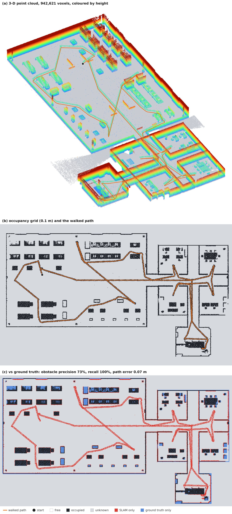

# G1 SLAM 지도

G1이 캠퍼스를 한 바퀴 걸으면서 머리의 LiDAR와 IMU만으로 만든 지도입니다(FAST-LIO2, 지도 묶음 `campus`).

| 항목 | 결과 |
|---|---|
| 걸은 거리와 시간 | 326.0 m, 시뮬레이션 15.6분, 스캔 9374개 |
| 지도 크기 | 792x482 칸 (0.1 m), 3D 점 942,621개 |
| 수평 보정, 벽 정렬 | 2.534도, 16.7도 |
| 위치 오차 (평균 제곱근 / 최대 / 출발점 복귀) | 0.069 m / 0.177 m / 0.057 m |
| 장애물 정밀도 / 재현율 (허용 오차 0.2 m) | 73% / 100% |
| 실제 빈 공간 중 빈 공간 / 장애물 / 미확인 | 0% / 9% / 91% |

## 다음 단계

주석 도구(`tools/map_annotator.html`)로 방과 통로를 그린 뒤 `scripts/build_map_package.py`로 지도 묶음을 완성하면 여기에 주석 그림이 추가됩니다.

## 폴더

- `01_slam_map`: 점유 지도(ROS map_server 형식), 3D 점군, 경로, 설정
- `02_check_vs_truth`: 시뮬레이터 정답과의 비교(시뮬레이션에서만)
- `03_annotation`: 사람 주석과 자동 토폴로지(주석을 그린 뒤)
