# G1 VLN 결과

실행 11개 (성공 7/11, 콘솔 실행은 정답이 없어 성공 여부를 매기지 않음). 지도의 숫자는 VLN이 결정을 내린 지점과 순서, 사진은 그 결정에서 VLM이 본 영상입니다.

실험 행렬의 집계표는 `experiments/<이름>/results.md`에 있습니다.

| # | 지시 | 시뮬레이터 | 지도 | VLM | 결과 | 결정 | 대상까지 | 판정 | 시뮬레이션 시간 |
|---:|---|---|---|---|---|---:|---:|---|---:|
| 1 | Find the blue electrical panel on the east wall of the assem | Isaac Sim | 시뮬레이터 지도 | qwen3-vl:8b-instruct | 실패 | 3 | 1.51 m | no (오답) | 80 s |
| 2 | 창고 서쪽 끝에 있는 빨간 소화기함까지 가서 소화기가 들어 있는지 확인해. | Isaac Sim | 시뮬레이터 지도 | qwen3-vl:8b-instruct | 실패 | 7 | 1.45 m | no (오답) | 86 s |
| 3 | 조립 라인으로 가서 컨베이어 위에 상자가 놓여 있는지 확인해. | Isaac Sim | 시뮬레이터 지도 | qwen3-vl:8b-instruct | 성공 | 5 | 0.77 m | yes (정답) | 99 s |
| 4 | 충전 구역의 3번 충전 도크에 AMR 카트가 주차되어 있는지 확인해. | Isaac Sim | 시뮬레이터 지도 | qwen3-vl:8b-instruct | 성공 | 30 | 0.00 m | no (정답) | 373 s |
| 5 | Go to the charging area and check whether the free charging  | Isaac Sim | 시뮬레이터 지도 | qwen3-vl:8b-instruct | 실패 | 8 | 0.53 m | no (오답) | 125 s |
| 6 | Go to the meeting room and check whether anyone is sitting a | Isaac Sim | 시뮬레이터 지도 | qwen3-vl:8b-instruct | 실패 | 5 | 5.95 m | no (정답) | 55 s |
| 7 | 사무동 관제실에 가서 서버 랙의 상태 표시등이 켜져 있는지 확인해. | Isaac Sim | 시뮬레이터 지도 | qwen3-vl:8b-instruct | 성공 | 13 | 1.38 m | yes (정답) | 236 s |
| 8 | 부품 품질을 확인하는 곳에 가서 두 번째 비전 검사 장비 위에 부품이 올려져 있는지 봐줘. | Isaac Sim | 시뮬레이터 지도 | qwen3-vl:8b-instruct | 성공 | 11 | 0.90 m | yes (정답) | 168 s |
| 9 | {"task_id": "agent-007", "steps": [{"goal": "cross the wareh | Isaac Sim | 시뮬레이터 지도 | qwen3-vl:8b-instruct | 성공 | 33 | 1.46 m | yes (정답) | 482 s |
| 10 | 조립 라인으로 가서 컨베이어 위에 상자가 놓여 있는지 확인해. | Isaac Sim | 시뮬레이터 지도 | qwen3-vl:8b-instruct | 성공 | 5 | 0.84 m | yes (정답) | 98 s |
| 11 | 조립 라인으로 가서 컨베이어 위에 상자가 놓여 있는지 확인해. | Isaac Sim | 시뮬레이터 지도 | qwen3-vl:8b-instruct | 성공 | 5 | 1.34 m | yes (정답) | 105 s |

## 실행별

### 1. Find the blue electrical panel on the east wall of the assembly area and check whether it carries a high-voltage warning.

Isaac Sim, 시뮬레이터 지도, qwen3-vl:8b-instruct. 결과: 실패, 판정 no (오답), 대상까지 1.51 m. 답변: The blue electrical panel does not have a high-voltage warning visible on it.

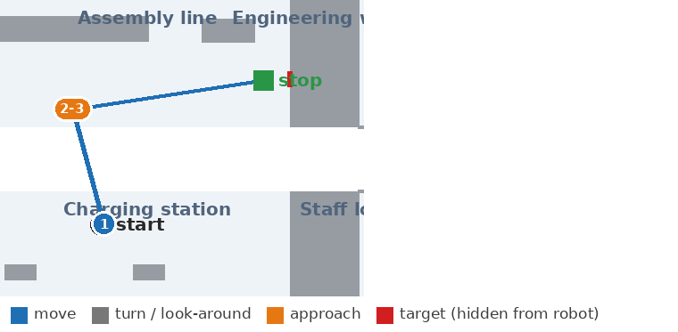
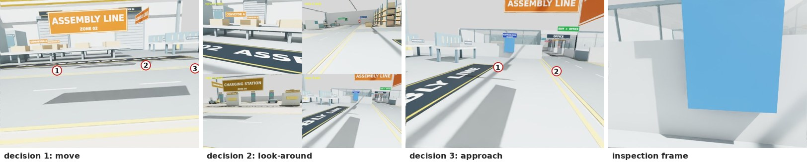

### 2. 창고 서쪽 끝에 있는 빨간 소화기함까지 가서 소화기가 들어 있는지 확인해.

Isaac Sim, 시뮬레이터 지도, qwen3-vl:8b-instruct. 결과: 실패, 판정 no (오답), 대상까지 1.45 m. 답변: 소화기함은 보이지만, 그 안에 소화기가 없습니다.

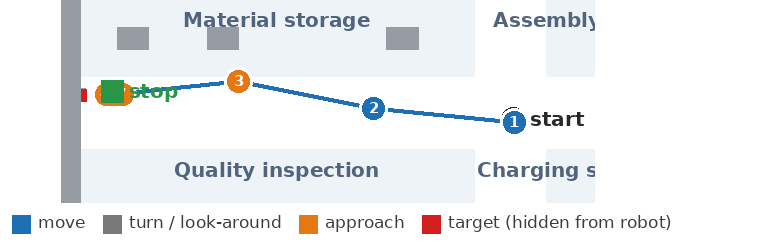
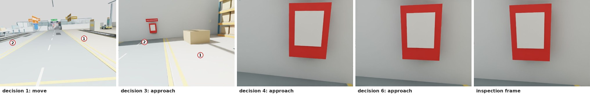

### 3. 조립 라인으로 가서 컨베이어 위에 상자가 놓여 있는지 확인해.

Isaac Sim, 시뮬레이터 지도, qwen3-vl:8b-instruct. 결과: 성공, 판정 yes (정답), 대상까지 0.77 m. 답변: 컨베이어 위에 상자가 있습니다.

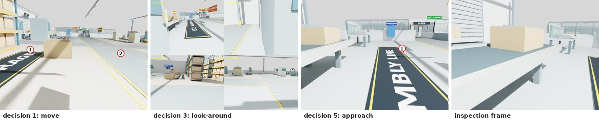

### 4. 충전 구역의 3번 충전 도크에 AMR 카트가 주차되어 있는지 확인해.

Isaac Sim, 시뮬레이터 지도, qwen3-vl:8b-instruct. 결과: 성공, 판정 no (정답), 대상까지 0.00 m. 답변: 충전 구역의 3번 충전 도크에는 AMR 카트가 주차되어 있지 않습니다.

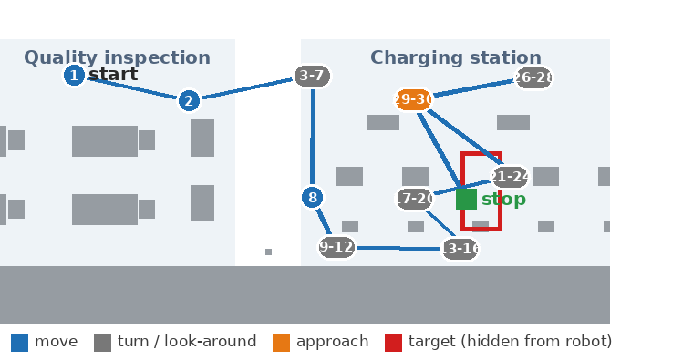
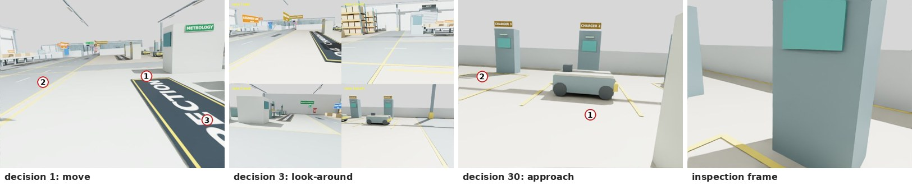

### 5. Go to the charging area and check whether the free charging dock is empty.

Isaac Sim, 시뮬레이터 지도, qwen3-vl:8b-instruct. 결과: 실패, 판정 no (오답), 대상까지 0.53 m. 답변: No cart is parked at the free charging dock.

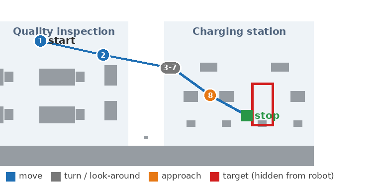
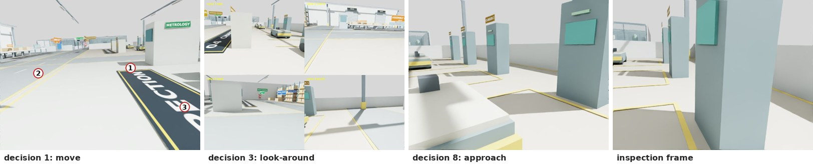

### 6. Go to the meeting room and check whether anyone is sitting at the meeting table.

Isaac Sim, 시뮬레이터 지도, qwen3-vl:8b-instruct. 결과: 실패, 판정 no (정답), 대상까지 5.95 m. 답변: No one is sitting at the meeting table; the chairs are empty.

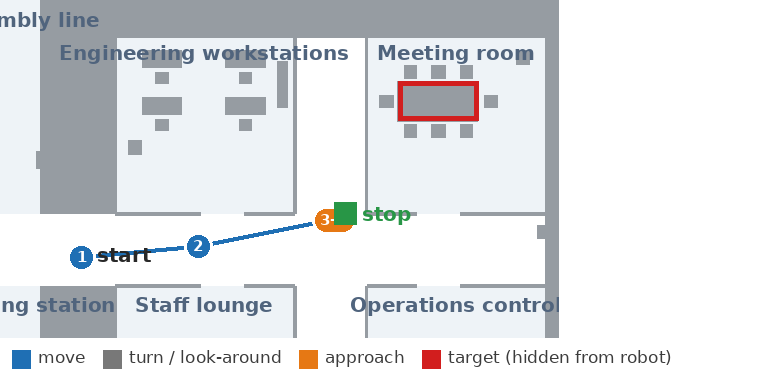
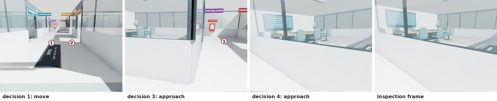

### 7. 사무동 관제실에 가서 서버 랙의 상태 표시등이 켜져 있는지 확인해.

Isaac Sim, 시뮬레이터 지도, qwen3-vl:8b-instruct. 결과: 성공, 판정 yes (정답), 대상까지 1.38 m. 답변: 서버 랙의 상태 표시등이 켜져 있습니다.

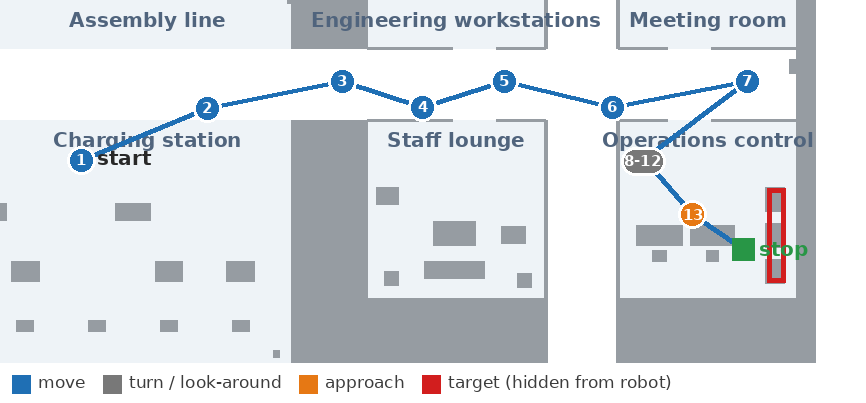
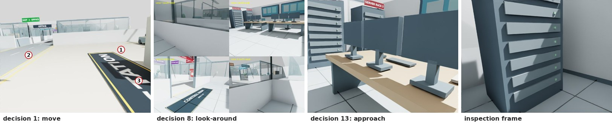

### 8. 부품 품질을 확인하는 곳에 가서 두 번째 비전 검사 장비 위에 부품이 올려져 있는지 봐줘.

Isaac Sim, 시뮬레이터 지도, qwen3-vl:8b-instruct. 결과: 성공, 판정 yes (정답), 대상까지 0.90 m. 답변: 두 번째 비전 검사 장비 위에 부품이 올려져 있습니다.

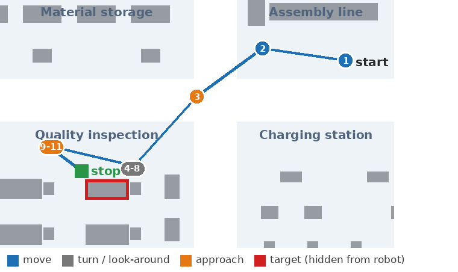
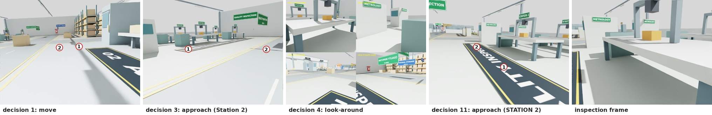

### 9. {"task_id": "agent-007", "steps": [{"goal": "cross the warehouse-office bridge into the office", "region": null}, {"goal": "enter the staff lounge", "region": "office_lounge"}, {"goal": "find the vending machine and stand in front of it", "region": "office_lounge"}], "subgoals": ["warehouse_office_bridge", "vending_machine"], "target": "vending machine", "question": "자판기가 넘어지지 않고 정상적으로 서 있는지 확인해.", "language": "ko"}

Isaac Sim, 시뮬레이터 지도, qwen3-vl:8b-instruct. 결과: 성공, 판정 yes (정답), 대상까지 1.46 m. 답변: 자판기는 정상적으로 서 있으며 넘어져 있지 않습니다.

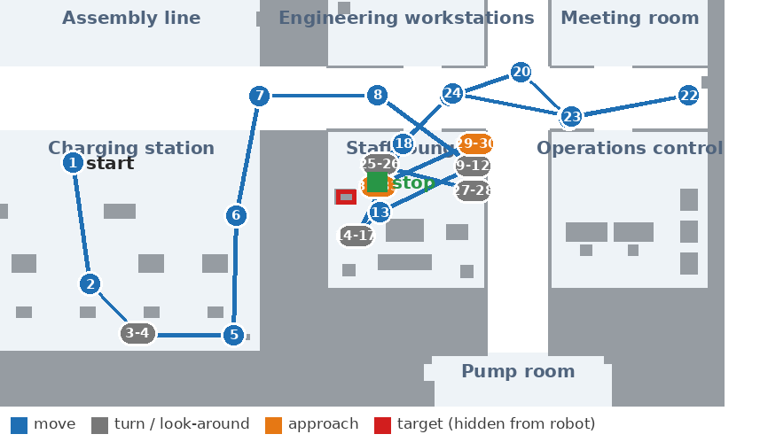
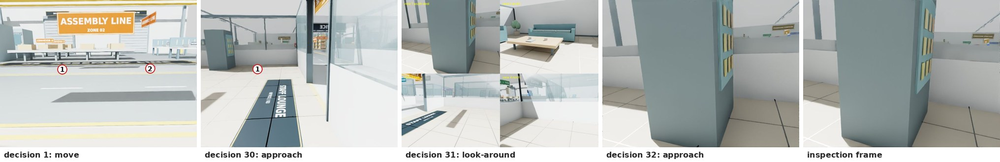

### 10. 조립 라인으로 가서 컨베이어 위에 상자가 놓여 있는지 확인해.

Isaac Sim, 시뮬레이터 지도, qwen3-vl:8b-instruct. 결과: 성공, 판정 yes (정답), 대상까지 0.84 m. 답변: 컨베이어 위에 상자가 있습니다.

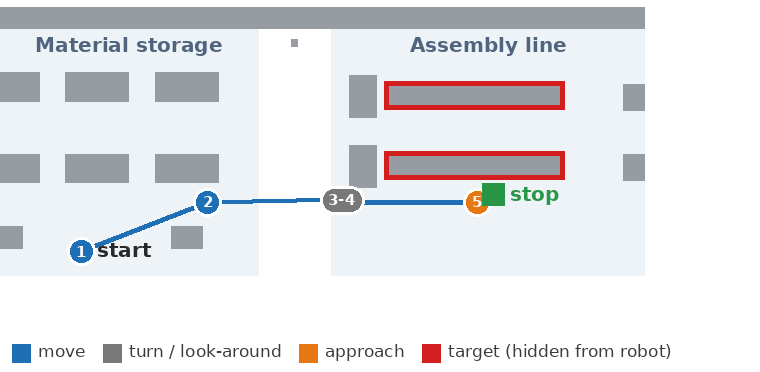

### 11. 조립 라인으로 가서 컨베이어 위에 상자가 놓여 있는지 확인해.

Isaac Sim, 시뮬레이터 지도, qwen3-vl:8b-instruct. 결과: 성공, 판정 yes (정답), 대상까지 1.34 m. 답변: 컨베이어 위에는 상자가 두 개 있습니다.

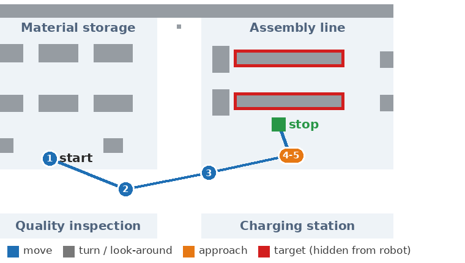
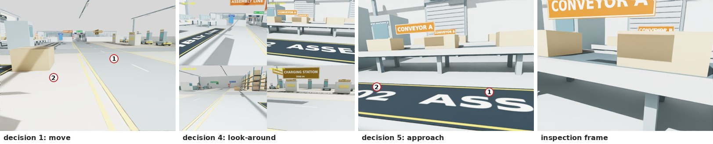
