# G1 Factory VLN

외부 에이전트가 "공장 어디에 가서 무엇을 확인해"라고 지시하면, Unitree G1이 목표 좌표를 받지 않은 채 SLAM 지도와 머리 카메라 영상만으로 길을 고릅니다. 대상을 영상에서 찾아 그 앞까지 걸어간 뒤 확인 결과를 돌려줍니다. 시뮬레이션은 Isaac Sim 5.1에서 했습니다.

| 항목 | 내용 |
|---|---|
| VLN | MapGPT 방식의 지도 기반 계층형 VLN, 고수준 정책은 Qwen3-VL-8B-Instruct |
| 로봇 | Unitree G1, 공식 사전학습 보행 정책 (다리 12관절) |
| 센서 | RealSense D435i를 모사한 RGB-D 640x480 30 Hz, Livox MID-360을 모사한 LiDAR 10 Hz |
| 환경 | 창고, 사무동, 펌프실로 이루어진 공장 캠퍼스 |
| 지도 | 점유 지도 위에 시멘틱 레이어와 토폴로지 그래프를 얹은 계층형 지도. 점유 지도는 로봇이 LiDAR-관성 SLAM(FAST-LIO2)으로 직접 만들 수 있음 |

## 어떻게 동작하나

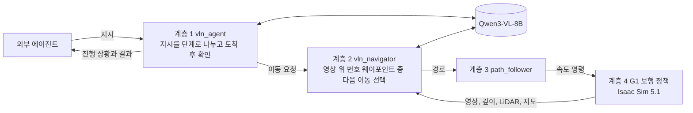

VLN은 결정할 때마다 SLAM 지도에서 직선으로 갈 수 있는 지점을 골라 카메라 영상 위에 번호로 그립니다. VLM은 이 영상과 함께 지시, 단계 계획, 목표 구역의 방향, 토폴로지 경로, 후보마다 줄어드는 보행 거리, 최근 결정을 받습니다. 그리고 몇 번 지점으로 갈지, 회전할지, 보이는 물체에 다가갈지, 멈출지를 고릅니다. 규칙은 VLM 대신 행동을 정하지 않습니다. 지도에 없는 이동, 목표 구역에서 멀어지는 이동, 명판이 맞지 않는 접근만 거절하고 다시 묻습니다.

토폴로지 경로는 장소 그래프에서 출입구를 거쳐 가는 최단 경로입니다. 예를 들어 자재 창고에서 펌프실로 갈 때는 프롬프트에 아래 줄이 들어갑니다.

```text
Topological route to Pump room: Material storage -> Warehouse main aisle -> Warehouse-office bridge -> Office corridor -> Pump room passage -> Pump room; next opening (into Warehouse main aisle): ahead (+5 deg, east), 3.2 m
```

목표 구역에 처음 들어서면 네 방향을 둘러보고 계속 갈 방향을 고릅니다. 머리 카메라 시야가 69도라서, 옆에 있는 대상을 지나치지 않게 하려는 것입니다.

로봇이 아는 것은 주행 가능 공간(점유 지도), 사람이 단 구역 9개와 기준점 7개, 장소 그래프뿐입니다. 검사대, 충전 도크, 소화기함 같은 세부 대상의 위치는 평가에만 쓰고 로봇에게는 주지 않습니다. 실제 로봇처럼 할 수도 있습니다. 점유 지도는 로봇이 미리 한 바퀴 걸으며 SLAM으로 만들고, 구역과 기준점은 사람이 그 지도 위에 그리고, 장소 그래프는 둘에서 자동으로 만듭니다(아래 결과). 이때 시뮬레이터 정답은 평가에만 씁니다.

MapGPT 방식을 고른 이유는 기존 지도와 영상, 지시를 함께 쓰면서도 따로 학습할 필요가 없고, 결정마다 근거가 남기 때문입니다. NaVILA 같은 end-to-end 생성형 모델은 공장 환경과 장애물 처리에 약합니다. 지도에서 목표 좌표를 찾아 A*로 가는 방식은 목표를 미리 알고 가는 것이라 VLN으로 보기 어렵습니다.

## 결과

### 지시문을 따라가는 모습

Isaac Sim 5.1과 Qwen3-VL-8B로 실행한 결과입니다. 지도의 숫자는 VLN이 결정을 내린 지점과 순서입니다. 파란색은 이동, 회색은 회전이나 둘러보기, 주황색은 접근입니다. 빨간 상자는 평가에 쓰는 실제 대상 위치이며 로봇에게는 주지 않았습니다. 사진은 각 결정에서 VLM이 실제로 본 영상이고, 흰 원 안의 숫자가 VLM이 고를 수 있는 웨이포인트입니다.

#### 1. "조립 라인으로 가서 컨베이어 위에 상자가 놓여 있는지 확인해."

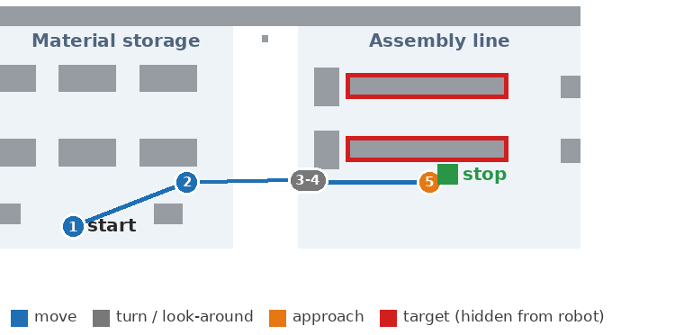

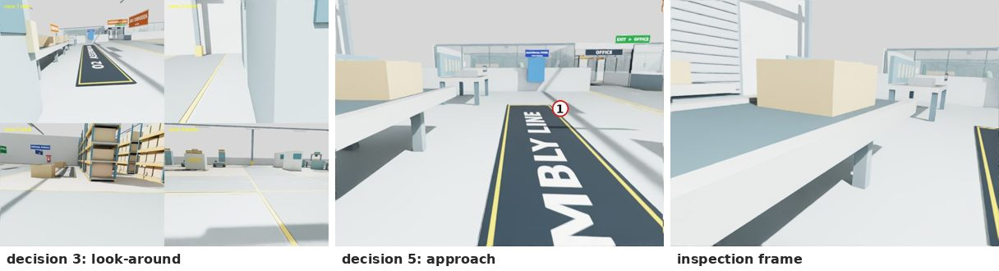

| 시뮬레이션 시간 | VLN 결정 | VLM이 남긴 이유 (요약) |
|---:|---|---|
| 6 s | 1 이동 | 자재 창고에 있으니 조립 라인 쪽으로 가까워지는 1번 |
| 29 s | 2 이동 | 2번이 조립 라인 입구이고 남은 보행 거리를 가장 많이 줄임 |
| 66 s | 3 둘러보기 | 조립 라인에 도착해 네 방향을 찍고, ASSEMBLY LINE 표지가 보이는 동쪽을 고름 |
| 72 s | 4 이동 | 컨베이어를 찾으려고 앞으로 감 |
| 96 s | 5 접근 | 컨베이어가 보여 영상에서 위치를 지정하고, 깊이로 3D 위치를 구해 그 앞에 섬 |
| 99 s | 확인 | "a beige box on the conveyor", 판정 yes (정답), 대상까지 0.77 m |

#### 2. "부품 품질을 확인하는 곳에 가서 두 번째 비전 검사 장비 위에 부품이 올려져 있는지 봐줘."

지시에 장소 이름이 없습니다. VLN은 "부품 품질을 확인하는 곳"을 품질 검사 구역으로, "두 번째"를 명판 STATION 2로 해석했습니다. 다른 검사대(STATION 1, 3, 4)의 명판을 읽어 걸러낸 뒤 STATION 2를 찾아 다가갔습니다.

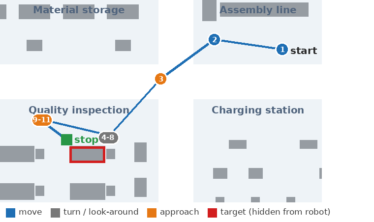

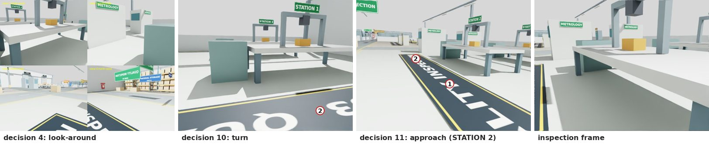

| 시뮬레이션 시간 | VLN 결정 | VLM이 남긴 이유 (요약) |
|---:|---|---|
| 7-55 s | 1-3 이동, 접근 | 조립 라인에서 품질 검사 구역으로 이동 |
| 95 s | 4 둘러보기 | STATION 4, METROLOGY, 품질 검사 구역 표지가 보임 |
| 102-119 s | 5-8 회전, 이동 | STATION 2 명판을 아직 못 읽어서 돌아보며 찾음 |
| 152 s | 10 회전 | 보이는 것은 STATION 1과 STATION 3이라 STATION 2를 찾아 돎 |
| 158 s | 11 접근 | 확대 영상에서 명판을 다시 읽어 STATION 2와 일치해 다가감 |
| 168 s | 확인 | "a yellow block on the second vision inspection station", 판정 yes (정답), 0.90 m |

#### 3. "사무동 관제실에 가서 서버 랙의 상태 표시등이 켜져 있는지 확인해."

창고 충전 구역에서 출발해 연결 통로와 사무동 복도를 지나 관제실에 들어간 뒤, 서버 랙을 찾아 확인했습니다.

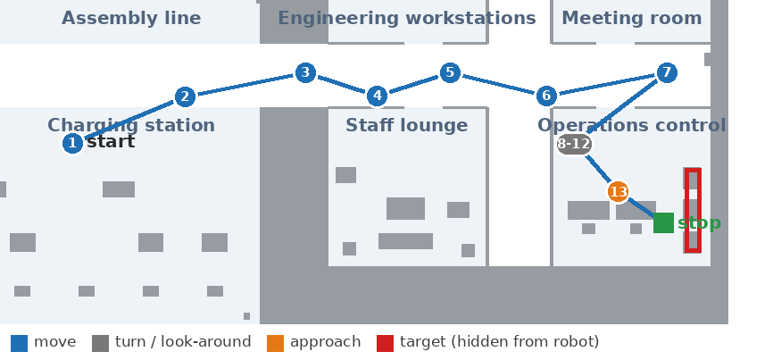

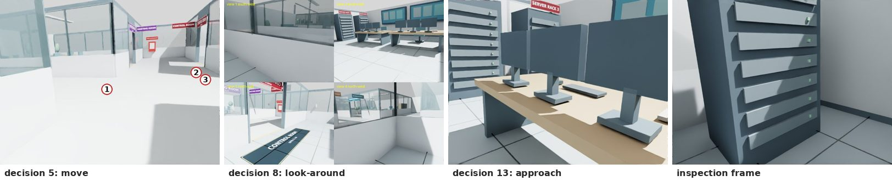

| 시뮬레이션 시간 | VLN 결정 | VLM이 남긴 이유 (요약) |
|---:|---|---|
| 7-133 s | 1-7 이동 | 충전 구역에서 연결 통로를 지나 사무동 복도로 감, "CONTROL ROOM 표지가 오른쪽 앞에 보인다" |
| 174 s | 8 둘러보기 | 두 번째 방향에 명판이 붙은 서버 랙이 보임 |
| 186-203 s | 9-12 회전, 이동 | 서버 랙 쪽으로 위치를 맞춤 |
| 220 s | 13 접근 | SERVER RACK 3 명판이 보여 다가감 |
| 236 s | 확인 | 서버 랙 여러 층에 녹색 상태 표시등이 켜져 있음, 판정 yes (정답), 1.38 m |

### 공장 캠퍼스와 펌프실

| 공간 | 구성 |
|---|---|
| 창고 (48 x 32 m) | 자재 창고, 조립 라인, 품질 검사, 충전 구역. 구역 표지판과 설비 명판(STATION 1-4, CHARGER 1-5, CONVEYOR A/B 등) |
| 사무동 (24 x 24 m) | 업무실, 회의실, 휴게실, 관제실. 방 문패와 서버 랙 명판 |
| 펌프실 (12 x 10 m) | 사무동 복도 남쪽 통로로 연결. 원심 펌프 P-101과 전동기 M-101(커플링 가드), 흡입 배관과 토출 배관, 밸브와 압력계, 압력 탱크 TK-101, 전동기 제어반 MCC-1, 부품 선반 |

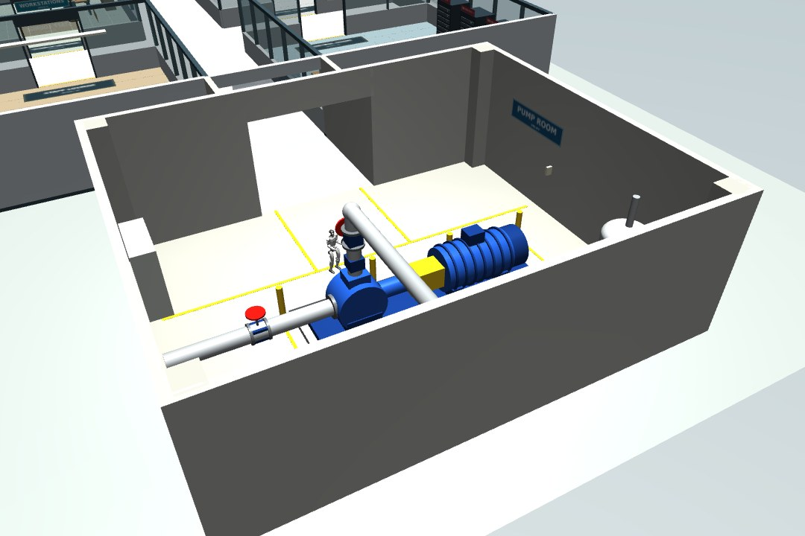

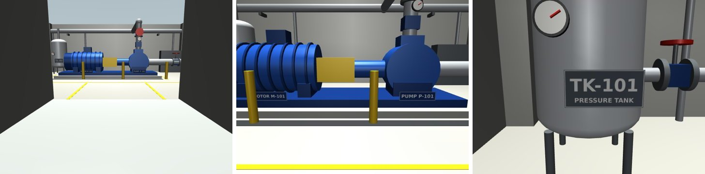

### 로봇이 직접 만든 SLAM 지도

G1이 캠퍼스를 한 바퀴 걸으면서 머리의 LiDAR(MID-360)와 IMU만으로 만든 지도입니다. 자세 추정은 FAST-LIO2(LiDAR-관성 SLAM)가 하고, 그 점군에서 바닥 평면을 맞춰 3D 점군과 0.1 m 점유 지도를 만듭니다. 이 결과는 Mac 개발 환경(MuJoCo, 같은 장면과 센서 모델)에서 만들었고, Isaac Sim에서도 같은 명령으로 만듭니다.

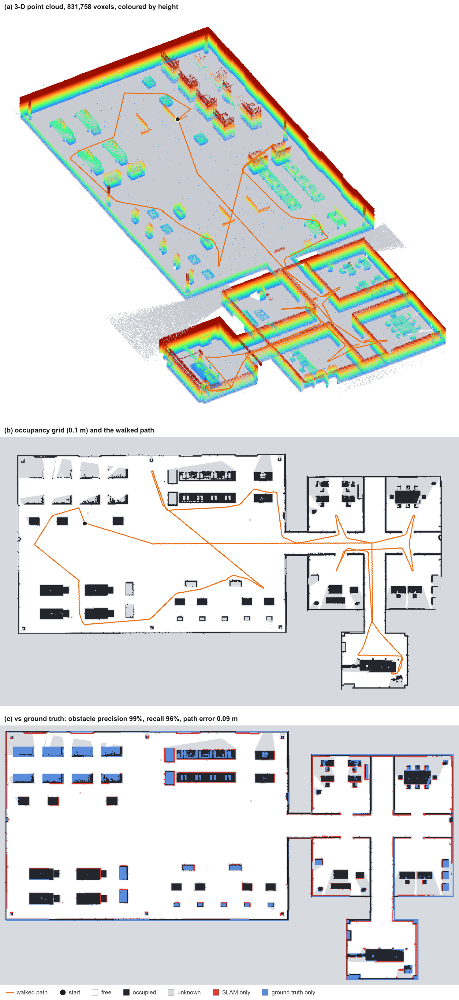

| 항목 | 결과 |
|---|---|
| 걸은 거리와 시간 | 324 m, 시뮬레이션 15분 (경유점 24개 모두 도착) |
| 위치 오차 (평균 제곱근 / 최대 / 출발점에 돌아왔을 때) | 0.09 m / 0.25 m / 0.03 m |
| 장애물 정밀도 / 재현율 (허용 오차 0.2 m) | 99% / 96% |
| 실제 빈 공간 중 빈 공간으로 표시된 비율 | 87% (나머지는 물체 뒤 그림자라 미확인) |
| 이 지도로 VLN 실행 (컨베이어 지시, Qwen3-VL-4B) | 성공: 결정 19회, 컨베이어 0.60 m 앞에서 정지, 판정 yes(정답), 충돌 0 |

파운데이션 SLAM 모델은 쓰지 않았습니다. G1 머리에는 LiDAR가 있어, 거리를 직접 재는 LiDAR-관성 SLAM이 축척이 정확하고 CPU로도 실시간으로 돕니다. 파운데이션 모델은 카메라만 있는 로봇이나, 나중에 시멘틱 층을 자동으로 채우는 용도로 검토할 만합니다. 만든 지도는 점유 지도(`map.yaml`, `map.pgm`), 3D 점군(`cloud.pcd`), 사람이 그린 주석과 자동 토폴로지(`semantic_map.json`)를 한 폴더에 묶어 외부 에이전트와 공유합니다. 자세한 내용은 [SLAM_MAPPING.md](docs/SLAM_MAPPING.md)에 있습니다.

### 로봇 지도 위의 사람 주석과 자동 토폴로지

점유 지도만으로는 "조립 라인"이 어디인지 알 수 없습니다. 그래서 사람이 주석 도구(`tools/map_annotator.html`)로 로봇이 만든 지도 위에 방 9개와 통로 4개를 그리고 이름과 별칭을 붙였습니다. 기준점도 4개 찍었습니다. 시뮬레이터 정답은 보지 않고 지도에 보이는 벽과 설비만 보고 그렸습니다. 방 사이의 연결과 출입구는 지도와 주석에서 자동으로 만들어집니다.

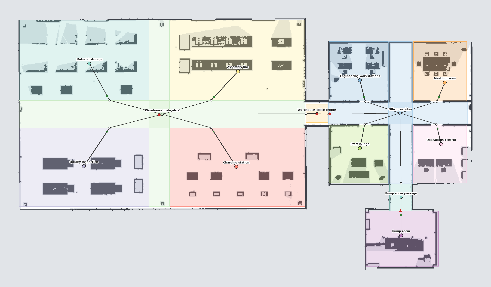

| 항목 | 결과 |
|---|---|
| 사람이 그린 방과 정답 구역의 겹침 (IoU 평균) | 0.91 |
| 자동으로 찾은 출입구 | 12개 (정답 장소 그래프도 12개), 방 9개 모두 연결됨, 벽 너머 방끼리는 연결 없음 |
| 출입구 위치 오차 | 벽이 있는 방 0.15-0.56 m, 벽 없이 바닥만 나뉜 창고 구역 1.6-2.3 m |
| 지도 묶음만으로 VLN (Qwen3-VL-4B, 과제당 1회, 충돌 0) | 컨베이어 확인 성공 (0.94 m 앞, 판정 정답). 충전 구역에서 연결 통로와 사무동 복도를 지나 펌프실 탱크 압력계 확인 성공 (이동 77 m, 최단 50 m, 1.65 m 앞, 판정 정답) |


### 시멘틱 맵과 토폴로지 맵

SLAM으로 만든 기하 지도 위에 의미 정보를 층층이 쌓은 3D 장면 그래프입니다. 맨 아래가 장면과 그 위의 객체 91개이고, 그 위로 장소 13개와 출입구 12개로 이루어진 토폴로지 그래프, 건물 3개, 캠퍼스가 있습니다. 선은 각 노드와 그 노드가 속한 상위 노드를 잇습니다.

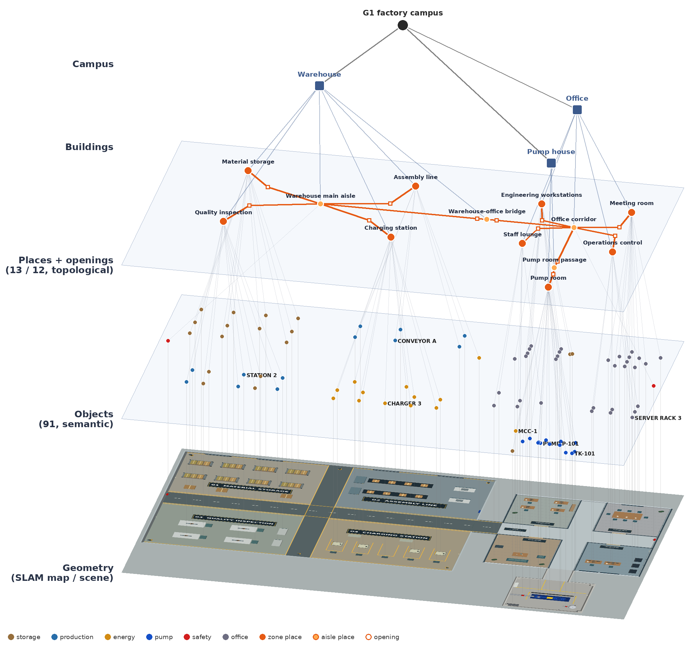

같은 지도를 위에서 본 그림입니다. 색칠한 영역이 구역, 작은 점이 객체(종류별 색), 검은 선이 장소 사이의 연결입니다. 작은 흰 원은 출입구, 초록 삼각형은 사람이 단 기준점입니다.

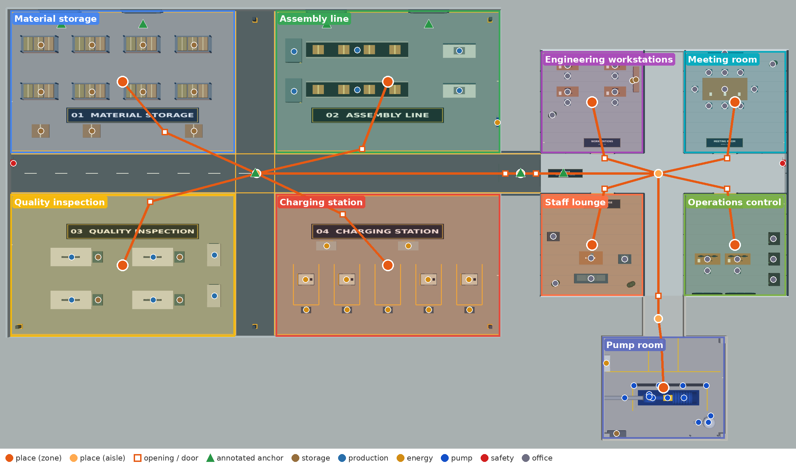

- 시멘틱 레이어는 구역 9개와 객체 91개(33종)입니다. 객체마다 명판 글자, 속한 구역, 3D 상자가 있습니다.
- 토폴로지 레이어는 장소 13개(구역 9개와 창고 통로, 연결 통로, 사무동 복도, 펌프실 통로)와 출입구를 가진 연결 12개입니다.
- 실제 로봇이라면 LiDAR SLAM이나 MASt3R 같은 SLAM 파운데이션 모델이 기하 지도를 만들고, 사람이 주석을 달거나 ConceptGraphs, HOV-SG 같은 개방 어휘 인식으로 위의 두 층을 채웁니다. 여기서는 시뮬레이터의 정답으로 만들었습니다.
- VLN에는 구역, 기준점, 장소 그래프를 주고 객체 층은 주지 않습니다.

## 문서

- [계층형 VLN 설계와 모델 선정](docs/HVLN.md)
- [로봇이 직접 만드는 SLAM 지도](docs/SLAM_MAPPING.md)
- [Ubuntu와 Isaac Sim 실행 순서](docs/UBUNTU_ISAAC.md)
- [ROS 2 인터페이스](docs/ROS2_INTERFACE.md)
- [검증 기록](docs/VALIDATION.md)
- [출처와 라이선스](THIRD_PARTY.md)
