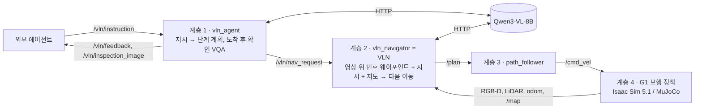

# G1 Factory VLN — 지시문을 따라 걸어가 확인하는 Unitree G1

**외부 에이전트가 "공장 ○○에 가서 △△를 확인해"라고 지시하면, Unitree G1이 목표 좌표를 모른 채 SLAM 지도와 머리 카메라만으로 길을 고르고, 대상을 눈으로 찾아 그 앞까지 걸어가 확인 결과를 돌려줍니다.** Isaac Sim 5.1과 MuJoCo에서 같은 ROS 2 스택으로 동작합니다.

| | |
|---|---|
| VLN | MapGPT 방식 지도 기반 계층형 VLN · 고수준 정책 **Qwen3-VL-8B-Instruct** (영상 위 번호 웨이포인트 중 선택) |
| 로봇 | Unitree G1 + 공식 사전학습 보행 정책 (다리 12관절, 실제 물리 보행) |
| 센서 | RealSense D435i 모사 RGB-D 640×480@30 Hz · Livox MID-360 모사 LiDAR 20,000 ray@10 Hz |
| 시뮬레이터 | **Isaac Sim 5.1** (실험) · MuJoCo 3.5 (개발·검증) — 같은 토픽·QoS |
| 파일럿 결과 | Isaac Sim, 지시 9개: **성공 5/9 · 대상 앞 도착 9/9 · 충돌 0** · VLM 결정당 4.3 s (RTX 5080 Laptop) |

## 지시문을 따라가는 모습 (Isaac Sim 5.1 + Qwen3-VL-8B 실제 실행)

지도의 숫자는 VLN이 결정을 내린 지점과 순서입니다. 파랑은 이동, 회색은 회전·둘러보기, 주황은 접근입니다. 빨간 상자는 평가용 실제 대상 위치로, **로봇에게는 주지 않습니다**. 사진은 그 결정 때 VLM이 실제로 본 영상이고, 흰 원 안의 번호가 VLM이 고를 수 있는 웨이포인트입니다.

### 1. "조립 라인으로 가서 컨베이어 위에 상자가 놓여 있는지 확인해."


| 시뮬레이션 시간 | VLN 결정 | VLM이 남긴 이유 (요약) |
|---:|---|---|
| 6 s | 1 이동 | 자재 창고에 있음, 조립 라인 쪽으로 가까워지는 1번 |
| 29 s | 2 이동 | 2번이 조립 라인 입구, 남은 보행 거리를 가장 많이 줄임 |
| 66 s | 3 둘러보기 | 조립 라인 도착 → 4방향 촬영, "ASSEMBLY LINE 표지가 보이는" 동쪽 선택 |
| 72 s | 4 이동 | 컨베이어를 찾으려 앞으로 |
| 96 s | 5 **접근** | "컨베이어가 보인다" → 영상 bbox → 깊이로 위치 → 정면에 섬 |
| 99 s | 확인 | "a beige box on the conveyor" → **yes (정답)**, 대상까지 0.77 m |

### 2. "부품 품질을 확인하는 곳에 가서 두 번째 비전 검사 장비 위에 부품이 올려져 있는지 봐줘."

지시에 장소 이름이 없습니다("부품 품질을 확인하는 곳" → 품질 검사 구역). 대상은 번호로 지정됩니다("두 번째" → 명판 `STATION 2`). VLN은 다른 검사대(STATION 1·3·4)의 명판을 읽어 거르고, STATION 2를 찾아 접근했습니다.


| 시뮬레이션 시간 | VLN 결정 | VLM이 남긴 이유 (요약) |
|---:|---|---|
| 7–55 s | 1–3 이동·접근 | 조립 라인 → 품질 검사 구역 |
| 95 s | 4 둘러보기 | "STATION 4, METROLOGY, 품질 검사 구역 표지가 보임" |
| 102–119 s | 5–8 회전·이동 | "STATION 2 명판을 아직 못 읽었다, 돌아보며 찾는다" |
| 152 s | 10 회전 | "보이는 건 STATION 1과 STATION 3, STATION 2를 찾아 돈다" |
| 158 s | 11 **접근** | 확대 영상으로 명판 재판독 "STATION 2" 일치 → 접근 |
| 168 s | 확인 | "a yellow block on the second vision inspection station" → **yes (정답)**, 0.90 m |

### 3. "사무동 관제실에 가서 서버 랙의 상태 표시등이 켜져 있는지 확인해."

창고 충전 구역에서 출발합니다. 연결 통로와 사무동 복도를 지나 관제실에 들어간 뒤, 서버 랙을 찾아 확인합니다.


| 시뮬레이션 시간 | VLN 결정 | VLM이 남긴 이유 (요약) |
|---:|---|---|
| 7–133 s | 1–7 이동 | 충전 구역 → 연결 통로 → 사무동 복도. "CONTROL ROOM 표지가 오른쪽 앞에 보인다" |
| 174 s | 8 둘러보기 | "view 2: 명판 붙은 서버 랙" |
| 186–203 s | 9–12 회전·이동 | 서버 랙 쪽으로 위치 조정 |
| 220 s | 13 **접근** | "SERVER RACK 3 명판이 보인다" → 접근 |
| 236 s | 확인 | "서버 랙의 여러 층에 녹색 상태 표시등이 켜져 있음" → **yes (정답)**, 1.38 m |

같은 그림은 어떤 실행 결과로도 만들 수 있습니다.

```bash
bash scripts/g1_docker.sh python3 scripts/plot_vln_episode.py outputs/hvln_inspect_conveyor --frames 2 4 inspection --name my_run
```

## 파일럿 결과 (Isaac Sim 5.1 + Qwen3-VL-8B, 지시 9개, 각 1회)

| 지시 | 결과 | VLN 결정 | 대상까지 | 판정 (정답) |
|---|---|---:|---:|---|
| 조립 라인으로 가서 컨베이어 위에 상자가 놓여 있는지 확인해. | ✅ | 5 | 0.77 m | yes (yes) |
| 충전 구역의 3번 충전 도크에 AMR 카트가 주차되어 있는지 확인해. | ✅ | 30 | 0.00 m | no (no) |
| 사무동 관제실에 가서 서버 랙의 상태 표시등이 켜져 있는지 확인해. | ✅ | 13 | 1.38 m | yes (yes) |
| 부품 품질을 확인하는 곳에 가서 두 번째 비전 검사 장비 위에 부품이 올려져 있는지 봐줘. | ✅ | 11 | 0.90 m | yes (yes) |
| JSON 단계: 연결 통로 → 휴게실 → 자판기 찾기 | ✅ | 33 | 1.46 m | yes (yes) |
| Go to the charging area and check whether the free charging dock is empty. | ❌ | 8 | 0.53 m | no (yes) |
| Go to the meeting room and check whether anyone is sitting at the meeting table. | ❌ | 5 | 5.95 m | no (no) |
| 창고 서쪽 끝에 있는 빨간 소화기함까지 가서 소화기가 들어 있는지 확인해. | ❌ | 7 | 1.45 m | no (yes) |
| Find the blue electrical panel on the east wall … whether it carries a high-voltage warning. | ❌ | 3 | 1.51 m | no (yes) |

- 성공 = 완료 ∧ 대상 물체 외곽 2.5 m 이내 정지 ∧ 판정 정답 ∧ 충돌·넘어짐 0.
- 실패 4개도 모두 대상을 찾아 앞까지 갔습니다. 원인은 이렇습니다.
  - 빈 도크: 답변 극성 오류("카트 없음"을 보고 "비어 있나?"에 no).
  - 회의실: 유리벽 너머 테이블을 봐서 깊이가 유리에 맞음.
  - 소화기함·분전반: 장면 결함(소화기가 패널 뒤에 가려짐, 경고 표지가 시야 밖).
- 네 원인 모두 수정했고, 재실행 예정입니다. 과제당 1회라 성능 주장이 아닌 동작 확인입니다. 자세한 내용은 [VALIDATION.md](docs/VALIDATION.md)에 있습니다.

## 어떻게 동작하나



- **매 결정**: SLAM 지도에서 직선으로 갈 수 있는 지점을 카메라 영상 위에 번호로 그립니다. 여기에 지시, 단계 계획, 구역 방향, 후보별 보행 거리 이득, 최근 결정을 함께 VLM에 줍니다. VLM은 "k번 이동 / 회전 / 보이는 물체에 접근(bbox) / 정지" 중 하나를 고르고, 규칙이 그 선택을 검증합니다(지도에 없는 이동, 구역 이탈, 명판 불일치는 거절하고 다시 묻습니다).
- **대상 구역 도착 시**: 네 방향을 둘러보고 계속 갈 방향을 고릅니다. 머리 카메라 시야가 69°라 옆에 있는 대상을 놓치지 않기 위해서입니다.
- **로봇이 아는 것**: 주행 가능 공간(점유 지도), 사람이 단 구역 8개와 고정 기준점 7개뿐입니다. 검사대, 충전 도크, 소화기함 같은 세부 대상 위치는 평가에만 씁니다.
- **왜 MapGPT 방식인가**: e2e 생성형(NaVILA)은 공장 도메인과 장애물 처리가 약하고, 지도 조회 + A*는 목표를 미리 알아 VLN이 아닙니다. 이 방식은 기존 지도와 영상, 지시를 모두 쓰고, 학습이 필요 없으며, 결정마다 근거가 남습니다. 자세한 비교는 [HVLN.md](docs/HVLN.md)에 있습니다.

## 실행 (Ubuntu + Isaac Sim 5.1)

처음 설치는 [UBUNTU_ISAAC.md](docs/UBUNTU_ISAAC.md)를 단계별로 따라 하세요(Docker 권한, NVIDIA 컨테이너, 이미지 빌드, G1 에셋, 장면 USD, Isaac 캐시, Ollama + Qwen3-VL). 설치 후에는 아래처럼 실행합니다.

터미널 1에서 Isaac Sim과 G1을 띄웁니다. `--gui`를 붙이면 창이 뜨고 로봇을 따라가는 카메라로 볼 수 있습니다.

```bash
bash scripts/run_isaac_sim.sh --gui --spawn -12 3.8 0
```

터미널 2에서 VLN 스택과 지시를 실행합니다. 결정마다 VLM의 선택과 이유가 로그에 나옵니다.

```bash
G1_DDS=fastdds bash scripts/g1_docker.sh ros2 launch launch/g1_hvln.launch.py sim:=false task:=inspect_conveyor
```

실험 행렬(지시 9개 × seed 3 × 조건 3)을 돌리고 `results.md`를 만듭니다.

```bash
python3 scripts/hvln_experiment.py --simulator isaac --out outputs/exp_isaac_$(date +%F)
```

직접 지시하려면 launch에 `agent:=false`를 붙여 띄우고, 다른 터미널에서 지시를 보냅니다.

```bash
G1_DDS=fastdds bash scripts/g1_docker.sh python3 scripts/send_instruction.py "창고 서쪽 끝에 있는 빨간 소화기함까지 가서 소화기가 들어 있는지 확인해"
```

## 외부 에이전트 인터페이스와 ROS 2 토픽

- **지시**: `/vln/instruction` (`std_msgs/String`). 자연어(한국어·영어) 또는 JSON(`{"instruction": …}`, `{"steps": […]}`).
- **결과**: `/vln/feedback`(진행 이벤트, 결정과 이유, `done.result` = 관찰·yes/no·답변)과 `/vln/inspection_image`(판정에 쓴 JPEG).

| 대용량 센서 토픽 | 메시지 | 발행 → 구독 | 크기 · 주기 (Isaac 실측) |
|---|---|---|---|
| `/camera/camera/color/image_raw` | `sensor_msgs/Image` rgb8 | g1_sim → vln_navigator, vln_agent | 921,672 B · 30 Hz · 27.7 MB/s |
| `/camera/camera/aligned_depth_to_color/image_raw` | `sensor_msgs/Image` 16UC1 | g1_sim → vln_navigator, vln_agent | 614,472 B · 30 Hz · 18.4 MB/s |
| `/livox/lidar` | `sensor_msgs/PointCloud2` (Livox 26 B/점) | g1_sim → vln_navigator | 약 18,000점, 470 KB · 10 Hz · 4.7 MB/s |

센서는 BestEffort / KeepLast 5, 명령·이벤트는 Reliable, 지도와 정적 TF는 TransientLocal입니다. 전체 토픽 목록, 실제 데이터 크기, Publisher·Subscriber 옵션, 노드 그래프, 코드는 [ROS2_INTERFACE.md](docs/ROS2_INTERFACE.md)에 있습니다.

## MuJoCo 캠퍼스 (개발·검증 환경)


| 공간 | 구성 |
|---|---|
| Warehouse 48×32 m | 자재 창고 · 조립 라인 · 품질 검사 · 충전 구역. 구역 표지판과 설비 명판(STATION 1–4, CHARGER 1–5, CONVEYOR A/B …) |
| Office 24×24 m | 업무실 · 회의실 · 휴게실 · 관제실 (방 문패, 서버 랙 명판) |
| 연결 | 하나의 물리 장면, 폭 4 m 연결 통로 |

- Isaac Sim 장면은 이 MuJoCo 장면을 USD로 내보낸 것이라 배치, 좌표, 의미 주석이 같습니다(`scripts/export_campus_usd.py`).
- MuJoCo로 VLN 스택 전체를 돌릴 때(Docker): `bash scripts/g1_docker.sh ros2 launch launch/g1_hvln.launch.py task:=inspect_conveyor`.
- VLN 없이 정해진 구역 순서로 걷는 데모, 창 조작, 연구실 프리셋, 평가 출력: [MUJOCO.md](docs/MUJOCO.md).
- 구역·선반·시나리오 편집: [FACTORY.md](docs/FACTORY.md). e2e 비교 기준선(NaVILA): [VLN.md](docs/VLN.md).

## 문서

[계층형 VLN 설계·모델 선정](docs/HVLN.md) · [Ubuntu·Isaac 실행 순서](docs/UBUNTU_ISAAC.md) · [ROS 2 인터페이스](docs/ROS2_INTERFACE.md) · [검증 결과](docs/VALIDATION.md) · [도구·모델 선정](docs/DECISIONS.md) · [MuJoCo 데모](docs/MUJOCO.md) · [환경 구성·변경](docs/FACTORY.md) · [출처·라이선스](THIRD_PARTY.md)
