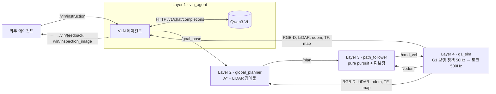

# 계층형 VLN: 외부 에이전트 지시 → VLM → 경로계획 → 경로추종 → G1 보행

**외부 에이전트의 "공장 ○○에 가서 △△를 확인해" 지시를 VLM이 해석·확인하고, 이동은 지도 기반 경로계획과 경로추종기가 담당하는 ROS 2 스택.**

| 항목 | 구성 |
|---|---|
| 실행 | ROS 2 Humble(22.04) / Jazzy(24.04) · Docker 또는 네이티브 · NVIDIA GPU 권장 |
| VLN 모델 | Qwen3-VL Instruct (실험 기본 8B, 경량 4B) · OpenAI 호환 API(Ollama·vLLM 등) |
| 시뮬레이터 | 이 저장소의 MuJoCo G1 캠퍼스(`g1_sim`). Isaac Sim·실로봇은 같은 토픽으로 교체 |
| 센서 | G1 EDU 머리 센서 모사: RealSense D435i(RGB-D 640×480@30Hz) + Livox MID-360(LiDAR 10Hz, IMU 200Hz) |
| 인터페이스 | `/vln/instruction`(지시) → `/vln/feedback`(진행·결과) + `/vln/inspection_image`(근거 영상) |
| 토픽·QoS·데이터 크기 | [ROS2_INTERFACE.md](ROS2_INTERFACE.md) |

## 1. 왜 계층형인가

| 방식 | 입력 → 출력 | 장점 | 이 작업에서의 한계 |
|---|---|---|---|
| NaVILA (e2e·생성형) | 영상 8장 + 지시 → "move forward 75 cm" | 지도 없이 동작 | 공장 도메인 미학습, 긴 경로 누적 오차, 장애물 회피·재계획 불가, "확인" 결과 보고 없음 |
| **계층형 (이 스택)** | 지시 → VLM이 장소·확인 대상 결정 → A* → 추종 | 지도·LiDAR로 충돌 없는 경로, 장소 단위 성공 판정, VLM 교체만으로 성능 향상, 확인 결과 반환 | 의미 지도(장소 목록)가 필요 |

공장처럼 **지도가 있는 고정 환경 + "어디 가서 무엇을 확인" 형태의 지시**에는 지도 기반 계층형(VLMaps·LM-Nav 계열 구조)이 적합. NaVILA 연결(`docs/VLN.md`)은 비교용 e2e 기준선으로 유지.

## 2. 구조



| 층 | 노드 | 하는 일 | 코드 |
|---|---|---|---|
| 1 | `vln_agent` | ① VLM 작업 계획: 지시+의미 지도 → 방문 장소 id 순서·볼 대상(항상 그 자리에 있는 기준물)·질문 ② 도착 후 VLM 시각 grounding(bbox) + 정렬 깊이 + TF → 대상 3D 위치. 대상이 화면에서 작게(가로·세로 25% 미만) 보일 때만 1.4m 앞으로 재접근, 안 보이면 ±40° 둘러본 뒤 원래 방향으로 복귀 ③ VLM 확인(VQA): 관찰 내용 기술 → yes/no 판정+설명. 장소가 보이는데 대상이 없으면 "no" | `g1_factory/ros2/vln_agent_node.py`, `g1_factory/vlm.py` |
| 2 | `global_planner` | 정적 `/map` + LiDAR 미등록 장애물 층 위 8방향 A*, 가시선 평활화, 막히면 재계획 | `planner_node.py`, `g1_factory/planning.py` |
| 3 | `path_follower` | pure pursuit + 횡방향 속도(vy) 보정 + 최종 방향 정렬 + 도착 후 위치 유지, 20Hz | `follower_node.py`, `planning.PathTracker` |
| 4 | `g1_sim` | MuJoCo 물리 + Unitree 사전학습 보행 정책. 센서·odom·TF·지도·`/clock` 발행 | `sim_node.py`, `g1_factory/sensors.py` |
| 평가 | `external_agent` | 과제 지시 전송·피드백 기록·지표 계산(`summary.json`) | `external_agent_node.py` |

- VLM 출력 검증: 장소 id는 의미 지도에 있어야 함 → 틀리면 1회 재질의 → 그래도 틀리면 규칙 기반 grounding으로 대체(`parser: rule_fallback`). 목적지를 지어내지 않음.
- VLM이 구역만 고르면, 질문에 나온 그 구역의 랜드마크로 보정(예: 관제실 → 서버 랙).
- 구조화 JSON `subgoals`는 VLM 없이 그대로 실행 → 상위 에이전트가 직접 계획하는 경우.
- VLM 호출은 작업 스레드에서 실행. 기다리는 동안 노드는 계속 센서를 받고 경로추종기는 위치를 유지.

## 3. 외부 에이전트 인터페이스

`/vln/instruction` (`std_msgs/String`, Reliable·Volatile·KeepLast 10). 세 가지 형식:

```text
조립 라인으로 가서 컨베이어 위에 상자가 놓여 있는지 확인해.
{"task_id": "t1", "instruction": "Go to the charging area and check whether the free dock is empty."}
{"task_id": "t2", "subgoals": ["warehouse_office_bridge", {"place": "자판기"}, {"x": 31.4, "y": -6.2, "yaw": 3.14}],
 "target": "vending machine", "question": "자판기가 정상적으로 서 있는지 확인해", "language": "ko"}
{"cancel": true}
```

- 진행 중 새 지시 → 현재 작업 `preempted` 후 그 자리 정지, 새 작업 시작. `{"cancel": true}` → 정지·유지.
- `/vln/feedback` (`std_msgs/String` JSON) 상태 순서: `accepted → planned → navigating → subgoal_reached … → grounding → target_located → (refining) → inspecting → done | failed`. 그 외 `looking_around`, `target_not_found`, `target_unlocalized`, `refine_skipped`, `preempted`, `canceled`.
- `done.result`: `{"observed": "…", "target_visible": bool, "verdict": "yes|no|unknown", "status": "ok|anomaly|unknown", "answer": "…"}` + `final_pose`, `target_xy`, `vlm_calls`(각 호출 원문·지연·요청/응답 바이트).
- `/vln/inspection_image` (`sensor_msgs/CompressedImage` JPEG): 판정에 사용한 바로 그 프레임.
- 명령행 클라이언트: `python3 scripts/send_instruction.py "검사 구역 2번 검사대에 부품이 있는지 확인해"` (ROS 2 환경에서). 확인 이미지는 `inspection.jpg`로 저장.

## 4. VLN 결과를 위한 환경 설정

| 설정 | 값 | 이유 |
|---|---|---|
| 의미 지도 | 구역 8 + 랜드마크 22, 영어·한국어 별칭 (`configs/semantic_map.yaml`) | VLM이 고를 수 있는 장소 집합. 지시의 표현과 장소를 연결 |
| 접근 자세 | 장애물에서 ≥0.6m, 대상 정면 1.5–1.8m (테스트로 검증) | 도착 시 대상 전체가 카메라 시야에 들어오도록 |
| 머리 카메라 | 640×480, HFOV 69°(D435i), 높이 ≈1.24m, 하향 10°(가정) | 실제 G1 센서와 같은 데이터 형태 |
| 작업대·컨베이어 높이 | 상판 0.95m, 벨트 0.85m (기존 1.2m) | G1 눈높이에서 위에 놓인 물체가 보이도록 |
| 검사 대상 부품 | 검사대 위 주황색 0.44×0.32×0.24m | 밝은 상판과 구분 안 되는 평판일 때 4B 모델이 "부품 없음"으로 오판 |
| 충전 도크 접근 자세 | 주차 칸 바깥 (칸 전체+충전기가 보임) | 칸 안에 서면 카트 유무를 볼 수 없음 |
| 정렬 깊이 | 16UC1 mm, 10m 초과 0 | VLM bbox → 3D 위치 계산 |
| LiDAR | 20,000 ray/scan, 10Hz, 고도 −52°…+7°(하향 장착 가정) | 지도에 없는 장애물 탐지·재계획 |
| 렌더링 그림자 | GPU에서 켬(`render_shadows:=true`) | 영상 사실감. CPU 렌더링 환경에서만 끔 |

## 5. Ubuntu 스테이션 실행

### 5.1 준비 (1회)

```bash
# Docker 경로 (권장): NVIDIA 드라이버 + Docker + nvidia-container-toolkit 설치 후
git clone https://github.com/alsgyu/G1-sim-test.git && cd G1-sim-test
docker build -f docker/Dockerfile.ros2 -t g1-sim-ros2:humble .
docker run --rm -v "$PWD":/ws g1-sim-ros2:humble python3 scripts/fetch_assets.py
sudo sysctl -w net.core.rmem_max=2147483647 net.ipv4.ipfrag_time=3 net.ipv4.ipfrag_high_thresh=134217728
```

```bash
# 네이티브 경로: ROS 2 Humble/Jazzy 설치 후
bash scripts/setup_ros2_native.sh
source /opt/ros/$ROS_DISTRO/setup.bash && source .venv-ros/bin/activate
export RMW_IMPLEMENTATION=rmw_cyclonedds_cpp CYCLONEDDS_URI=file://$PWD/configs/cyclonedds.xml MUJOCO_GL=egl
```

```bash
# VLN 모델 서버 (같은 스테이션, GPU)
curl -fsSL https://ollama.com/install.sh | sh
ollama pull qwen3-vl:8b-instruct && ollama pull qwen3-vl:4b-instruct
curl -s http://127.0.0.1:11434/v1/models
```

- vLLM 등 다른 OpenAI 호환 서버도 가능: `vlm_url`, `vlm_model`만 변경. 원격 GPU 서버는 SSH 터널 사용.
- 8B Q4 약 6GB, 4B 약 3GB VRAM. 시뮬레이터 렌더링과 같은 GPU 공유 가능.

### 5.2 단일 실행

```bash
docker run --rm --gpus all --network host --ipc host -v "$PWD":/ws g1-sim-ros2:humble \
  ros2 launch launch/g1_hvln.launch.py task:=inspect_conveyor
# 다른 터미널에서 직접 지시 (같은 ROS_DOMAIN_ID; 외부 에이전트도 같은 방식)
docker run --rm --network host -v "$PWD":/ws g1-sim-ros2:humble \
  python3 scripts/send_instruction.py "사무동 관제실에 가서 서버 랙 표시등이 켜져 있는지 확인해"
```

결과: `outputs/hvln_<task>/` → `summary.json`, `feedback.jsonl`, `inspection.jpg`, `trajectory.csv`, `plans.json`, `nav_status.jsonl`, `topic_stats.json`(monitor 켬), `launch_args.json`.

### 5.3 실험 절차

| 단계 | 명령·확인 | 통과 기준 |
|---|---|---|
| 0 환경 | `docker run --rm --gpus all --network host -v "$PWD":/ws g1-sim-ros2:humble python3 scripts/check_hvln_env.py` | FAIL 0개. RGB-D 렌더 < 15 ms/프레임(GPU EGL), VLM 모델 응답, `rmem_max` 확대 |
| 1 단위 테스트 | `docker run --rm -v "$PWD":/ws g1-sim-ros2:humble python3 -m pytest -q` | 전부 통과 |
| 2 스모크 | 5.2 단일 실행 | `success: true`, `realtime_factor ≥ 0.95` |
| 3 측정 + 본 실험 | `python3 scripts/hvln_experiment.py --out outputs/exp_$(date +%F)` | 중단 시 같은 명령으로 이어서 실행 |
| 4 결과 | `<out>/results.md`, `episodes.csv`, `measurement/topic_tables.md` | 표를 보고서에 그대로 사용 |

- 실험 행렬 `configs/hvln_experiment.yaml`: 과제 7 × seed 3 × 조건 3(`rule`, `vlm_4b`, `vlm_8b`) = 63회 + 토픽 측정 1회.
- 독립변수: 1층 계획기(규칙 기반 / VLM 4B / VLM 8B). `rule`도 시각 grounding·확인은 VLM 사용 → 언어 grounding 층만 비교.
- 통제: 같은 지도·과제·센서·추종기. seed≠0은 시작 위치를 ≤0.3m, ≤20° 섭동.
- `realtime_factor`가 0.95 미만이면 `--set camera_rate_hz=15.0`처럼 낮추고 결과에 명시. 시간 지표는 sim 시간 기준.
- 동시에 여러 실험을 돌리면 `--domain-id`를 다르게. `--network host`에서 같은 도메인은 서로 간섭.

| 지표 | 정의 |
|---|---|
| 성공 | 상태 done ∧ 마지막 하위목표 = 정답 장소 ∧ 모든 하위목표 도착 ∧ 정답 장소 접근 자세 1.5m 이내 ∧ 충돌·넘어짐 0 ∧ 답변 있음 |
| grounding 정확도 | 계획된 마지막 장소 = `expected_place` |
| SPL | 성공 × L*/max(L*, 이동거리). L* = `/map` 위 A* 최단 경로(시작 → 정답 접근 자세) |
| 판정 정확도 | VLM `verdict` = 과제의 `expected_verdict` (yes/no 균형 과제 포함) |
| 경로추종 RMSE | 각 목표 구간에서 계획 경로까지의 횡방향 오차 |
| VLM 지연 | 계획·grounding·확인 호출 벽시계 지연 평균 |

## 6. Isaac Sim / 실로봇 연결

`sim:=false`로 `g1_sim`을 빼고, 같은 메시지를 내보내도록 연결. 이름이 다르면 `remaps:=` 사용.

```bash
ros2 launch launch/g1_hvln.launch.py sim:=false monitor:=false \
  remaps:="/camera/camera/color/image_raw:=/rgb,/camera/camera/aligned_depth_to_color/image_raw:=/depth,/camera/camera/color/camera_info:=/camera_info,/livox/lidar:=/point_cloud"
```

| 이 스택이 필요로 하는 것 | Isaac Sim (ROS 2 Bridge) | 실제 G1 |
|---|---|---|
| RGB `sensor_msgs/Image` rgb8 | Camera Helper `rgb` | `realsense2_camera` (이름 동일) |
| 정렬 깊이 Image 16UC1(mm) 또는 32FC1(m) | Camera Helper `depth` (32FC1 지원) | `align_depth.enable:=true` |
| CameraInfo | Camera Helper `camera_info` | 동일 |
| PointCloud2 (x, y, z 필드만 있으면 됨) | RTX Lidar Helper `point_cloud` | `livox_ros_driver2` `xfer_format=0` |
| `/odom` + TF `odom→base_link` | Publish Odometry + Transform Tree | SLAM/LIO 출력 |
| TF `base_link→카메라 광학 프레임, LiDAR 프레임`, `map→odom` | Transform Tree / static TF | URDF + SLAM |
| `/map` OccupancyGrid (TransientLocal) | Occupancy Map 내보내기 → `nav2_map_server` | SLAM 지도 |
| `/clock` (`use_sim_time`) | Publish Clock | 없음 → 모든 노드 `use_sim_time:=false` |
| `/cmd_vel` Twist 수신 → 보행 | Isaac Lab G1 보행 정책 노드 | Unitree 보행 API 브리지 |

- 센서 구독 QoS는 BestEffort → 발행 측이 Reliable이든 BestEffort든 수신 가능.
- `configs/semantic_map.yaml`의 좌표는 이 MuJoCo 캠퍼스 기준. Isaac 장면·실공장은 장소 좌표·별칭을 새로 작성.
- `sim:=false`에서는 `/sim/status`가 없어 충돌·이동거리 지표가 비어 있음.
- 실시간(벽시계) 운용 시 goal/plan 식별자는 stamp 원본을 그대로 복사하므로 정밀도 손실 없음.

## 7. 검증 상태·한계

- 단위 테스트: grounding(한·영·JSON), 의미 지도 접근 자세 여유, A* 장애물 회피·LiDAR 재계획·감쇠, 추종기 횡보정·정렬·유지, VLM 출력 검증·재질의·대체.
- macOS(M1, Docker CPU 렌더링, Qwen3-VL 4B/Ollama)에서 전체 ROS 2 그래프 실제 실행 검증: [검증 결과](VALIDATION.md#계층형-vln-ros-2-스택).
- Ubuntu GPU 스테이션의 실시간 실행·8B 모델 결과는 5.3 절차로 측정 필요.
- 의미 지도 = 시뮬레이터 장면 정보(정답). 실환경에서는 지각 기반 의미 지도 구축(VLMaps 등)이 별도 과제.
- 위치 = 시뮬레이터 정답 odom. 실환경은 SLAM/LIO 필요.
- 보행 정책: 다리 12관절, 상체 고정. 계단·문 열기·조작 없음.
