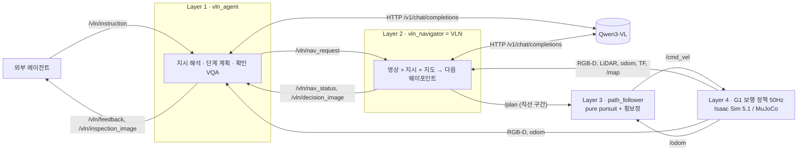
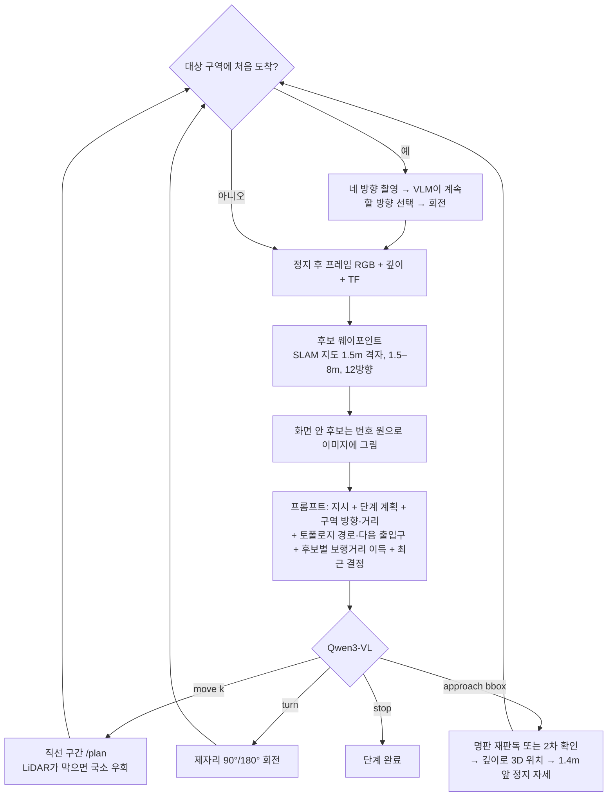

# 계층형 VLN: 외부 에이전트 지시 → 지도 기반 VLN(비전 + 지시) → 경로추종 → G1 보행

**외부 에이전트가 "공장 ○○에 가서 △△를 확인해"라고 지시하면, 로봇은 목표 좌표를 모른 채 SLAM 지도(+사람이 단 의미 주석)와 머리 카메라 영상, 지시문만으로 매 순간 어디로 갈지 VLM이 결정하고, 대상을 눈으로 찾아 앞에 선 뒤 확인 결과를 돌려준다.**

| 항목 | 구성 |
|---|---|
| 실험 대상 | **Isaac Sim 5.1 + Unitree G1** (Ubuntu GPU 스테이션). MuJoCo는 장면 생성기·단위 테스트로만 사용 |
| VLN 모델 | **지도 기반 계층형 VLN** (MapGPT 방식 지도 프롬프트 + 이미지 위 번호 웨이포인트 시각 프롬프트) · 고수준 정책 **Qwen3-VL-8B-Instruct** (경량 비교 4B) |
| 결정 방식 | 결정형(deterministic): 지도에서 갈 수 있는 후보 중 하나를 고름, greedy 디코딩(temperature 0), 출력 검증 |
| 로봇이 아는 것 | SLAM 점유 지도(주행 가능 공간) + 사람이 단 의미 주석(구역 8개 + 고정 기준점 7개) |
| 로봇이 모르는 것 | 확인 대상의 위치 ("2번 검사대", "3번 충전 도크", "빨간 소화기함" …). 카메라로 찾아야 함 |
| 센서 | G1 EDU 머리 센서 모사: RealSense D435i(RGB-D 640×480@30Hz) + Livox MID-360(LiDAR 10Hz, IMU 200Hz) |
| 인터페이스 | `/vln/instruction`(지시) → `/vln/feedback`(진행·결과) + `/vln/inspection_image`(확인 근거 영상) |
| 토픽·QoS·데이터 크기 | [ROS2_INTERFACE.md](ROS2_INTERFACE.md) |
| Ubuntu 실행 명령 전체 | [UBUNTU_ISAAC.md](UBUNTU_ISAAC.md) |

## 1. 모델 선정

조건: 공장 지도는 이미 있음(SLAM + 사람의 의미 주석). 지시는 "어느 구역에 가서 어떤 설비를 확인"하는 다단계 문장. 확인할 세부 대상은 지도에 없음. 공장 데이터로 학습할 수 없음.

| 계열 | 대표 | 지도 사용 | 이 과제에서의 판단 |
|---|---|---|---|
| e2e 생성형 VLN | NaVILA, Uni-NaVid | 안 함 | 집 실내(R2R)로 학습. 공장 도메인·긴 경로에서 누적 오차, 장애물 재계획·확인 보고 없음 → 비교용으로만 유지([VLN.md](VLN.md)) |
| 지도 조회 + A* | (이 저장소 `oracle`) | 목표 좌표 조회 | **VLN 아님**: 목표 위치를 미리 알고 감. 상한 기준선으로만 사용 |
| 3D 의미 지도 질의 | VLMaps | 지도 질의 → 좌표 | 세부 대상이 지도에 없으면 결국 좌표 조회와 같음. 지도 구축 자체가 별도 과제 |
| 프런티어 + 가치 지도 | VLFM | 지도 없이 탐사 | 지도가 이미 있는 환경에 불필요. 다단계 지시 처리 약함 |
| 웨이포인트 예측 + 위상 지도 | ETPNav, BEVBert | 온라인 위상 지도 | R2R-CE 학습 → 공장 재학습 필요 |
| **지도 기반 VLM 웨이포인트 선택 (채택)** | MapGPT(ACL 2024), VLMnav, PIVOT | SLAM 지도 + 의미 주석 | 지도·비전·지시를 모두 사용, 학습 불필요, 매 결정의 근거(이미지·생각·선택)가 남음 |

- **결정형을 고른 이유**: 출력은 "지도에서 직선으로 갈 수 있는 후보 k번 / 회전 / 보이는 물체에 접근 / 정지" 중 하나. 모델이 동작을 지어낼 수 없고, 같은 입력이면 같은 결정 → 실험 재현 가능. 생성은 언어(단계 분해, 확인 답변)에만 사용.
- **Qwen3-VL-8B-Instruct를 고른 이유**: 공개 가중치, bbox grounding(0–1000 좌표) 내장, 한국어·영어 지시, GPU 1장(Q4 약 6GB VRAM)으로 로컬 실행, OpenAI 호환 서버(Ollama·vLLM)로 교체 쉬움. 4B는 경량 비교 조건.

## 2. 구조



| 층 | 노드 | 하는 일 | 코드 |
|---|---|---|---|
| 1 | `vln_agent` | ① 지시 → 단계 계획 `steps`(목표 문장 + 의미 구역), 볼 대상(지시가 대상을 구별하는 말 유지: "빈", "빨간", "동쪽 벽의"), 대상 명판 글자(`target_label`), 질문. 검증: 마지막 단계는 "대상 찾기"여야 함(1회 재질의 후 자동 추가), 지시에 없는 번호(모델이 지어낸 "서버 랙 1")는 명판·대상·단계 문장에서 제거 ② `/vln/nav_request`로 VLN에 전달, 진행 상황 중계 ③ 도착 후 VQA 확인: 관찰 기술 → yes/no 판정 + 근거 영상 | `ros2/vln_agent_node.py`, `vln_navigator.decompose`, `vlm.py` |
| 2 | `vln_navigator` | **VLN 본체**. 매 결정: 현재 영상에 번호 웨이포인트를 그려 지시·지도 맥락과 함께 VLM에 질의 → 이동/회전/접근/정지 → 직선 구간 `/plan` | `ros2/vln_navigator_node.py`, `vln_navigator.py`, `roadmap.py` |
| 3 | `path_follower` | pure pursuit + 횡방향 속도(vy) 보정 + 최종 방향 정렬 + 도착 후 위치 유지, 20Hz | `ros2/follower_node.py`, `planning.PathTracker` |
| 4 | `isaac_sim_node` / `g1_sim` | 물리 + Unitree 사전학습 보행 정책(12관절). 센서·odom·TF·지도·`/clock` 발행 | `isaac/isaac_sim_node.py`, `ros2/sim_node.py`, `policy_core.py` |
| 평가 | `external_agent` | 과제 지시 전송·피드백 기록·지표 계산(`summary.json`), 결정 이미지 저장 | `ros2/external_agent_node.py` |

## 3. VLN 결정 한 번 (Layer 2)



1. **후보**: SLAM 지도의 주행 가능 공간 위 1.5m 격자(장애물 여유 0.6m)에서, 로봇 기준 12개 방향 섹터마다 직선으로 갈 수 있는 가장 먼 점(1.5–8m) 하나. 화면 안 후보는 카메라 투영으로 번호를 그리고, 화면 밖 후보는 방향(앞·왼쪽·뒤…)만 텍스트로.
2. **지도 맥락**: 의미 주석의 구역 이름과 방향·거리(나침반), 기준점(교차로·도크·연결 통로·사무동 입구), 토폴로지 경로(목표 구역까지 지나갈 장소 순서와 다음 출입구의 방향·거리, `/semantic_map`), 각 후보가 현재 단계 구역까지 **보행 거리**를 몇 m 줄이는지(벽을 돌아가는 길 반영), 방문 여부.
3. **VLM 출력**: `{"thought", "action": move|turn|approach|stop, "waypoint", "turn", "bbox_2d"}`.
4. **검증(규칙은 행동을 대신 정하지 않고 거절·재질의만)**: 없는 번호·형식 오류 → 재질의(최대 3회). 구역 이동 단계에서 구역과 멀어지는 이동 → 거절. 제자리 회전 연속 3회 초과 → 거절(이동하라고 재질의). `approach`는 ① 지시가 번호·서수로 대상을 지정했으면(`target_label`, 예: "두 번째 검사 장비" → STATION 2) VLM이 그 영역을 확대 이미지로 **명판을 다시 읽어** 번호·문자(식별자)가 같아야 수락(종류는 VLM의 시각 판단, 이 검사는 STATION 2와 1·3·4를 구분) ② 명판이 없는 대상은 대상 앞 바닥까지 포함한 확대 이미지로 **2차 확인**: 종류와 지시의 조건("비어 있는", "빨간", "경고 표시가 있는")이 보이는지까지 판단(예: 카트가 있는 도크는 "빈 충전 도크"가 아님). 세 번 모두 무효면 왼쪽으로 돌아보기, 그것도 소진되면 가장 이득 큰 후보로 이동.
5. **실행**: `move` → 직선 구간(국소 A*는 LiDAR가 본 미등록 장애물이 그 구간을 막을 때 우회용으로만), `approach` → bbox 중앙 깊이로 대상 3D 위치(영상으로 찾은 위치) → 그 점이 SLAM 지도의 장애물 위면 로봇 쪽으로 지도상 외곽을 찾아 외곽에서 1.4m, 아니면(바닥 구역·지도에 없는 물체) 가장 가까운 깊이(10백분위)에서 1.4m 떨어진 정면 정지 자세. 작업대·컨베이어처럼 위에서 내려다보는 물체는 깊이상 가장 가까운 점이 상판 안쪽이라, 외곽 기준이 없으면 너무 가까이 서서 상판만 보이는 문제를 실측으로 확인해 수정. `turn` → 제자리 회전.
6. **둘러보기(파노라마 관측)**: 마지막 단계("대상을 찾아 그 앞에 서기")의 구역에 처음 들어서면 제자리에서 90°씩 돌아 네 방향 영상을 찍고, VLM이 "대상이 보이는(명판 확인) 방향, 없으면 탐색할 방향"을 4장 중 하나로 고름 → 그 방향으로 돌아선 뒤 위의 결정을 계속. 카메라 시야(69°) 밖 옆에 있는 대상을 지나치지 않도록 하는 R2R·MapGPT식 파노라마 관측이며, 단계당 1회.
7. **단계 완료**: 구역 단계는 그 구역에 들어가면 자동 완료. 마지막 단계는 대상에 접근해 그 앞에 섰을 때만 완료(멀리서 `stop`은 거절·재질의: Isaac Sim + 8B 첫 실행에서 컨베이어를 4 m 밖에서 보고 멈춘 사례로 추가). 결정 최대 40회(둘러보기 선택 포함).
8. 모든 결정은 `/vln/nav_status`(생각·선택·자세·지연)와 `/vln/decision_image`(번호를 그린 이미지, 둘러보기는 4방향 모음)로 기록.

### 로봇에게 주는 정보 vs 숨긴 정보 (`configs/semantic_map.yaml`)

| 정보 | VLN에 제공 | 비고 |
|---|---|---|
| 점유 지도 `/map` (0.1m) | O | SLAM 결과에 해당 |
| 구역 9개 사각형·이름·별칭 | O | 사람이 지도에 단 의미 주석 |
| 장소 그래프(장소 13·출입구 12) | O | `/semantic_map` 토폴로지 층 → 목표 구역까지 장소 순서와 다음 출입구 |
| 고정 기준점 7개 (`annotated: true`) | O | 주 통로 교차로, 하역 도크 1–4, 창고-사무동 연결 통로, 사무동 입구 |
| 세부 대상 (`annotated: false`) | **X** | 검사대 1–4, 충전 도크 1–5, 컨베이어, 서버 랙, 회의 테이블, 자판기, 소화기함, 분전반 … 평가와 `oracle` 기준선에만 사용 |
| 명판·표지판 | 영상 속에만 | 구역 표지판, "STATION 2", "CHARGER 3" 같은 설비 명판 → 사람처럼 읽고 찾음 |

## 4. 외부 에이전트 인터페이스

`/vln/instruction` (`std_msgs/String`, Reliable·Volatile·KeepLast 10):

```text
조립 라인으로 가서 컨베이어 위에 상자가 놓여 있는지 확인해.
{"task_id": "t1", "instruction": "Go to the charging area and check whether the free dock is empty."}
{"task_id": "t2", "steps": [{"goal": "cross the warehouse-office bridge into the office", "region": null},
                            {"goal": "enter the staff lounge", "region": "office_lounge"},
                            {"goal": "find the vending machine and stand in front of it", "region": "office_lounge"}],
 "target": "vending machine", "question": "자판기가 정상적으로 서 있는지 확인해", "language": "ko"}
{"cancel": true}
```

- 자연어: Layer 1이 VLM으로 단계 분해. `steps` JSON: 상위 에이전트가 단계를 직접 계획한 경우(위치 좌표가 아니라 **말로 된 단계**이므로 여전히 VLN이 비전으로 찾음).
- `subgoals`(장소 id·좌표 목록)는 `planner_mode:=oracle` 기준선 전용. VLN 모드에서 `instruction`·`steps` 없이 보내면 거절.
- 진행 중 새 지시 → 현재 작업 `preempted`, 그 자리 정지 후 새 작업. `{"cancel": true}` → 정지·유지.
- `/vln/feedback` (`std_msgs/String` JSON) 상태: `accepted → planned → decision … step_done … target_located → arrived → inspecting → done | failed`. 그 외 `detour`, `blocked`, `preempted`, `canceled`.
- `done.result`: `{"observed", "target_visible", "verdict": "yes|no|unknown", "status", "answer"}` + `final_pose`, `target_xy`(VLN이 영상으로 찾은 대상 위치), `vlm_calls`.
- `/vln/inspection_image` (`sensor_msgs/CompressedImage` JPEG): 판정에 쓴 바로 그 프레임.
- 대화형 콘솔: `bash scripts/vln_console.sh` → `지시>`에 직접 입력, 결정과 판정을 실시간 표시, 지시마다 `outputs/console/…`에 기록([UBUNTU_ISAAC.md](UBUNTU_ISAAC.md) 7.1절).
- 명령행 클라이언트: `python3 scripts/send_instruction.py "검사 구역 2번 검사대에 부품이 있는지 확인해"`.

## 5. VLN 결과를 위한 환경 설정

| 설정 | 값 | 이유 |
|---|---|---|
| 구역 표지판 | 구역마다 정면 표지판(높이 2.1m) + 통로 쪽 돌출 표지판 | 영상만으로 구역을 알아볼 수 있게 |
| 설비 명판 | STATION 1–4, CHARGER 1–5, CONVEYOR A/B, WORKBENCH 1/2, CNC MACHINE 1/2, SERVER RACK 1–3 … | "두 번째 검사 장비"처럼 번호로 지시된 대상을 읽어서 구분 |
| 숨긴 대상 | 창고 서쪽 끝 빨간 소화기함, 조립 구역 동쪽 벽 파란 분전반, 사무동 소화기함 | 구역 주석만으로는 못 찾고 영상 탐색이 필요한 과제 |
| 머리 카메라 | 640×480, HFOV 69.4°(D435i), 높이 ≈1.24m, 하향 10° | 실제 G1 센서와 같은 데이터 형태 |
| 작업대·컨베이어 높이 | 상판 0.95m, 벨트 0.85m | G1 눈높이에서 위에 놓인 물체가 보이도록 |
| 검사 대상 부품 | 주황색 0.44×0.32×0.24m | 밝은 상판과 구분 |
| 충전 도크 확인 자세 | 주차 칸 바깥 | 칸 전체 + 충전기가 보이도록 |
| LiDAR | 20,000 ray/scan, 10Hz, 고도 −52°…+7° | 지도에 없는 장애물 탐지 → 국소 우회 |

## 6. 실험 설계 (`configs/hvln_experiment.yaml`, `configs/vln_tasks.yaml`)

| 과제 | 시작 | 지시 | 정답 장소 / 판정 |
|---|---|---|---|
| `inspect_conveyor` | 자재 창고 | 조립 라인으로 가서 컨베이어 위에 상자가 놓여 있는지 확인해. | 컨베이어 / yes |
| `inspect_dock_en` | 검사 구역 | Go to the charging area and check whether the free charging dock is empty. | 충전 도크 3 / yes |
| `inspect_dock_cart_ko` | 검사 구역 | 충전 구역의 3번 충전 도크에 AMR 카트가 주차되어 있는지 확인해. | 충전 도크 3 / no |
| `inspect_servers_office` | 충전 구역 | 사무동 관제실에 가서 서버 랙의 상태 표시등이 켜져 있는지 확인해. | 서버 랙 / yes |
| `inspect_meeting_table_en` | 창고-사무동 사이 통로 | Go to the meeting room and check whether anyone is sitting at the meeting table. | 회의 테이블 / no |
| `inspect_station_paraphrase` | 조립 라인(서쪽 향함) | 부품 품질을 확인하는 곳에 가서 두 번째 비전 검사 장비 위에 부품이 올려져 있는지 봐줘. (+지도에 없는 팔레트) | 검사대 2 / yes |
| `json_agent_subgoals` | 충전 구역(북쪽 향함) | JSON `steps`: 연결 통로 → 휴게실 → 자판기 찾기 | 자판기 / yes |
| `go_fire_cabinet_ko` | 주 통로 교차로 | 창고 서쪽 끝에 있는 빨간 소화기함까지 가서 소화기가 들어 있는지 확인해. | 소화기함 / yes |
| `check_electrical_panel_en` | 충전 구역(북쪽 향함) | Find the blue electrical panel on the east wall of the assembly area and check whether it carries a high-voltage warning. | 분전반 / yes |
| `inspect_pump_guard_ko` | 사무동 입구 | 사무동 남쪽 펌프실에 가서 펌프와 모터 사이에 커플링 가드가 설치되어 있는지 확인해. | 펌프 P-101 / yes |
| `check_tank_gauge_en` | 충전 구역 | Go to the pump room and check whether the pressure tank TK-101 has a pressure gauge. | 압력 탱크 TK-101 / yes |

- 행렬: 과제 11 × seed 3 × 조건 3 = 99회 + 토픽 측정 1회. seed≠0은 시작 위치 ≤0.3m, ≤20° 섭동.
- 조건: `vln_8b`(주 조건), `vln_4b`(모델 크기), `oracle_8b`(목표 좌표를 아는 지도 조회 + A*, **VLN 아님, 상한 기준선**).
- 통제: 같은 지도·주석·과제·센서·추종기·보행 정책. 시간 지표는 sim 시간.
- 거리 기준: 대상 물체의 바닥 외곽(`semantic_map.yaml`의 `footprint`, 장면 형상과 일치하는지 테스트로 확인). 10m 컨베이어처럼 긴 물체도 공정하게 평가하고, "컨베이어"처럼 어느 개체든 맞는 지시는 해당 개체 모두(A·B)를 정답으로 인정.

| 지표 | 정의 |
|---|---|
| 성공 | done ∧ VLN 도착(`arrived`) ∧ 대상 물체 외곽에서 2.5m 이내 정지 ∧ 판정이 틀리지 않음 ∧ 충돌·넘어짐 0 ∧ 답변 있음 |
| grounding 정확도 | VLN이 영상으로 찾은 `target_xy`가 실제 대상 물체 외곽 1.0m 이내 |
| 대상 위치 오차 | `target_xy` ↔ 실제 대상 물체 외곽 거리 (0 = 물체 위) |
| SPL | 성공 × L*/max(L*, 이동거리). L* = `/map` 위 최단 경로(시작 → 정답 확인 자세) |
| 판정 정확도 | `verdict` = `expected_verdict` (yes/no 섞임) |
| VLN 결정 수·지연 | 작업당 VLM 결정 수, 결정당 지연(벽시계) |
| 경로추종 RMSE | 구간별 계획 경로 대비 횡방향 오차 |

## 7. 시멘틱·토폴로지 맵과 인식 정확도

| 층 | 내용 | VLN에 제공 |
|---|---|---|
| 기하 | 점유 지도 `/map` (0.1 m) — SLAM 결과에 해당 | O |
| 시멘틱 | 구역 9개(이름·별칭·경계·입구), 객체 91개(종류 33, 명판 글자, 소속 구역, 3D 상자) | 구역만 O, 객체는 평가 정답 |
| 토폴로지 | 장소 13개(구역 9 + 창고 통로·연결 통로·사무동 복도·펌프실 통로), 연결 12개(출입구 좌표·길이), 기준점 7개 | O (경로 힌트) |

- 경로 계획에 쓰는 방식: 현재 단계의 목표 구역까지 장소 그래프에서 최단 경로(Dijkstra, 출입구 경유 거리)를 구해 매 결정 프롬프트에 한 줄로 넣음. 예: (창고 교차로에서 동쪽을 볼 때) `Topological route to Pump room: Warehouse main aisle -> Warehouse-office bridge -> Office corridor -> Pump room passage -> Pump room; next opening (into Warehouse-office bridge): ahead (+0 deg, east), 24.5 m`. VLM은 이 순서와 다음 출입구 방향을 보고 웨이포인트를 고름(웨이포인트 자체는 여전히 영상 위 후보, 실제 경로는 점유 지도 위 직선 구간 + LiDAR 우회).


- 생성: `g1_factory/semantic_world.py`(시뮬레이터 정답 = 사람이 SLAM 지도에 단 주석). `scripts/export_campus_usd.py`가 `outputs/isaac/semantic_map.json`·`.png`를 함께 만들고, Isaac 노드가 `/semantic_map`(JSON, TransientLocal)으로 발행.
- 실로봇: SLAM(LiDAR SLAM, MASt3R-SLAM 같은 파운데이션 모델)이 기하 층과 자세를 만들고, 시멘틱·토폴로지 층은 사람 주석이나 개방어휘 인식(ConceptGraphs, HOV-SG)으로 그 지도 좌표계에 얹음.
- 인식 정확도(`g1_factory/recognition.py`, `scripts/recognition_eval.py`): Isaac에서 장소마다 무작위 방향으로 촬영 → VLM이 영상만으로 구역·객체(명판·bbox)를 답함 → 정답(자세의 구역, 깊이로 가림을 확인한 객체 투영)과 비교. 구역 정확도·혼동표, 객체 precision·recall·F1, 명판 판독, 3D 위치 오차. 실행: [UBUNTU_ISAAC.md](UBUNTU_ISAAC.md) 9절.

## 8. 검증 상태·한계

- 단위 테스트 134개: 후보 생성·투영·보행거리 힌트, 구역 이탈 거절·재질의, 명판 재판독, 2차 확인, 회전 제한(제자리 회전 중 밀림 포함), 둘러보기 1회·방향 선택·무효 응답·서버 오류 대체, 단계 자동 완료, 접근 자세(지도 외곽 기준 거리), 명판 라벨 grounding·식별자 비교, 단계 분해 검증(찾기 단계·지어낸 번호 제거), 평가용 대상 외곽이 실제 장면 형상과 일치, 시멘틱 객체·토폴로지 경로·촬영 자세·가림을 고려한 보이는 객체 정답·검출 매칭, LiDAR 패턴·시작 섭동 결정성, 기존 계획기·추종기·grounding.
- macOS(M1, Docker CPU 렌더링, Qwen3-VL 4B/Ollama)에서 MuJoCo + 전체 ROS 2 그래프 VLN 실행 검증: [VALIDATION.md](VALIDATION.md#지도-기반-계층형-vln).
- **Isaac Sim 5.1 경로는 Mac에서 실행 불가**: USD 장면(MuJoCo와 같은 배치) 내보내기, 쿼터니언·LiDAR 에뮬레이션 수학, Fast DDS 프로파일까지만 오프라인 검증. Ubuntu에서 `--smoke-test`부터 실행해 확인 필요([UBUNTU_ISAAC.md](UBUNTU_ISAAC.md)).
- 8B 결과·실시간 실행은 Ubuntu GPU에서 측정.
- 위치 = 시뮬레이터 정답 odom. 실환경은 SLAM/LIO 필요. 의미 주석은 사람이 지도에 단 것으로 가정.
- 보행 정책: 다리 12관절, 상체 고정. 계단·문 열기·조작 없음.
