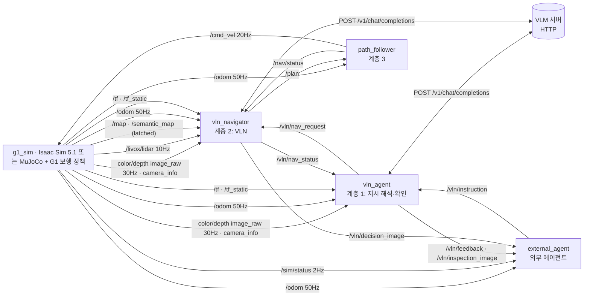

# ROS 2 인터페이스: 토픽·메시지·데이터 크기·QoS·발행/구독

**계층형 VLN 통합 시스템(G1 + 머리 센서 + VLN 에이전트 + 경로계획·추종 + 외부 에이전트)의 전체 토픽 명세와 실측값.**

| 측정 조건 | 값 |
|---|---|
| 측정일·환경 | **Isaac Sim 5.1** (2026-10-17, Ubuntu, RTX 5080 Laptop, Fast DDS, 파일럿 측정 회차 `inspect_conveyor`, 카메라 30 Hz, Qwen3-VL-8B). 비교: MuJoCo(2026-10-16, macOS Docker, CycloneDDS) |
| 원본 | `results/isaac_pilot_2026-10-17/topic_tables.md` (Isaac). MuJoCo와 다른 값은 표 안에 괄호로 표기 |
| 크기 | 메시지 1개의 **직렬화(CDR) 바이트** = DDS가 실어 나르는 페이로드. RTPS·UDP·IP 헤더와 조각화 오버헤드 제외 |
| 주기 | 시뮬레이션 시간 기준 실측. 발행 주기는 launch 기본값 |
| 대역폭 | 평균 크기 × 발행 주기. 실시간(RTF 1)일 때의 벽시계 대역폭 |
| 측정 도구 | `topic_monitor` 노드(raw 구독 + ROS 그래프 API) → `topic_stats.json` → `scripts/topic_report.py` |

- 크기는 시뮬레이터와 거의 무관(같은 `SimTopics` 발행 코드). 다른 것은 LiDAR 반사점 수(장면 표면에 따라 다름): Isaac 평균 약 18,000점, MuJoCo 약 12,500점.
- 재측정(Isaac Sim): `python3 scripts/hvln_experiment.py --simulator isaac --out outputs/exp_<날짜>` → `measurement/topic_tables.md`. 메시지 크기·QoS·발행 코드는 MuJoCo와 같음(`SimTopics` 공용). Isaac LiDAR 점 수는 장면 반사점 수에 따라 다름.

## 1. 토픽별 메시지 타입 (전체 통합 시스템)

기본 구성 = VLN 모드(`planner_mode:=vln`). 발행 노드 `g1_sim`은 MuJoCo(`sim_node`)와 Isaac Sim 5.1(`isaac_sim_node`) 어느 쪽이든 같은 이름·메시지·QoS로 발행(`g1_factory/ros2/sim_bridge.py`의 `SimTopics` 공용).

### 1.1 대용량 센서 토픽

| 토픽 | 메시지 타입 | 발행 노드 → 구독 노드 | 실로봇 대응 |
|---|---|---|---|
| `/camera/camera/color/image_raw` | `sensor_msgs/msg/Image` (rgb8) | `g1_sim` → `vln_navigator`(매 결정), `vln_agent`(도착 후 확인) | `realsense2_camera` (D435i) |
| `/camera/camera/aligned_depth_to_color/image_raw` | `sensor_msgs/msg/Image` (16UC1, mm) | `g1_sim` → `vln_navigator`(접근 대상 3D 위치), `vln_agent` | `realsense2_camera`, `align_depth.enable:=true` |
| `/livox/lidar` | `sensor_msgs/msg/PointCloud2` | `g1_sim` → `vln_navigator`(지도에 없는 장애물 → 국소 우회) | `livox_ros_driver2` (MID-360, `xfer_format=0`) |
| `/map` | `nav_msgs/msg/OccupancyGrid` | `g1_sim` → `vln_navigator`(주행 가능 공간 → 웨이포인트 후보), `external_agent` | SLAM 지도 + `nav2_map_server` |
| `/vln/decision_image` | `sensor_msgs/msg/CompressedImage` (JPEG) | `vln_navigator` → `external_agent`(기록) | 동일 |
| `/vln/inspection_image` | `sensor_msgs/msg/CompressedImage` (JPEG) | `vln_agent` → 외부 에이전트 | 동일 |

### 1.2 상태·좌표계·보조 센서

| 토픽 | 메시지 타입 | 발행 노드 → 구독 노드 |
|---|---|---|
| `/livox/imu` | `sensor_msgs/msg/Imu` | `g1_sim` → (없음. 실로봇에서는 LIO/SLAM이 구독) |
| `/odom` | `nav_msgs/msg/Odometry` | `g1_sim` → `vln_navigator`, `vln_agent`, `path_follower`, `external_agent` |
| `/joint_states` | `sensor_msgs/msg/JointState` | `g1_sim` → (없음. `robot_state_publisher`·RViz용) |
| `/camera/camera/color/camera_info` | `sensor_msgs/msg/CameraInfo` | `g1_sim` → `vln_navigator`, `vln_agent` |
| `/camera/camera/aligned_depth_to_color/camera_info` | `sensor_msgs/msg/CameraInfo` | `g1_sim` → (없음) |
| `/tf` | `tf2_msgs/msg/TFMessage` | `g1_sim` → `vln_navigator`, `vln_agent` |
| `/tf_static` | `tf2_msgs/msg/TFMessage` | `g1_sim` → `vln_navigator`, `vln_agent` |
| `/clock` | `rosgraph_msgs/msg/Clock` | `g1_sim` → `use_sim_time` 노드 전부 |
| `/sim/status` | `std_msgs/msg/String` (JSON) | `g1_sim` → `external_agent` (시뮬레이터 전용) |
| `/semantic_map` | `std_msgs/msg/String` (JSON) | `g1_sim`(Isaac) → `vln_navigator`(토폴로지 경로 힌트), 외부 에이전트·시각화 (시멘틱·토폴로지 레이어, `g1_factory/semantic_world.py`) |

### 1.3 VLN·계획·제어

| 토픽 | 메시지 타입 | 발행 노드 → 구독 노드 |
|---|---|---|
| `/vln/instruction` | `std_msgs/msg/String` (자연어 또는 JSON) | 외부 에이전트 → `vln_agent` |
| `/vln/feedback` | `std_msgs/msg/String` (JSON 이벤트) | `vln_agent` → 외부 에이전트 |
| `/vln/nav_request` | `std_msgs/msg/String` (JSON: 단계 계획·대상·명판 글자, 또는 취소) | `vln_agent` → `vln_navigator` |
| `/vln/nav_status` | `std_msgs/msg/String` (JSON: 결정·단계 완료·대상 위치·도착·실패) | `vln_navigator` → `vln_agent` |
| `/plan` | `nav_msgs/msg/Path` | `vln_navigator` → `path_follower`, `external_agent` |
| `/nav/status` | `std_msgs/msg/String` (JSON) | `path_follower` → `vln_navigator`, `vln_agent`, `external_agent` |
| `/cmd_vel` | `geometry_msgs/msg/Twist` | `path_follower` → `g1_sim` (실로봇: 보행 API 브리지) |
| `/goal_pose`, `/vln/subgoals` | `geometry_msgs/msg/PoseStamped`, `PoseArray` | `vln_agent` → `global_planner` (**`oracle` 기준선 전용**. VLN 모드에서는 발행 안 함) |

SLAM 매핑(`launch/g1_slam_mapping.launch.py`, [SLAM_MAPPING.md](SLAM_MAPPING.md))과 저장한 지도로 VLN을 돌릴 때만 쓰는 토픽:

| 토픽 | 메시지 타입 | 발행 노드 → 구독 노드 |
|---|---|---|
| `/slam/imu` | `sensor_msgs/msg/Imu` (RELIABLE) | `slam_map` (시뮬레이터 `/livox/imu`를 다시 발행) → `fast_lio` |
| `/cloud_registered`, `/Odometry`, `/path` | `PointCloud2`, `Odometry`, `Path` (frame `camera_init`) | `fast_lio` → `slam_map` |
| `/slam/map` | `nav_msgs/msg/OccupancyGrid` (frame `slam_map`, TransientLocal) | `slam_map` → 외부 에이전트, 시각화 (매핑 중 2초마다) |
| `/slam/status` | `std_msgs/msg/String` (JSON) | `slam_map` → `mapping_tour`, 외부 에이전트 |
| `/mapping/done` | `std_msgs/msg/String` | `mapping_tour` → `slam_map` (지도 저장) |
| `/slam_map` | `nav_msgs/msg/OccupancyGrid` (TransientLocal) | `map_file` → `vln_navigator` (`map_file:=`, `map_package:=`로 실행할 때 `/map` 대신), 외부 에이전트 |
| `/slam/semantic_map` | `std_msgs/msg/String` (JSON, TransientLocal) | `map_file` (`map_package:=`) → 외부 에이전트, 시각화 (사람이 그린 방·기준점과 자동 토폴로지) |

ROS 토픽이 아닌 흐름: `vln_navigator`·`vln_agent` ⇄ VLM 서버 HTTP `POST /v1/chat/completions` (JPEG base64 + 프롬프트). 5절 참고.

## 2. 실제 데이터 크기

### 2.1 실측 (발행 주기 × 크기 순)

| 토픽 | 데이터 | 메시지 크기 (평균, 최소–최대) | 주기 | 대역폭 |
|---|---|---|---:|---:|
| `/camera/camera/color/image_raw` | 640×480 rgb8 = 921,600 B 픽셀 + 헤더 72 B | **921,672 B** (고정) | 30 Hz | **27.65 MB/s** |
| `/camera/camera/aligned_depth_to_color/image_raw` | 640×480 16UC1 = 614,400 B + 72 B | **614,472 B** (고정) | 30 Hz | **18.43 MB/s** |
| `/livox/lidar` | 20,000 ray/scan 중 반사점 약 17,500–18,400점 × 26 B (MuJoCo 12,000–13,000점) | **470.0 KB** (456.2–479.7 KB; MuJoCo 325.7 KB) | 10 Hz | **4.70 MB/s** |
| `/livox/imu` | 각속도·가속도 | 324 B | 200 Hz | 64.8 KB/s |
| `/odom` | pose·twist·공분산 | 724 B | 50 Hz | 36.2 KB/s |
| `/joint_states` | 12관절 × (위치·속도·토크) | 644 B | 50 Hz | 32.2 KB/s |
| `/camera/.../camera_info` ×2 | K·D·R·P | 384 B 각 | 30 Hz | 11.5 KB/s 각 |
| `/tf` | odom→base_link 1개 | 100 B | 50 Hz | 5.0 KB/s |
| `/cmd_vel` | vx·vy·yaw rate | 52 B | 20 Hz | 1.0 KB/s |
| `/clock` | sim time | 12 B | 100 Hz | 1.2 KB/s |
| `/sim/status` | JSON | 436–452 B | 2 Hz | 0.9 KB/s |
| `/map` | 0.1 m 격자 780×440 = 343,200 셀 (펌프실 추가 후; 파일럿 측정 시 780×340 = 265,304 B) | **343,304 B** (계산값) | 1회 (latched) | - |
| `/semantic_map` | JSON: 구역 9, 객체 91(클래스·명판·구역·3D 상자), 장소 13, 연결 12(출입구), 기준점 7 | 29,290 B | 1회 (latched) | - |
| `/vln/decision_image` | JPEG q80 640×480 (VLM이 본 영상 + 번호 웨이포인트) | **25.7 KB** (20.3–29.4 KB) | VLN 결정마다 (측정 회차 5회) | - |
| `/vln/inspection_image` | JPEG q85 640×480 | 19.3–20.7 KB | 작업당 1회 | - |
| `/plan` | 0.1 m 간격 PoseStamped. VLN: 결정 1회의 직선 구간(≤8 m), 회전·정지 = 1점 | 100 B – 5.9 KB (평균 3.6 KB) | VLN 결정마다 + 우회 | - |
| `/vln/nav_request` | JSON: 지시·단계 계획·대상·명판 글자 | 512 B | 작업당 1회 (+취소) | - |
| `/vln/feedback` | JSON | 88 B – 2.6 KB | 작업당 약 12회 (결정 수에 비례) | - |
| `/vln/nav_status` | JSON: 결정(생각·선택·자세·지연)·단계 완료·대상 위치·도착 | 369 B (88–736 B) | 결정마다 + 이벤트 (이 회차 9회) | - |
| `/nav/status` | JSON | 172–240 B | 추종 중 1 Hz + 이벤트 | - |
| `/tf_static` | 정적 변환 4개 | 396 B | 1회 (latched) | - |
| `/vln/instruction` | 지시문 UTF-8 | 96–132 B (한글 문장 1개) | 작업당 1회 | - |
| `/goal_pose`, `/vln/subgoals` | 목표 자세, 하위목표 2개 (`oracle` 기준선 전용) | 76 B, 140 B | 목표마다, 작업당 1회 | - |

- **주기 토픽 합계 ≈ 51.0 MB/s (≈ 408 Mbit/s, Isaac).** 이 중 RGB·깊이가 90%. (MuJoCo 49.5 MB/s, LiDAR 점 수 차이)
- `/livox/lidar` 점 수는 장면에 따라 다름: 반사가 없는(40m 밖·하늘 방향) ray는 제외. 실내 벽이 가까우면 최대 20,000점 ≈ 520 KB/scan → 5.2 MB/s.
- 점 하나 26 B: `x,y,z,intensity`(float32×4) + `tag,line`(uint8×2) + `timestamp`(float64). `livox_ros_driver2` PointCloud2 배치(packed `LivoxPointXyzrtlt`)와 동일.

### 2.2 실제 센서 설정별 크기 (계산값)

`Image` = 가로×세로×픽셀 바이트 + 약 72 B. `PointCloud2` = 점 수×26 B + 약 250 B.

| 센서·설정 | 메시지 크기 | 30 Hz / 10 Hz 대역폭 |
|---|---:|---:|
| D435i color 640×480 rgb8 (이 스택) | 921,672 B | 27.6 MB/s |
| D435i color 1280×720 rgb8 | 2,764,872 B | 82.9 MB/s |
| D435i depth 848×480 16UC1 (D400 계열 깊이 기본 프로필) | 814,152 B | 24.4 MB/s |
| D435i aligned depth 640×480 16UC1 (이 스택) | 614,472 B | 18.4 MB/s |
| D435i color 640×480 @15 Hz | 921,672 B | 13.8 MB/s |
| MID-360 PointCloud2, 20,000점/scan @10 Hz | 약 520 KB | 5.2 MB/s |
| MID-360 `livox_ros_driver2/CustomMsg` (`xfer_format=1`), 점당 약 20 B(CDR 정렬 포함) | 약 400 KB | 약 4.0 MB/s |

- 실제 G1의 저수준 상태 `rt/lowstate`(`unitree_hg/LowState`, 500 Hz)·명령 `rt/lowcmd`는 이 스택에서 사용하지 않아 미측정. 보행 정책을 로봇 외부에서 돌릴 때만 해당.

## 3. Publisher 옵션 (발행 주기·QoS)

QoS 표기: 신뢰성 / 지속성 / 이력(깊이). 정의는 한 파일에 모음: `g1_factory/ros2/qos.py`. 신뢰성·지속성은 실행 중 ROS 그래프에서 확인(Isaac·MuJoCo 동일). 이력 깊이는 Fast DDS 그래프 API가 알려주지 않아(`UNKNOWN`) 코드 값.

| 토픽 | 발행 노드 | 주기·발행 시점 | QoS | frame_id |
|---|---|---|---|---|
| color `image_raw`, aligned depth `image_raw` | `g1_sim` | 30 Hz (`camera_rate_hz`). 같은 렌더 패스에서 RGB·깊이 동시 발행, 같은 stamp | BestEffort / Volatile / KeepLast(5) | `camera_color_optical_frame` |
| `camera_info` ×2 | `g1_sim` | 영상과 같은 시점 | BestEffort / Volatile / KeepLast(5) | 같음 |
| `/livox/lidar` | `g1_sim` | 10 Hz (`lidar_rate_hz`), 점별 `timestamp`(ns) 포함 | BestEffort / Volatile / KeepLast(5) | `livox_frame` |
| `/livox/imu` | `g1_sim` | 200 Hz | BestEffort / Volatile / KeepLast(50) | `livox_frame` |
| `/odom`, `/joint_states` | `g1_sim` | 50 Hz (보행 정책 주기) | Reliable / Volatile / KeepLast(10) | `odom` → `base_link` |
| `/tf` | `g1_sim` | 50 Hz | Reliable / Volatile / KeepLast(100) | odom→base_link |
| `/tf_static` | `g1_sim` | 시작 시 1회 | Reliable / **TransientLocal** / KeepLast(1) | map→odom, base_link→camera_link→optical, base_link→livox_frame |
| `/map` | `g1_sim` | 시작 시 1회 | Reliable / **TransientLocal** / KeepLast(1) | `map` |
| `/semantic_map` | `g1_sim` (Isaac) | 시작 시 1회 (`outputs/isaac/semantic_map.json`) | Reliable / **TransientLocal** / KeepLast(1) | `map` |
| `/clock` | `g1_sim` | 100 Hz (sim time) | BestEffort / Volatile / KeepLast(1) | - |
| `/sim/status` | `g1_sim` | 2 Hz | Reliable / Volatile / KeepLast(10) | - |
| `/vln/feedback` | `vln_agent` | 상태 변화·VLN 결정마다 | Reliable / Volatile / KeepLast(50) | - |
| `/vln/nav_request` | `vln_agent` | 작업 시작 1회, 취소·선점 시 | Reliable / Volatile / KeepLast(10) | - |
| `/vln/inspection_image` | `vln_agent` | 확인 완료 시 1회 | Reliable / Volatile / KeepLast(2) | `camera_color_optical_frame` |
| `/vln/nav_status` | `vln_navigator` | VLN 결정마다(작업당 10–40회) + 단계 완료·대상 위치·도착·실패·우회 | Reliable / Volatile / KeepLast(50) | - |
| `/vln/decision_image` | `vln_navigator` | VLN 결정마다 (VLM이 본 영상 + 번호 웨이포인트) | Reliable / Volatile / KeepLast(2) | `camera_color_optical_frame` |
| `/plan` | `vln_navigator` | 결정마다 1개(직선 구간·회전·접근), LiDAR가 구간을 막으면 우회 경로(0.5 s마다 검사), 취소·정지 시 제자리 1점 | Reliable / Volatile / KeepLast(1) | `map`. header.stamp = 계획 id(우회는 같은 id) |
| `/nav/status` | `path_follower` | following 1 Hz, reached/failed 이벤트 | Reliable / Volatile / KeepLast(50) | - |
| `/goal_pose`, `/vln/subgoals` | `vln_agent` | `oracle` 기준선에서만 (하위목표마다 / 계획 시 1회, TransientLocal) | Reliable / Volatile·TransientLocal | `map` |
| `/cmd_vel` | `path_follower` | 20 Hz (경로 추종·위치 유지 중에만. 대기 중에는 발행 안 함) | Reliable / Volatile / KeepLast(10) | base_link 기준 |
| `/vln/instruction` | 외부 에이전트 | 지시마다 | Reliable / Volatile / KeepLast(10) | - |

QoS 선택 이유:
- **센서(BestEffort, 얕은 큐)**: 늦게 온 영상·점군은 쓸모가 없음. 재전송으로 최신 데이터가 밀리지 않도록. 구독 측이 BestEffort이면 발행 측 신뢰성과 무관하게 연결됨 → Isaac Sim·실드라이버(기본 Reliable)와도 호환.
- **명령·상태·이벤트(Reliable)**: 목표·경로·도착 이벤트는 하나라도 잃으면 작업이 멈춤.
- **지도·정적 TF(TransientLocal)**: 늦게 시작한 노드도 마지막 값을 받음. `vln_navigator`는 `/map`을 받아야 웨이포인트 후보를 만들 수 있음.
- **결정 이미지(Reliable, 깊이 2)**: 결정마다 1장이고 실험 기록용이므로 잃지 않도록.
- **`/plan` 깊이 1**: 최신 계획만 유효.
- 참고: `realsense2_camera`의 영상 기본 QoS는 `SYSTEM_DEFAULT`(Reliable), `livox_ros_driver2`의 발행 큐 깊이는 32. 실드라이버를 쓸 때도 이 스택의 BestEffort 구독은 그대로 동작.

## 4. Subscriber 옵션

| 구독 노드 | 토픽 | QoS | 처리 |
|---|---|---|---|
| `vln_navigator` | `/vln/nav_request` | Reliable / Volatile / KeepLast(10) | 작업 시작(이전 작업 선점, 제자리 정지) 또는 취소 |
| | `/map` | Reliable / TransientLocal / KeepLast(1) | 비용지도(거리장) + 1.5 m 격자 웨이포인트 로드맵 생성 |
| | color `image_raw` | BestEffort / Volatile / KeepLast(5) | 최신 1장. 정지 후(0.4 s 이후) 촬영된 프레임만 VLM 결정에 사용 |
| | aligned depth `image_raw` | BestEffort / Volatile / KeepLast(5) | 최근 8장 → RGB와 stamp가 같은(±0.1 s) 프레임으로 접근 대상 3D 위치 |
| | color `camera_info` | BestEffort / Volatile / KeepLast(5) | 웨이포인트를 영상에 투영, bbox → 3D |
| | `/livox/lidar` | BestEffort / Volatile / KeepLast(5) | 스캔 stamp의 TF로 map 변환 → 높이 0.15–1.7 m, 거리 0.3–8 m 점 중 지도에 없는 칸 표시(감쇠) → 현재 구간이 막히면 국소 우회 |
| | `/odom` | Reliable / Volatile / KeepLast(10) | 현재 자세, 방문 기록 |
| | `/semantic_map` | Reliable / TransientLocal / KeepLast(1) | 장소 그래프 → 매 결정 프롬프트에 목표 구역까지 토폴로지 경로·다음 출입구 (없으면 `outputs/isaac/semantic_map.json`) |
| | `/nav/status` | Reliable / Volatile / KeepLast(50) | 현재 계획 id의 reached/failed → 다음 결정 |
| | `/tf`, `/tf_static` | tf2_ros 기본 (Reliable, KeepLast 100) | camera optical·livox_frame → map |
| `vln_agent` | `/vln/instruction` | Reliable / Volatile / KeepLast(10) | 작업 시작·선점·취소. VLM 호출은 작업 스레드 |
| | `/vln/nav_status` | Reliable / Volatile / KeepLast(50) | 현재 작업 id의 이벤트만 → `/vln/feedback`으로 중계, `arrived` 후 확인 |
| | color `image_raw`, aligned depth `image_raw`, `camera_info` | BestEffort / Volatile / KeepLast(5) | 도착·정지 후 촬영된 프레임으로 VQA 확인 |
| | `/odom` | Reliable / Volatile / KeepLast(10) | 최종 자세 보고 |
| `path_follower` | `/plan` | Reliable / Volatile / KeepLast(1) | 경로 교체(같은 id면 우회로 처리). 1점 경로 = 제자리 정렬·유지 |
| | `/odom` | Reliable / Volatile / KeepLast(10) | 0.5 s 이상 끊기면 정지 |
| `g1_sim` | `/cmd_vel` | Reliable / Volatile / KeepLast(10) | 0.5 s 이상 명령이 없으면 0 명령. 보행 정책은 50 Hz로 최신 명령 사용 |
| `external_agent` | `/vln/feedback`, `/vln/inspection_image`, `/vln/decision_image`, `/odom`, `/plan`, `/nav/status`, `/sim/status`, `/map` | 발행 측과 동일 | 기록·평가(`summary.json`, `decisions/*.jpg`) |
| 모든 sim-time 노드 | `/clock` | BestEffort / Volatile / KeepLast(1) | rclpy TimeSource 기본 |

- 모든 노드: rclpy 단일 스레드 executor. 블로킹 작업은 VLM HTTP 호출뿐이며 `vln_navigator`·`vln_agent` 모두 별도 작업 스레드에서 실행 → 기다리는 동안에도 센서·odom 수신과 경로추종(위치 유지)은 계속됨.
- 센서 구독이 BestEffort이므로 발행 측이 Reliable(Isaac Sim, `realsense2_camera` 기본)이든 BestEffort든 연결됨.

## 5. 발행 노드 → 구독 노드



| 노드 | 발행 | 구독 |
|---|---|---|
| `g1_sim` (Isaac `isaac_sim_node`) | `/clock`, color·depth `image_raw`·`camera_info`, `/livox/lidar`, `/livox/imu`, `/odom`, `/joint_states`, `/tf`, `/tf_static`, `/map`, `/semantic_map`, `/sim/status` | `/cmd_vel` |
| `vln_agent` | `/vln/feedback`, `/vln/inspection_image`, `/vln/nav_request` | `/vln/instruction`, `/vln/nav_status`, `/odom`, color `image_raw`·`camera_info`, depth `image_raw`, `/tf`, `/tf_static`, `/clock` |
| `vln_navigator` | `/plan`, `/vln/nav_status`, `/vln/decision_image` | `/vln/nav_request`, `/map`, `/semantic_map`, `/odom`, color `image_raw`·`camera_info`, depth `image_raw`, `/livox/lidar`, `/nav/status`, `/tf`, `/tf_static`, `/clock` |
| `path_follower` | `/cmd_vel`, `/nav/status` | `/plan`, `/odom`, `/clock` |
| `external_agent` (평가기) | `/vln/instruction` | `/vln/feedback`, `/vln/inspection_image`, `/vln/decision_image`, `/odom`, `/sim/status`, `/nav/status`, `/plan`, `/map`, `/clock` |
| `topic_monitor` (측정 전용) | - | 위 토픽 전부 (raw) |
| `global_planner` (`oracle` 기준선 전용) | `/plan`, `/nav/status` | `/map`, `/odom`, `/goal_pose`, `/livox/lidar`, `/tf` |

로봇 내부 vs 외부 경계:
- **로봇 내부(온보드)**: `g1_sim`(실로봇에서는 센서 드라이버 + 보행 제어) → `vln_navigator`·`vln_agent`·`path_follower`. 영상·깊이·LiDAR 같은 대용량 토픽은 이 안에서만 흐름.
- **외부와 주고받는 것**: `/vln/instruction`(외부 에이전트 → 로봇), `/vln/feedback`·`/vln/inspection_image`(로봇 → 외부 에이전트), VLM HTTP(로봇 ↔ VLM 서버). `external_agent` 노드는 실험에서 외부 에이전트 역할을 대신하는 평가기.

### 네트워크 배치 시 주의

- 원시 RGB+깊이만 46 MB/s(≈370 Mbit/s). **Wi-Fi로 로봇 밖에 보내는 구성은 비현실적.**
- 권장 배치: `vln_agent`·`vln_navigator`·`path_follower`를 로봇 온보드(Jetson Orin 등)나 유선 엣지에 둠. 네트워크를 건너는 것은 VLM HTTP 호출(아래)과 외부 에이전트와의 `/vln/instruction`·`/vln/feedback`·`/vln/inspection_image`뿐.
- 원격 시각화가 필요하면 `image_transport` 압축 토픽(JPEG 약 20 KB/장)이나 저주기 throttle 사용.
- 대용량 BestEffort 메시지는 UDP 조각 하나만 잃어도 전체가 버려짐 → 수신 버퍼 확대: `configs/cyclonedds.xml`(MuJoCo 구성) 또는 `configs/fastdds.xml`(Isaac Sim 구성) + `sudo sysctl -w net.core.rmem_max=2147483647 net.core.wmem_max=2147483647`.
- Fast DDS 실측(같은 호스트, 30 Hz RGB 0.9 MB, 10초): 기본 설정 수신 161/281 = 57%, `configs/fastdds.xml`(UDP, 16 MB 소켓 버퍼) 278/278 = 100%.

### VLM HTTP (ROS 외 데이터 흐름)

| 호출 | 노드 | 시점 | 요청 (실측) | 응답 (실측) | 지연 (Mac M1, 4B) |
|---|---|---|---:|---:|---:|
| 단계 분해 | `vln_agent` | 지시 수신 시 1회 | 1.9 KB (지시 + 구역 목록, 이미지 없음) | 0.8 KB | 3.9 s |
| VLN 결정 | `vln_navigator` | 결정마다 (작업당 4–40회) | 47–55 KB (번호를 그린 JPEG 640×480 + 지도 맥락 텍스트) | 약 0.2 KB | 9.9–12.7 s |
| VLN 결정 + 명판 재판독 | `vln_navigator` | `approach`를 고를 때 | 68 KB (위 + 확대 이미지 1장) | 약 0.1 KB | 18.8 s |
| 둘러보기 (4방향 중 선택) | `vln_navigator` | 대상 구역 첫 도착 시 1회 | 195 KB (JPEG 4장 + 지시) | 약 0.3 KB | 22.5 s |
| 확인 VQA | `vln_agent` | 도착 후 1회 | 29.0 KB (JPEG 1장 + 질문) | 0.6 KB | 8.4 s |

- Isaac Sim 파일럿(Qwen3-VL-8B, RTX 5080 Laptop): 결정당 VLM 지연 평균 **4.28 s**(9개 과제). 아래 표의 지연은 Mac(M1, 4B) 값.
- 측정: `inspect_station_paraphrase` VLN 회차(결정 4회), 둘러보기는 `inspect_conveyor` 회차. 요청 크기는 HTTP 본문(JSON, 이미지 base64) 바이트.
- 둘러보기 요청은 영상 4장(Ollama 기준 장당 약 1,050 토큰) → VLM 서버 문맥 길이 8192 이상 필요(`OLLAMA_CONTEXT_LENGTH=8192`, vLLM `--max-model-len`).
- 작업 1회당 VLM 트래픽 약 0.5 MB(결정 4회 + 둘러보기 1회) – 2.7 MB(결정 40회). 원시 센서 스트림(약 50 MB/s) 대비 무시할 수준 → VLM 서버는 원격에 두어도 됨. 위 지연은 Mac(M1, Metal) 값이며, Ubuntu GPU 지연은 실험 행렬의 `results.md`로 측정([UBUNTU_ISAAC.md](UBUNTU_ISAAC.md) 6절).
- 이전 `oracle` 경로의 호출(작업 계획 5.6 KB·2.9 s, 대상 bbox 17.5–27.0 KB·5.1 s, 확인 18.0–37.9 KB·6.2 s)은 기준선 조건에서만 발생.

## 6. Publisher / Subscriber 코드

전체 노드: `g1_factory/ros2/` · QoS·토픽 정의: [`qos.py`](../g1_factory/ros2/qos.py) · 메시지 변환: [`messages.py`](../g1_factory/ros2/messages.py).

### 6.1 QoS 정의

```python
# g1_factory/ros2/qos.py
def _qos(depth, reliable=True, latched=False):
    return QoSProfile(history=HistoryPolicy.KEEP_LAST, depth=depth,
                      reliability=ReliabilityPolicy.RELIABLE if reliable else ReliabilityPolicy.BEST_EFFORT,
                      durability=DurabilityPolicy.TRANSIENT_LOCAL if latched else DurabilityPolicy.VOLATILE)

SENSOR = _qos(5, reliable=False)    # 영상·깊이·점군
IMU = _qos(50, reliable=False)
CLOCK = _qos(1, reliable=False)
STATE = _qos(10)                    # odom, joint_states, cmd_vel, status
TF = _qos(100)
TF_STATIC = _qos(1, latched=True)
LATCHED = _qos(1, latched=True)     # /map, /vln/subgoals
COMMAND = _qos(10)                  # /goal_pose, /vln/instruction
EVENTS = _qos(50)                   # /vln/feedback, /nav/status
EVIDENCE = _qos(2)                  # /vln/inspection_image
PATH = _qos(1)                      # /plan
```

### 6.2 대용량 센서 Publisher (`g1_sim`, MuJoCo·Isaac 공용)

```python
# g1_factory/ros2/sim_bridge.py  (sim_node.py, isaac/isaac_sim_node.py 모두 이 클래스로 발행)
class SimTopics:
    def __init__(self, node, now_fn):
        pub = lambda name, msg: node.create_publisher(msg, name, TOPICS[name][1])
        self.rgb = pub("/camera/camera/color/image_raw", Image)
        self.depth = pub("/camera/camera/aligned_depth_to_color/image_raw", Image)
        self.cloud = pub("/livox/lidar", PointCloud2)
        node.create_subscription(Twist, "/cmd_vel", self._on_cmd, TOPICS["/cmd_vel"][1])

    def publish_camera(self, t, rgb, depth_m, fx, fy, cx, cy):   # 한 번의 렌더 패스, 같은 stamp
        frame = "camera_color_optical_frame"
        info = M.camera_info_msg(t, frame, w, h, fx, fy, cx, cy)
        self.rgb.publish(M.image_msg(t, frame, rgb, "rgb8"))
        depth_mm = np.round(np.clip(np.nan_to_num(depth_m), 0, 65.535)*1000).astype(np.uint16)
        self.depth.publish(M.image_msg(t, frame, depth_mm, "16UC1"))

    def publish_lidar(self, t, xyz, intensity, line, point_ns):  # Livox 점 배치 26 B/점
        self.cloud.publish(M.livox_cloud_msg(t, "livox_frame", xyz, intensity, line, point_ns))

# g1_factory/ros2/messages.py
def image_msg(t, frame, pixels, encoding):
    msg = Image()
    msg.header.stamp, msg.header.frame_id = stamp(t), frame
    msg.height, msg.width = pixels.shape[:2]
    msg.encoding, msg.step = encoding, pixels.strides[0]
    msg.data = array("B", pixels.tobytes())  # array.array: 원소별 검사 없이 복사
    return msg
```

### 6.3 LiDAR Subscriber (`vln_navigator`)

```python
# g1_factory/ros2/vln_navigator_node.py
sub("/livox/lidar", PointCloud2, self.on_cloud)          # SENSOR QoS (BestEffort, 깊이 5)

def on_cloud(self, msg):
    try:  # 스캔 stamp의 TF, 기다리지 않음
        tf = self.buffer.lookup_transform("map", msg.header.frame_id, Time.from_msg(msg.header.stamp))
    except Exception:
        return
    xyz = M.cloud_xyz(msg)                     # x,y,z 필드만 읽음 → Livox·Isaac 모두 가능
    rng = np.linalg.norm(xyz, axis=1)
    xyz = xyz[(rng > 0.3) & (rng < 8.0)]
    matrix = M.transform_matrix(tf.transform)
    world = xyz@matrix[:3, :3].T+matrix[:3, 3]
    world = world[(world[:, 2] > 0.15) & (world[:, 2] < 1.7)]
    self.costmap.mark_points(world[:, :2], self.now())   # 지도에 없는 장애물 층 → 구간이 막히면 국소 우회
```

### 6.4 영상·깊이 Subscriber와 결정 이미지 Publisher (`vln_navigator`)

```python
# g1_factory/ros2/vln_navigator_node.py
sub("/camera/camera/color/image_raw", Image, self.on_rgb)               # SENSOR QoS
sub("/camera/camera/aligned_depth_to_color/image_raw", Image, self.on_depth)
self.depths = deque(maxlen=8)
self.pub_image = pub("/vln/decision_image", CompressedImage)            # EVIDENCE QoS

def on_rgb(self, msg):   self.rgb = msg          # 최신 1장
def on_depth(self, msg): self.depths.append(msg)

def fresh_frame(self):  # 정지 후 촬영된 RGB + 같은 시각의 깊이 + 그 시각의 카메라 자세
    stamp = M.to_seconds(self.rgb.header.stamp)
    if stamp < self.arrival+self.settle*0.5:
        return None
    depth = min(self.depths, key=lambda d: abs(M.to_seconds(d.header.stamp)-stamp), default=None)
    tf = self.buffer.lookup_transform("map", self.rgb.header.frame_id, Time.from_msg(self.rgb.header.stamp))
    return self.rgb, depth, M.transform_matrix(tf.transform)

def act(self, d):  # VLM 결정 1회 → 기록 + 실행
    image = CompressedImage(format="jpeg", data=array("B", encode_jpeg(d.prompt_image, 80)))
    self.pub_image.publish(image)                # VLM이 본 영상 + 번호 웨이포인트
    self.report("decision", action=d.action, thought=d.thought, waypoint=..., vlm_latency_s=...)
    if d.action == "move":
        self.send_path(self.segment(d.goal), d.goal[2], "move")   # 직선 구간 (막히면 국소 우회)
```

### 6.5 외부 에이전트 Publisher / Subscriber

```python
# scripts/send_instruction.py (외부 에이전트 최소 예제)
COMMAND = QoSProfile(history=HistoryPolicy.KEEP_LAST, depth=10,
                     reliability=ReliabilityPolicy.RELIABLE, durability=DurabilityPolicy.VOLATILE)
self.pub = self.create_publisher(String, "/vln/instruction", COMMAND)
self.create_subscription(String, "/vln/feedback", self.on_feedback, EVENTS)
self.create_subscription(CompressedImage, "/vln/inspection_image", self.on_image, EVIDENCE)

def tick(self):  # 구독자가 연결된 뒤 1회 발행 (Volatile이므로 연결 전 메시지는 유실)
    if not self.sent and self.pub.get_subscription_count() > 0:
        self.pub.publish(String(data=self.payload))
        self.sent = True
```

### 6.6 측정용 raw Subscriber (`topic_monitor`)

```python
# g1_factory/ros2/topic_monitor.py
for name, (type_name, qos) in TOPICS.items():
    self.create_subscription(get_message(type_name), name, self._callback(name), qos, raw=True)
    # raw=True → 역직렬화 없이 CDR bytes 그대로 → len(raw) = 메시지 크기
pubs = self.get_publishers_info_by_topic(name)       # 실제 발행 노드와 QoS
subs = self.get_subscriptions_info_by_topic(name)    # 실제 구독 노드와 QoS
```
