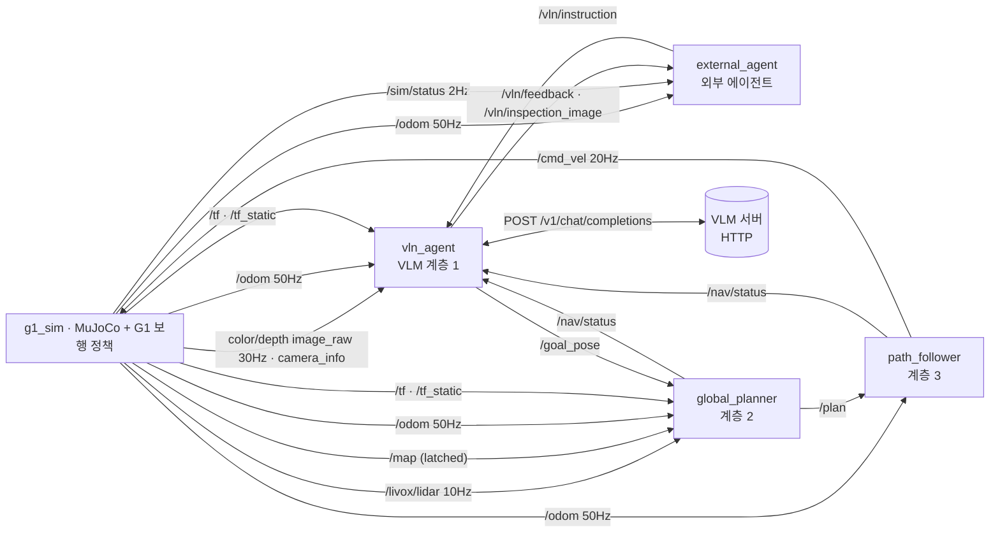

# ROS 2 인터페이스: 토픽·메시지·데이터 크기·QoS·발행/구독

**계층형 VLN 통합 시스템(G1 + 머리 센서 + VLN 에이전트 + 경로계획·추종 + 외부 에이전트)의 전체 토픽 명세와 실측값.**

| 측정 조건 | 값 |
|---|---|
| 측정일·환경 | 2026-10-16 · ROS 2 Humble · CycloneDDS · Docker(macOS M1 Pro, CPU 렌더링) |
| 에피소드 | `inspect_conveyor` (자재 창고 → 조립 라인 컨베이어 확인), 시뮬레이션 84.6초, VLM Qwen3-VL 4B |
| 크기 | 메시지 1개의 **직렬화(CDR) 바이트** = DDS가 실어 나르는 페이로드. RTPS·UDP·IP 헤더와 조각화 오버헤드 제외 |
| 주기 | 시뮬레이션 시간 기준 실측. 발행 주기는 launch 기본값 |
| 대역폭 | 평균 크기 × 발행 주기. 실시간(RTF 1)일 때의 벽시계 대역폭 |
| 측정 도구 | `topic_monitor` 노드(raw 구독 + ROS 그래프 API) → `topic_stats.json` → `scripts/topic_report.py` |

- 크기는 하드웨어와 무관. 이 Mac은 CPU 렌더링이라 실시간의 0.15배로 돌았고, 벽시계 대역폭도 같은 비율로 낮았음. Ubuntu GPU에서 RTF ≈ 1이면 아래 대역폭 그대로.
- 재측정: `python3 scripts/hvln_experiment.py --out outputs/exp_<날짜>` → `measurement/topic_tables.md`.

## 1. 토픽별 메시지 타입 (전체 통합 시스템)

### 1.1 대용량 센서 토픽

| 토픽 | 메시지 타입 | 발행 노드 → 구독 노드 | 실로봇 대응 |
|---|---|---|---|
| `/camera/camera/color/image_raw` | `sensor_msgs/msg/Image` (rgb8) | `g1_sim` → `vln_agent` | `realsense2_camera` (D435i) |
| `/camera/camera/aligned_depth_to_color/image_raw` | `sensor_msgs/msg/Image` (16UC1, mm) | `g1_sim` → `vln_agent` | `realsense2_camera`, `align_depth.enable:=true` |
| `/livox/lidar` | `sensor_msgs/msg/PointCloud2` | `g1_sim` → `global_planner` | `livox_ros_driver2` (MID-360, `xfer_format=0`) |
| `/map` | `nav_msgs/msg/OccupancyGrid` | `g1_sim` → `global_planner`, `external_agent` | `nav2_map_server` 또는 SLAM |
| `/vln/inspection_image` | `sensor_msgs/msg/CompressedImage` (JPEG) | `vln_agent` → `external_agent` | 동일 |

### 1.2 상태·좌표계·보조 센서

| 토픽 | 메시지 타입 | 발행 노드 → 구독 노드 |
|---|---|---|
| `/livox/imu` | `sensor_msgs/msg/Imu` | `g1_sim` → (없음. 실로봇에서는 LIO/SLAM이 구독) |
| `/odom` | `nav_msgs/msg/Odometry` | `g1_sim` → `vln_agent`, `global_planner`, `path_follower`, `external_agent` |
| `/joint_states` | `sensor_msgs/msg/JointState` | `g1_sim` → (없음. `robot_state_publisher`·RViz용) |
| `/camera/camera/color/camera_info` | `sensor_msgs/msg/CameraInfo` | `g1_sim` → `vln_agent` |
| `/camera/camera/aligned_depth_to_color/camera_info` | `sensor_msgs/msg/CameraInfo` | `g1_sim` → (없음) |
| `/tf` | `tf2_msgs/msg/TFMessage` | `g1_sim` → `vln_agent`, `global_planner` |
| `/tf_static` | `tf2_msgs/msg/TFMessage` | `g1_sim` → `vln_agent`, `global_planner` |
| `/clock` | `rosgraph_msgs/msg/Clock` | `g1_sim` → `use_sim_time` 노드 전부 |
| `/sim/status` | `std_msgs/msg/String` (JSON) | `g1_sim` → `external_agent` (시뮬레이터 전용) |

### 1.3 VLN·계획·제어

| 토픽 | 메시지 타입 | 발행 노드 → 구독 노드 |
|---|---|---|
| `/vln/instruction` | `std_msgs/msg/String` (자연어 또는 JSON) | 외부 에이전트 → `vln_agent` |
| `/vln/feedback` | `std_msgs/msg/String` (JSON 이벤트) | `vln_agent` → 외부 에이전트 |
| `/vln/subgoals` | `geometry_msgs/msg/PoseArray` | `vln_agent` → (RViz 시각화) |
| `/goal_pose` | `geometry_msgs/msg/PoseStamped` | `vln_agent` → `global_planner` |
| `/plan` | `nav_msgs/msg/Path` | `global_planner` → `path_follower`, `external_agent` |
| `/nav/status` | `std_msgs/msg/String` (JSON) | `global_planner`, `path_follower` → `vln_agent`, `external_agent` |
| `/cmd_vel` | `geometry_msgs/msg/Twist` | `path_follower` → `g1_sim` (실로봇: 보행 API 브리지) |

ROS 토픽이 아닌 흐름: `vln_agent` ⇄ VLM 서버 HTTP `POST /v1/chat/completions` (JPEG base64 + 프롬프트). 4절 참고.

## 2. 실제 데이터 크기

### 2.1 실측 (발행 주기 × 크기 순)

| 토픽 | 데이터 | 메시지 크기 (평균, 최소–최대) | 주기 | 대역폭 |
|---|---|---|---:|---:|
| `/camera/camera/color/image_raw` | 640×480 rgb8 = 921,600 B 픽셀 + 헤더 72 B | **921,672 B** (고정) | 30 Hz | **27.65 MB/s** |
| `/camera/camera/aligned_depth_to_color/image_raw` | 640×480 16UC1 = 614,400 B + 72 B | **614,472 B** (고정) | 30 Hz | **18.43 MB/s** |
| `/livox/lidar` | 20,000 ray/scan 중 반사점 약 12,000–13,000점 × 26 B | **325.7 KB** (314.4–338.5 KB) | 10 Hz | **3.26 MB/s** |
| `/livox/imu` | 각속도·가속도 | 324 B | 200 Hz | 64.8 KB/s |
| `/odom` | pose·twist·공분산 | 724 B | 50 Hz | 36.2 KB/s |
| `/joint_states` | 12관절 × (위치·속도·토크) | 644 B | 50 Hz | 32.2 KB/s |
| `/camera/.../camera_info` ×2 | K·D·R·P | 384 B 각 | 30 Hz | 11.5 KB/s 각 |
| `/tf` | odom→base_link 1개 | 100 B | 50 Hz | 5.0 KB/s |
| `/cmd_vel` | vx·vy·yaw rate | 52 B | 20 Hz | 1.0 KB/s |
| `/clock` | sim time | 12 B | 100 Hz | 1.2 KB/s |
| `/sim/status` | JSON | 436–452 B | 2 Hz | 0.9 KB/s |
| `/map` | 0.1 m 격자 780×340 = 265,200 셀 | **265,304 B** | 1회 (latched) | - |
| `/plan` | 0.1 m 간격 PoseStamped (경로 길이 비례) | 676 B – 17.5 KB | 목표·재계획마다 | - |
| `/vln/inspection_image` | JPEG q85 640×480 | 19.3 KB | 작업당 1회 | - |
| `/vln/feedback` | JSON | 108 B – 1.1 KB | 작업당 약 11회 | - |
| `/nav/status` | JSON | 224–240 B | 추종 중 1 Hz + 이벤트 | - |
| `/tf_static` | 정적 변환 4개 | 396 B | 1회 (latched) | - |
| `/goal_pose` | 목표 자세 | 76 B | 목표마다 | - |
| `/vln/instruction` | 지시문 UTF-8 | 96 B (한글 문장 1개) | 작업당 1회 | - |
| `/vln/subgoals` | 하위목표 2개 | 140 B | 작업당 1회 | - |

- **주기 토픽 합계 ≈ 49.5 MB/s (≈ 396 Mbit/s).** 이 중 RGB·깊이가 93%.
- `/livox/lidar` 점 수는 장면에 따라 다름: 반사가 없는(40m 밖·하늘 방향) ray는 제외. 실내 벽이 가까우면 최대 20,000점 ≈ 520 KB/scan → 5.2 MB/s.
- 점 하나 26 B: `x,y,z,intensity`(float32×4) + `tag,line`(uint8×2) + `timestamp`(float64). `livox_ros_driver2` PointCloud2 배치(packed `LivoxPointXyzrtlt`)와 동일.

### 2.2 실제 센서 설정별 크기 (계산값)

`Image` = 가로×세로×픽셀 바이트 + 약 72 B. `PointCloud2` = 점 수×26 B + 약 250 B.

| 센서·설정 | 메시지 크기 | 30 Hz / 10 Hz 대역폭 |
|---|---:|---:|
| D435i color 640×480 rgb8 (이 스택) | 921,672 B | 27.6 MB/s |
| D435i color 1280×720 rgb8 | 2,764,872 B | 82.9 MB/s |
| D435i depth 848×480 16UC1 (D400 계열 깊이 기본 프로필) | 814,152 B | 24.4 MB/s |
| D435i aligned depth 640×480 16UC1 (이 스택) | 614,472 B | 18.4 MB/s |
| D435i color 640×480 @15 Hz | 921,672 B | 13.8 MB/s |
| MID-360 PointCloud2, 20,000점/scan @10 Hz | 약 520 KB | 5.2 MB/s |
| MID-360 `livox_ros_driver2/CustomMsg` (`xfer_format=1`), 점당 약 20 B(CDR 정렬 포함) | 약 400 KB | 약 4.0 MB/s |

- 실제 G1의 저수준 상태 `rt/lowstate`(`unitree_hg/LowState`, 500 Hz)·명령 `rt/lowcmd`는 이 스택에서 사용하지 않아 미측정. 보행 정책을 로봇 외부에서 돌릴 때만 해당.

## 3. Publisher 옵션 (발행 주기·QoS)

QoS 표기: 신뢰성 / 지속성 / 이력(깊이). 정의는 한 파일에 모음: `g1_factory/ros2/qos.py`.

| 토픽 | 발행 노드 | 주기·발행 시점 | QoS | frame_id |
|---|---|---|---|---|
| color `image_raw`, aligned depth `image_raw` | `g1_sim` | 30 Hz (`camera_rate_hz`). 같은 렌더 패스에서 RGB·깊이 동시 발행, 같은 stamp | BestEffort / Volatile / KeepLast(5) | `camera_color_optical_frame` |
| `camera_info` ×2 | `g1_sim` | 영상과 같은 시점 | BestEffort / Volatile / KeepLast(5) | 같음 |
| `/livox/lidar` | `g1_sim` | 10 Hz (`lidar_rate_hz`), 점별 `timestamp`(ns) 포함 | BestEffort / Volatile / KeepLast(5) | `livox_frame` |
| `/livox/imu` | `g1_sim` | 200 Hz | BestEffort / Volatile / KeepLast(50) | `livox_frame` |
| `/odom`, `/joint_states` | `g1_sim` | 50 Hz (보행 정책 주기) | Reliable / Volatile / KeepLast(10) | `odom` → `base_link` |
| `/tf` | `g1_sim` | 50 Hz | Reliable / Volatile / KeepLast(100) | odom→base_link |
| `/tf_static` | `g1_sim` | 시작 시 1회 | Reliable / **TransientLocal** / KeepLast(1) | map→odom, base_link→camera_link→optical, base_link→livox_frame |
| `/map` | `g1_sim` | 시작 시 1회 | Reliable / **TransientLocal** / KeepLast(1) | `map` |
| `/clock` | `g1_sim` | 100 Hz (sim time) | BestEffort / Volatile / KeepLast(1) | - |
| `/sim/status` | `g1_sim` | 2 Hz | Reliable / Volatile / KeepLast(10) | - |
| `/goal_pose` | `vln_agent` | 하위목표·재접근·둘러보기·정지마다 | Reliable / Volatile / KeepLast(10) | `map` |
| `/vln/feedback` | `vln_agent` | 상태 변화마다 | Reliable / Volatile / KeepLast(50) | - |
| `/vln/subgoals` | `vln_agent` | 작업 계획 시 1회 | Reliable / **TransientLocal** / KeepLast(1) | `map` |
| `/vln/inspection_image` | `vln_agent` | 확인 완료 시 1회 | Reliable / Volatile / KeepLast(2) | `camera_color_optical_frame` |
| `/plan` | `global_planner` | 새 목표, 경로가 막혀 재계획할 때(0.5 s마다 검사) | Reliable / Volatile / KeepLast(1) | `map`. header.stamp = 목표 stamp(계획 id) |
| `/nav/status` | `global_planner`, `path_follower` | planned/plan_failed, following 1 Hz, reached/failed | Reliable / Volatile / KeepLast(50) | - |
| `/cmd_vel` | `path_follower` | 20 Hz (경로 추종·위치 유지 중에만. 대기 중에는 발행 안 함) | Reliable / Volatile / KeepLast(10) | base_link 기준 |
| `/vln/instruction` | 외부 에이전트 | 지시마다 | Reliable / Volatile / KeepLast(10) | - |

QoS 선택 이유:
- **센서(BestEffort, 얕은 큐)**: 늦게 온 영상·점군은 쓸모가 없음. 재전송으로 최신 데이터가 밀리지 않도록. 구독 측이 BestEffort이면 발행 측 신뢰성과 무관하게 연결됨 → Isaac Sim·실드라이버(기본 Reliable)와도 호환.
- **명령·상태·이벤트(Reliable)**: 목표·경로·도착 이벤트는 하나라도 잃으면 작업이 멈춤.
- **지도·정적 TF·하위목표(TransientLocal)**: 늦게 시작한 노드도 마지막 값을 받음.
- **`/plan` 깊이 1**: 최신 계획만 유효.
- 참고: `realsense2_camera`의 영상 기본 QoS는 `SYSTEM_DEFAULT`(Reliable), `livox_ros_driver2`의 발행 큐 깊이는 32. 실드라이버를 쓸 때도 이 스택의 BestEffort 구독은 그대로 동작.

## 4. Subscriber 옵션

| 구독 노드 | 토픽 | QoS | 처리 |
|---|---|---|---|
| `vln_agent` | `/vln/instruction` | Reliable / Volatile / KeepLast(10) | 작업 시작·선점·취소. VLM 호출은 작업 스레드 |
| | color `image_raw` | BestEffort / Volatile / KeepLast(5) | 최신 1장만 보관. 도착·정지 후 촬영된 프레임만 VLM에 사용 |
| | aligned depth `image_raw` | BestEffort / Volatile / KeepLast(5) | 최근 8장 보관 → RGB와 stamp가 같은(±0.1 s) 프레임으로 bbox 3D 위치 계산 |
| | color `camera_info` | BestEffort / Volatile / KeepLast(5) | 내부 파라미터(fx, fy, cx, cy) |
| | `/odom` | Reliable / Volatile / KeepLast(10) | 현재 자세 |
| | `/nav/status` | Reliable / Volatile / KeepLast(50) | 현재 goal id의 reached/failed만 처리 |
| | `/tf`, `/tf_static` | tf2_ros 기본 (Reliable, KeepLast 100) | camera optical → map 변환 |
| `global_planner` | `/map` | Reliable / TransientLocal / KeepLast(1) | 정적 비용지도(거리장) 생성 |
| | `/livox/lidar` | BestEffort / Volatile / KeepLast(5) | 스캔 stamp의 TF로 map 변환 → 높이 0.15–1.7 m, 거리 0.3–8 m 점 중 지도에 없는 칸 표시(15 s 감쇠) |
| | `/goal_pose` | Reliable / Volatile / KeepLast(10) | A* 계획 → `/plan` |
| | `/odom` | Reliable / Volatile / KeepLast(10) | 시작점·진행도 |
| | `/tf`, `/tf_static` | tf2_ros 기본 | livox_frame → map |
| `path_follower` | `/plan` | Reliable / Volatile / KeepLast(1) | 경로 교체(같은 id면 재계획으로 처리) |
| | `/odom` | Reliable / Volatile / KeepLast(10) | 0.5 s 이상 끊기면 정지 |
| `g1_sim` | `/cmd_vel` | Reliable / Volatile / KeepLast(10) | 0.5 s 이상 명령이 없으면 0 명령. 보행 정책은 50 Hz로 최신 명령 사용 |
| `external_agent` | `/vln/feedback`, `/vln/inspection_image`, `/odom`, `/plan`, `/nav/status`, `/sim/status`, `/map` | 발행 측과 동일 | 기록·평가(`summary.json`) |
| 모든 sim-time 노드 | `/clock` | BestEffort / Volatile / KeepLast(1) | rclpy TimeSource 기본 |

- 모든 노드: rclpy 단일 스레드 executor. 블로킹 작업은 `vln_agent`의 VLM HTTP 호출뿐이며 별도 스레드에서 실행.

## 5. 발행 노드 → 구독 노드



| 노드 | 발행 | 구독 |
|---|---|---|
| `g1_sim` | `/clock`, color·depth `image_raw`·`camera_info`, `/livox/lidar`, `/livox/imu`, `/odom`, `/joint_states`, `/tf`, `/tf_static`, `/map`, `/sim/status` | `/cmd_vel` |
| `vln_agent` | `/goal_pose`, `/vln/feedback`, `/vln/subgoals`, `/vln/inspection_image` | `/vln/instruction`, `/nav/status`, `/odom`, color `image_raw`·`camera_info`, depth `image_raw`, `/tf`, `/tf_static`, `/clock` |
| `global_planner` | `/plan`, `/nav/status` | `/map`, `/odom`, `/goal_pose`, `/livox/lidar`, `/tf`, `/tf_static`, `/clock` |
| `path_follower` | `/cmd_vel`, `/nav/status` | `/plan`, `/odom`, `/clock` |
| `external_agent` | `/vln/instruction` | `/vln/feedback`, `/vln/inspection_image`, `/odom`, `/sim/status`, `/nav/status`, `/plan`, `/map`, `/clock` |
| `topic_monitor` (측정 전용) | - | 위 21개 토픽 전부 (raw) |

### 네트워크 배치 시 주의

- 원시 RGB+깊이만 46 MB/s(≈370 Mbit/s). **Wi-Fi로 로봇 밖에 보내는 구성은 비현실적.**
- 권장 배치: `vln_agent`·`global_planner`·`path_follower`를 로봇 온보드(Jetson Orin 등)나 유선 엣지에 둠. 네트워크를 건너는 것은 VLM HTTP 호출(아래)과 `/vln/*` 이벤트뿐.
- 원격 시각화가 필요하면 `image_transport` 압축 토픽(JPEG 약 20 KB/장)이나 저주기 throttle 사용.
- 대용량 BestEffort 메시지는 UDP 조각 하나만 잃어도 전체가 버려짐 → 수신 버퍼 확대: `configs/cyclonedds.xml` + `sudo sysctl -w net.core.rmem_max=2147483647`.

### VLM HTTP (ROS 외 데이터 흐름)

| 호출 | 시점 | 요청 (실측) | 응답 (실측) | 지연 평균 (최소–최대) |
|---|---|---:|---:|---:|
| 작업 계획 | 지시 수신 시 1회 | 5.6 KB (의미 지도 30곳 + 지시, 이미지 없음) | 0.7 KB | 2.9 s (2.0–3.5) |
| 대상 위치 찾기 (bbox) | 도착 후 1–3회 | 17.5–27.0 KB (JPEG 640×480 1장 base64) | 0.4 KB | 5.1 s (4.2–6.6) |
| 확인 (VQA) | 작업당 1회 | 18.0–37.9 KB (JPEG 1장 + 질문) | 0.5 KB | 6.2 s (5.7–7.4) |

- 측정: Mac 검증 8회, Qwen3-VL 4B Instruct (Ollama, M1 Pro Metal). 요청 크기는 HTTP 본문(JSON) 바이트.
- 작업 1회당 VLM 트래픽 약 60–130 KB. 원시 센서 스트림(약 50 MB/s) 대비 무시할 수준 → VLM 서버는 원격에 두어도 됨.

## 6. Publisher / Subscriber 코드

전체 노드: `g1_factory/ros2/` · QoS·토픽 정의: [`qos.py`](../g1_factory/ros2/qos.py) · 메시지 변환: [`messages.py`](../g1_factory/ros2/messages.py).

### 6.1 QoS 정의

```python
# g1_factory/ros2/qos.py
def _qos(depth, reliable=True, latched=False):
    return QoSProfile(history=HistoryPolicy.KEEP_LAST, depth=depth,
                      reliability=ReliabilityPolicy.RELIABLE if reliable else ReliabilityPolicy.BEST_EFFORT,
                      durability=DurabilityPolicy.TRANSIENT_LOCAL if latched else DurabilityPolicy.VOLATILE)

SENSOR = _qos(5, reliable=False)    # 영상·깊이·점군
IMU = _qos(50, reliable=False)
CLOCK = _qos(1, reliable=False)
STATE = _qos(10)                    # odom, joint_states, cmd_vel, status
TF = _qos(100)
TF_STATIC = _qos(1, latched=True)
LATCHED = _qos(1, latched=True)     # /map, /vln/subgoals
COMMAND = _qos(10)                  # /goal_pose, /vln/instruction
EVENTS = _qos(50)                   # /vln/feedback, /nav/status
EVIDENCE = _qos(2)                  # /vln/inspection_image
PATH = _qos(1)                      # /plan
```

### 6.2 대용량 센서 Publisher (`g1_sim`)

```python
# g1_factory/ros2/sim_node.py
pub = lambda name, msg: self.create_publisher(msg, name, TOPICS[name][1])
self.pub_rgb = pub("/camera/camera/color/image_raw", Image)
self.pub_depth = pub("/camera/camera/aligned_depth_to_color/image_raw", Image)
self.pub_cloud = pub("/livox/lidar", PointCloud2)

def publish_camera(self, t):
    rgb, depth = self.camera.render(self.data)          # 한 번의 렌더 패스
    frame = "camera_color_optical_frame"
    info = M.camera_info_msg(t, frame, c.width, c.height, c.fx, c.fy, c.cx, c.cy)
    self.pub_rgb.publish(M.image_msg(t, frame, rgb, "rgb8"))
    self.pub_rgb_info.publish(info)
    self.pub_depth.publish(M.image_msg(t, frame, np.round(depth*1000).astype(np.uint16), "16UC1"))
    self.pub_depth_info.publish(info)

# g1_factory/ros2/messages.py
def image_msg(t, frame, pixels, encoding):
    msg = Image()
    msg.header.stamp, msg.header.frame_id = stamp(t), frame
    msg.height, msg.width = pixels.shape[:2]
    msg.encoding, msg.step = encoding, pixels.strides[0]
    msg.data = array("B", pixels.tobytes())  # array.array: 원소별 검사 없이 복사
    return msg
```

### 6.3 LiDAR Subscriber (`global_planner`)

```python
# g1_factory/ros2/planner_node.py
self.create_subscription(PointCloud2, "/livox/lidar", self.on_cloud, TOPICS["/livox/lidar"][1])

def on_cloud(self, msg):
    try:  # 스캔 stamp의 TF, 기다리지 않음
        tf = self.buffer.lookup_transform("map", msg.header.frame_id, Time.from_msg(msg.header.stamp))
    except Exception:
        return
    xyz = M.cloud_xyz(msg)                     # x,y,z 필드만 읽음 → Livox·Isaac RTX LiDAR 모두 가능
    xyz = xyz[(np.linalg.norm(xyz, axis=1) > 0.3) & (np.linalg.norm(xyz, axis=1) < self.max_range)]
    matrix = M.transform_matrix(tf.transform)
    world = xyz@matrix[:3, :3].T+matrix[:3, 3]
    world = world[(world[:, 2] > 0.15) & (world[:, 2] < 1.70)]
    self.costmap.mark_points(world[:, :2], self.now())
```

### 6.4 영상·깊이 Subscriber (`vln_agent`)

```python
# g1_factory/ros2/vln_agent_node.py
sub("/camera/camera/color/image_raw", Image, self.on_rgb)              # SENSOR QoS
sub("/camera/camera/aligned_depth_to_color/image_raw", Image, self.on_depth)
self.depths = deque(maxlen=8)

def on_rgb(self, msg):   self.rgb = msg          # 최신 1장
def on_depth(self, msg): self.depths.append(msg)

def latest_frames(self):  # 정지 후 촬영된 RGB + 같은 시각의 깊이
    stamp = M.to_seconds(self.rgb.header.stamp)
    depth = min(self.depths, key=lambda d: abs(M.to_seconds(d.header.stamp)-stamp), default=None)
    ...
```

### 6.5 외부 에이전트 Publisher / Subscriber

```python
# scripts/send_instruction.py (외부 에이전트 최소 예제)
COMMAND = QoSProfile(history=HistoryPolicy.KEEP_LAST, depth=10,
                     reliability=ReliabilityPolicy.RELIABLE, durability=DurabilityPolicy.VOLATILE)
self.pub = self.create_publisher(String, "/vln/instruction", COMMAND)
self.create_subscription(String, "/vln/feedback", self.on_feedback, EVENTS)
self.create_subscription(CompressedImage, "/vln/inspection_image", self.on_image, EVIDENCE)

def tick(self):  # 구독자가 연결된 뒤 1회 발행 (Volatile이므로 연결 전 메시지는 유실)
    if not self.sent and self.pub.get_subscription_count() > 0:
        self.pub.publish(String(data=self.payload))
        self.sent = True
```

### 6.6 측정용 raw Subscriber (`topic_monitor`)

```python
# g1_factory/ros2/topic_monitor.py
for name, (type_name, qos) in TOPICS.items():
    self.create_subscription(get_message(type_name), name, self._callback(name), qos, raw=True)
    # raw=True → 역직렬화 없이 CDR bytes 그대로 → len(raw) = 메시지 크기
pubs = self.get_publishers_info_by_topic(name)       # 실제 발행 노드와 QoS
subs = self.get_subscriptions_info_by_topic(name)    # 실제 구독 노드와 QoS
```
