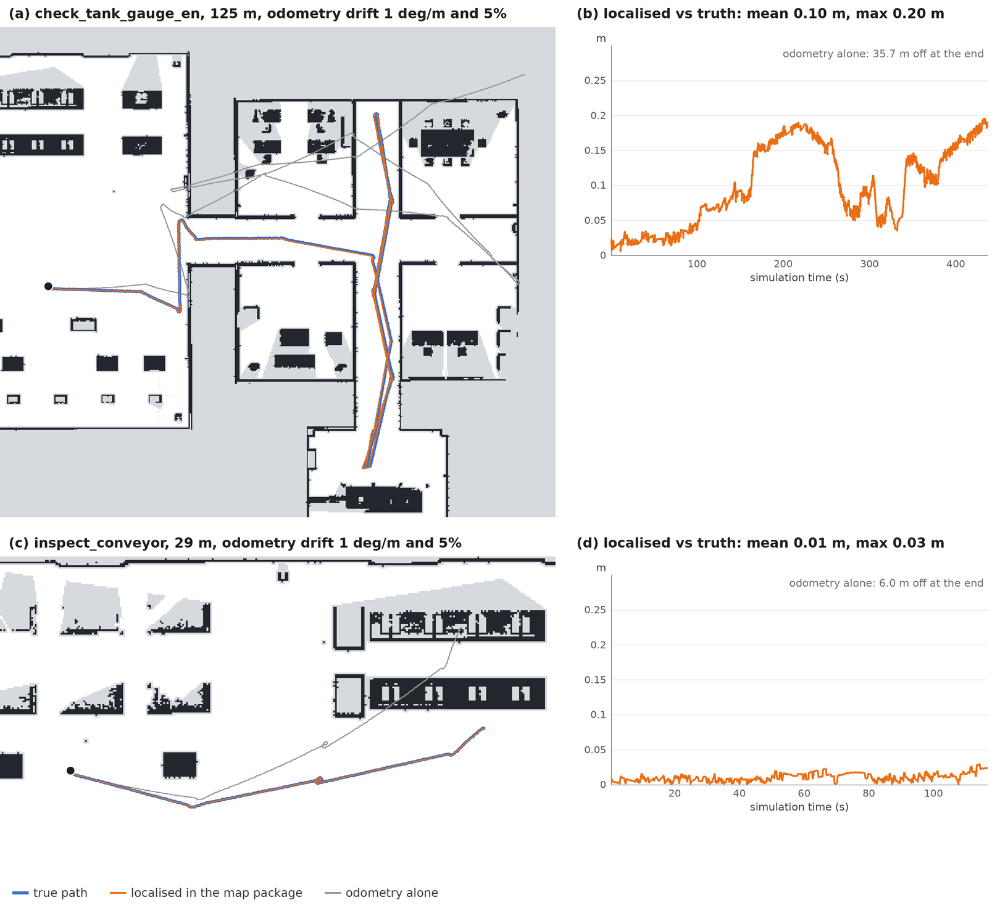

# Warehouse + Office 검증 결과

## 지도 안에서 스스로 위치 찾기 (2026-10-20, Mac 개발 그래프)

macOS(M1 Pro) Docker arm64, MuJoCo 개발 그래프, 지도 묶음 `outputs/maps/campus_dev`(매핑 시작 자세 = 시뮬레이터 (-12, 3.8, 0)), Qwen3-VL-4B. `package_frame:=map`: 시뮬레이터는 map에서 odom으로의 변환을 내지 않고(`map_tf:=false`), `localizer`가 LiDAR 스캔과 점유 지도만으로 찾습니다. 시뮬레이터 정답은 평가기만 씁니다.

- 정지 스캔 오프라인 시험(MuJoCo MID-360 스캔, 캠퍼스 14곳, 곳마다 무작위 초기 자세 8개):
  - 초기 자세가 0-1.5 m, 0-20도 틀렸을 때 112회 중 110회 맞음(오차 평균 0.06 m, 최대 0.25 m), 2회 거절(다음 스캔에서 다시 시도), 틀린 위치 0회.
  - 초기 자세가 2.5-5 m 틀렸을 때 112회 모두 거절, 틀린 위치 0회. 처음에는 받아들이는 기준을 지도 장애물 위 점 60%로 두었더니 6회가 틀린 곳(60-70%)에 맞춰짐. 맞는 자세는 거의 100%라 첫 위치 추정 기준을 80%로 올림.
  - 계산 시간: 지도 읽기 0.1초, 첫 위치 추정 0.6초, 추적 한 번 0.1초.
- VLN 실행 1(탱크 압력계, 충전 구역 (12, -3.8) 출발: 매핑 시작점에서 24 m, 시뮬레이터 odom):
  - 초기 자세 `24.8,-7.0,0.2`(지도 좌표, 실제보다 0.93 m, 12도 틀림) → 0.5초 만에 위치 추정, map에서 odom으로의 변환 오차 2 cm.
  - 624초, 146 m 걷는 동안 위치 오차 평균 0.094 m, p95 0.20 m, 최대 0.21 m, 방향 오차 최대 0.5도, lost 0회(정답과 2,800번 비교).
  - 오차는 지도 자체의 오차와 같은 크기: 매핑 시작점 근처 창고에서 평균 0.02 m(최대 0.04), 가장 먼 사무동과 펌프실에서 평균 0.14 m(최대 0.21). SLAM 지도의 경로 오차가 최대 0.25 m이므로, 정합은 지도와 맞고 지도가 정답과 그만큼 다름.
  - 과제는 실패: 충전 구역, 창고 통로, 연결 통로, 사무동 복도, 펌프실 통로를 지나 펌프실에 들어갔으나(단계 1, 2 완료) 4B가 펌프실 남동쪽 구석의 TK-101을 찾지 못하고 결정 40회 한도에 걸림(대상 9.5 m 앞, 충돌 0). 같은 과제를 시뮬레이터 시작 자세(`package_frame:=world`)로 돌린 앞선 실행은 성공했으므로 4B 탐색의 편차로 봄. 지도 좌표와 시뮬레이터 좌표에서 토폴로지 경로 안내가 같게 나오는 것을 따로 확인함.
  - 같은 설정으로 다시 실행해도 실패: 펌프실에 들어갔으나(142 m, 충돌 0) 북쪽 절반만 돌며 펌프와 MCC-1 배전반을 보고, 펌프를 "명판 P-341인 압력 탱크"라고 잘못 읽은 뒤 결정 41회 한도(대상 4.2 m 앞). 남동쪽 구석의 TK-101은 한 번도 시야에 들어오지 않음. 결정 영상의 번호 지점은 바닥 표시선 위에 제자리에 그려짐. 위치 오차 평균 0.13 m, 최대 0.22 m, lost 0회(2,709번 비교).
- VLN 실행 2(컨베이어, seed 2: 실제 시작 자세가 과제 시작 자세에서 0.29 m, 18도 벗어남, `initial_pose:=spawn`, odom이 1도/m, 5% 길게 흔들림 `odom_drift:=0.05,1.0`):
  - 0.5초 만에 위치 추정(초기 자세에서 0.29 m, 18.6도 보정). 걷는 동안 odom만으로는 끝에서 6.0 m 틀렸지만, 위치 오차는 평균 0.010 m, 최대 0.03 m, 방향 최대 0.21도, lost 0회.
  - 과제 성공: 결정 5회, 컨베이어에서 대상 위치를 깊이와 TF(map에서 카메라, `localizer` 경유)로 찾아 접근, 1.25 m 앞, 판정 yes(정답), 충돌 0, 이동 29 m(최단 23 m, SPL 0.78), 시뮬레이션 114 s.
  - 로봇이 보고한 대상 위치는 지도 묶음 좌표 (25.13, 3.95)이고, 평가기가 `evaluation.json`으로 시뮬레이터 좌표 (13.21, 7.63)로 옮겨 컨베이어 위로 확인.
- VLN 실행 3(실행 1과 같은 탱크 압력계 과제와 초기 자세, odom이 1도/m, 5% 길게 흔들림):
  - 434초, 125 m 걷는 동안 odom만으로는 끝에서 35.8 m 틀렸지만, 위치 오차는 평균 0.10 m, p95 0.18 m, 최대 0.20 m, 방향 최대 0.42도, lost 0회(1,926번 비교). 창고 평균 0.02 m, 사무동과 펌프실 평균 0.13 m로 실행 1과 같은 모양이라, 오차는 odom 흔들림이 아니라 지도의 오차에서 옴.
  - 과제는 실패: 펌프실까지 가서(결정 21회, 충돌 0) 대상에 접근했지만, 4B가 펌프 P-101(명판 "PUMP P-101"을 읽고도)을 압력 탱크로 보고 "압력계 없음"이라고 답함. 접근한 위치는 시뮬레이터 좌표로 펌프 받침 위(38.5, -21.9)라 지도 좌표의 대상 위치 계산은 맞음. 인식 오류.



- 실행하며 찾아 고친 것:
  - 평가기가 로봇이 보고한 대상 위치(지도 묶음 좌표)를 시뮬레이터 좌표의 대상과 바로 비교함 → `package_frame:=map`이면 `world_from_map`으로 옮겨 비교(`target_xy_robot_frame`에 원래 값).
  - 대화형 콘솔의 현재 위치가 `/odom` 그대로였음 → map 좌표로 바꾸고, 구역 이름은 지도 묶음의 방에서 찾음.
  - 런치가 끝날 때 rclpy가 메시지를 받다가 오류를 내며 `localizer`가 비정상 종료로 기록됨 → `slam_map`과 같이 종료 중 오류는 무시.
- 단위 테스트 161개 통과(지도 안 위치 찾기 9개: 거리장 정확도, 다른 odom 좌표계에서 초기 자세 보정과 바닥 높이, odom 흔들림 추적, odom 급변 뒤 재탐색과 창 밖 급변 거절, 먼 초기 자세 거절, 통로 방향 사전 분포와 공분산, 점 부족, odom 흔들림 모형).
- 미검증: Isaac Sim(`--no-map-tf`), 실제 G1. 실로봇 odom을 `/odom`으로 내보내는 노드(G1 자체 추정이나 수평을 맞춘 FAST-LIO2)는 아직 없음. 사람이나 선반 이동처럼 지도와 달라진 현장은 시험하지 않음(시뮬레이션 스캔은 지도와 거의 100% 맞음).

## 사람 주석 + 자동 토폴로지 + 지도 묶음으로 VLN (2026-10-20, Mac 개발 그래프)

- 주석: `tools/map_annotator.html`을 브라우저에서 열고, 로봇 SLAM 지도(`outputs/maps/campus_dev`) 위에 방 9개, 통로 4개(사각형 6개), 기준점 4개를 마우스로 그림. 시뮬레이터 정답은 보지 않고 지도의 벽과 설비만 보고 그림(한 화면 픽셀 약 0.13 m). 결과는 `configs/annotations_campus.json`.
  - 도구를 쓰며 고친 것: 머리 줄이 두 줄로 넘치면 페이지가 스크롤되어, 이름 칸에 커서가 가는 순간 지도가 밀려 다음 클릭이 2.4 m 어긋남 → 페이지가 스크롤되지 않게 배치를 바꿈.
- 자동 토폴로지(`scripts/build_map_package.py`): 장소 13개, 출입구 12개(정답 장소 그래프도 12개), 이름 없는 구역 0개. 방 9개 모두 통로와 연결, 유리벽으로 나뉜 사무동 방끼리는 연결 없음. 사무동 방 출입구 폭 1.7-1.8 m.
- 정답과 비교(`annotation_check.json`): 사람이 그린 방과 정답 구역의 IoU 평균 0.91(0.86-0.97). 출입구 위치 오차는 벽이 있는 방 0.15-0.56 m, 창고 구역 1.6-2.3 m(창고 구역은 벽 없이 바닥만 나뉘어, 구역과 통로가 맞닿은 긴 변의 가운데를 출입구로 잡음). 기준점 오차 0.13-2.17 m.
- 지도 묶음으로 VLN(`map_package:=outputs/maps/campus_dev`, 시뮬레이터 좌표로는 시작 자세로만 옮김, Qwen3-VL-4B, 과제당 1회):
  - 컨베이어: 성공. 결정 20회, 컨베이어 0.94 m 앞, 판정 yes(정답), 충돌 0, 이동 106 m(최단 22 m), 시뮬레이션 398 s.
  - 탱크 압력계(충전 구역 출발, 창고 통로, 연결 통로, 사무동 복도, 펌프실 통로를 지나 펌프실): 성공. 결정 19회, TK-101 1.65 m 앞, 판정 yes(정답), 충돌 0, 이동 77 m(최단 50 m), 시뮬레이션 306 s.
  - 과제 2개, 각 1회의 동작 확인이며 성공률 주장은 아님. Isaac 8B 실험 행렬은 `hvln_experiment.py --set map_package=...`로 돌릴 수 있음.
- 단위 테스트 152개 통과(지도 묶음: 벽을 따르는 장소 그래프, 이름 없는 방, 자동 입구, 경로 안내, 주석 검증, 좌표계 변환, 정답 비교).

## 로봇이 만든 SLAM 지도 (2026-10-20, Mac 개발 그래프)

macOS(M1 Pro) Docker arm64, MuJoCo 개발 그래프, FAST-LIO2(ROS 2 브랜치 a4743b0, `configs/fast_lio_g1_sim.yaml`). `ros2 launch launch/g1_slam_mapping.launch.py sim:=true name:=campus_dev`.

- 매핑 주행: 경유점 24개 모두 도착, 324 m, 시뮬레이션 920 s, 스캔 9,207개 모두 처리. 지도 822x481 칸(0.1 m), 3D 복셀 83만 개.
- 위치 정확도(정답 자세와 비교, 시작 자세로 맞춤): 평균 제곱근 0.09 m, 최대 0.25 m, 출발점으로 돌아왔을 때 0.03 m(경로 대비 0.01%).
- 지도 정확도(정답 지도와 비교, 허용 오차 0.2 m): 장애물 정밀도 99.2%, 재현율 96.4%. 실제 빈 공간의 87.1%를 빈 공간으로, 2.7%를 장애물로, 10.2%를 미확인으로 표시. 미확인은 걸어온 경로에서 몸 높이로 보이지 않는 물체 뒤 그림자. 정답 장애물 칸 중 빈 공간으로 표시된 3%는 대부분 자재 창고 선반의 상자 사이 0.3 m 틈(정답 지도는 선반 전체를 장애물로 둠, 로봇 반경 0.4 m라 지나갈 수 없음).
- 이 지도로 만든 VLN 웨이포인트 로드맵: 544개(정답 지도 649개).
- 실행하며 찾아 고친 문제:
  - 시간 도장 버그(`messages.stamp`): 85.9999999999 s가 85.0 s로 바뀌어 1초 뒤로 가는 도장이 몇 초마다 나옴. 모든 토픽에 영향(FAST-LIO2가 스캔을 버림, TF 조회 실패 가능). 정수 나노초로 한 번만 반올림하도록 고치고 회귀 테스트 추가.
  - FAST-LIO2 ROS 2 브랜치의 `lidar_type` 4는 MID-360 PointCloud2(점 시간을 회전각으로 추정)라서, 한순간에 찍는 시뮬레이션 스캔에는 점 시간을 쓰지 않는 5(일반 PointCloud2)를 씀.
  - FAST-LIO2는 IMU를 RELIABLE로 구독하는데 시뮬레이터 IMU는 BEST_EFFORT라 연결이 안 됨 → `slam_map`이 `/slam/imu`로 다시 발행.
  - 시작할 때 잰 중력으로만 수평을 맞추면 지도가 1.1도 기울어(로봇이 서면서 흔들림) 먼 바닥이 장애물로 보이고 빈 공간이 18%만 잡힘 → 저장할 때 지도 전체 바닥에 평면을 맞춰 다시 수평 보정(빈 공간 87-96%).
  - 선반 아래 팔레트 틈으로 보인 바닥이 빈 공간이 되던 문제 → 걸어온 경로에서 몸 높이로 보이는 칸만 빈 공간.
- 이 지도로 VLN 실행(`map_file:=outputs/maps/campus_dev/map_world.yaml`, 컨베이어 지시, Qwen3-VL-4B, 1회): 성공. 결정 19회, 컨베이어 0.60 m 앞, 판정 yes(정답), 충돌 0, 이동 91 m(최단 22 m, 4B가 조립 라인 안을 돌아다님), 시뮬레이션 342 s.
  - 첫 시도는 실패: 4B가 조립 라인에서 뒤돌아 자재 창고 바닥의 상자를 "컨베이어 위 상자"로 골라 접근(대상 9 m 밖). 지도 문제가 아니라 VLN 규칙의 빈틈이라, 접근 대상이 현재 단계 구역(여유 3 m) 밖이면 거절하고 다시 묻는 규칙을 추가(`outside_region`). 11개 과제의 정답 대상은 모두 자기 구역에서 통과함을 확인.
- 단위 테스트 147개 통과(SLAM 지도: 중력·바닥 평면 수평 보정, 선반 아래 바닥, 지도 파일 왕복, 좌표 변환, 정답 비교, 시간 도장; 구역 밖 접근 거절).
- 미검증: Isaac Sim에서의 매핑(같은 launch, 센서는 깊이 카메라로 흉내 낸 LiDAR), SLAM 지도로 돌린 Isaac 8B 실험 행렬, 실제 G1.

## 펌프실 · 시멘틱/토폴로지 맵 · 인식 정확도 (2026-10-20, Mac에서 확인한 범위)

- 펌프실: 장면 생성·USD 내보내기(상자 1,295, 원기둥 104, 충돌체 219, 누락 0). 머리 카메라 미리보기에서 PUMP P-101·MOTOR M-101·TK-101 명판과 커플링 가드·탱크 압력계가 점검 거리에서 보임(탱크 압력계는 처음 1.75 m라 시야 밖 → 1.5 m로 낮춤). 사무동 → 펌프실 경로가 격자 로드맵·토폴로지 그래프에서 연결됨.
- 시멘틱 맵: 객체 91개(33종, 명판 26개), 장소 13, 연결 12. 자재 창고 → 펌프실 경로 = 창고 통로 → 연결 통로 → 사무동 복도 → 펌프실 통로 → 펌프실.
- 인식 정답 계산: 객체 3D 상자를 카메라에 투영하고 깊이로 가림을 확인 → 26장 미리보기에서 정답 상자가 실제 물체 위에 놓임(검사대, 충전 도크, 선반, 서버 랙, 콘솔), 가려진 물체 제외.
- 채점 파이프라인 점검(MuJoCo 미리보기 영상 12장, Qwen3-VL 4B): 구역 33%, 객체 F1 37%. 오답은 실제 모델 오류(구역 표지판을 설비로 답함, 같은 도크 중복, 콘솔을 책상으로)였고 채점 오류가 아님 → 표지판 제외·중복 금지를 프롬프트에 명시. **이 수치는 파이프라인 점검용이며 결과가 아님**(Isaac 영상·8B로 측정해야 함).
- 토폴로지 경로를 VLN 프롬프트에 추가: `vln_navigator`가 `/semantic_map`을 구독해 목표 구역까지 장소 순서와 다음 출입구(방향·거리)를 한 줄로 넣음. 단위 테스트로 경로·출입구 방향을 확인.
- 대화형 콘솔(`scripts/vln_console.sh`): Mac 개발 그래프(MuJoCo + Qwen3-VL 4B)에서 컨베이어 지시 1회 → 단계 계획, 결정 7회(이동 4, 둘러보기 1, 접근 1, 정지 1), 판정 yes(정답), 133.8 s. `feedback.jsonl`·`decisions/`·`inspection.jpg`·`summary.json`·`route.png` 저장과 이어지는 `:where` 확인. 이 실행은 토폴로지 힌트 추가 전 코드.
- 단위 테스트 134개 통과(시멘틱 층·토폴로지 경로·토폴로지 힌트·촬영 자세·가림 정답·검출 매칭).
- 미검증: Isaac의 `--capture` 모드와 펌프실 장면의 Isaac 렌더링, 펌프실 VLN 과제 2개, 8B 인식 정확도, 토폴로지 힌트가 Isaac 8B 성공률에 주는 영향, Isaac에서의 콘솔 → [UBUNTU_ISAAC.md](UBUNTU_ISAAC.md) 2.3·9절.

## 지도 기반 계층형 VLN

실행일 2026-10-17. macOS(M1 Pro 16GB) Docker arm64 · ROS 2 Humble · CycloneDDS · MuJoCo 3.5.0 EGL(CPU 렌더링) · Qwen3-VL 4B Instruct(Ollama 0.40.5, Metal, 문맥 8192). 카메라 10 Hz, 그림자 끔. Isaac Sim과 8B는 이 Mac에서 실행하지 않음.

- 단위 테스트 `python -m pytest -q`: **120 passed** (당시 기준).
- 실제 ROS 2 그래프(`g1_sim`·`vln_agent`·`vln_navigator`·`path_follower`·`external_agent`)를 `scripts/hvln_experiment.py`로 실행. 로봇은 대상 위치를 받지 않음.

### 실행 예: `inspect_station_paraphrase` ("부품 품질을 확인하는 곳에 가서 두 번째 비전 검사 장비 위에 부품이 올려져 있는지 봐줘", 조립 라인에서 출발)

| 시뮬레이션 시간 | 계층 | 내용 |
|---:|---|---|
| 4.0 s | 1 (단계 분해) | ① 품질 검사 구역으로 이동 ② 두 번째 비전 검사 장비 찾기, 명판 STATION 2 |
| 8.6–51.4 s | 2 (VLN) | 영상 위 번호 웨이포인트 중 선택 ×3 (검사 구역 방향 보행거리 이득·표지판 근거) |
| 72.4 s | 2 | 검사 구역 진입 → ①단계 자동 완료 |
| 78.8 s | 2 | `approach`: 영상 속 STATION 2 bbox → 확대 이미지로 명판 재판독 "STATION 2" 일치 → 깊이로 대상 위치 |
| 89.6 s | 3·4 | 대상 앞 도착(VLN 결정 4회, 이동 26.0 m, 최단 23.9 m, 충돌 0) |

- 영상으로 찾은 대상 위치 오차 0.18 m, 정지 위치 대상 외곽 0.55 m. 이 회차의 확인 답변은 오답("부품 없음") → 아래 표의 VQA·접근 거리 문제를 찾아 수정.

### 검증 중 발견해 수정한 문제

| 문제 (실측) | 수정 |
|---|---|
| `vln_agent`가 같은 파라미터를 두 번 선언해 시작 직후 종료 | 한 번만 선언 |
| 새 지시·취소 시 VLN 모드에는 `/goal_pose` 구독자가 없어 로봇이 이전 구간을 계속 걸음 | 내비게이터가 제자리 1점 경로(`/plan`)로 정지 |
| LiDAR가 구간을 막고 우회도 불가하면 추종기가 막힌 경로를 계속 따라감 | 정지 후 VLN이 다른 길 선택 |
| 제자리 회전 제한(3회)이 0.5 m 위치 기준이라 휴머노이드가 돌며 밀리면 초기화 → 6회 연속 회전 | 이동·접근 결정 때만 초기화 (회귀 테스트 추가) |
| 확인 VQA: "갈색 블록이 있다"고 관찰하고도 "부품 없음" | 프롬프트: 대상 위 물체 = on, 판정은 관찰과 일치. 저장 프레임 9장(예 5·아니오 4) 9/9 |
| 옆에 있는 대상(컨베이어)을 69° 시야 밖에 두고 지나침 | 대상 구역 첫 도착 시 4방향 둘러보기 → VLM이 방향 선택 |
| 둘러보기 요청(영상 4장 ≈ 4,200 토큰)이 Ollama 기본 문맥 4096 초과 → HTTP 400 → 작업 실패 | 문맥 8192 설정·`check_hvln_env.py` 점검 추가. 호출 실패 시 현재 방향으로 계속 |
| `approach` 조건이 "명판 확인" 필수 → 명판이 반대편인 컨베이어 옆을 지나침 | 번호로 지정된 대상만 명판 확인, 그 외는 2차 확인 |
| 접근 정지 위치를 상판 안쪽 깊이 기준으로 계산 → 검사대 0.44 m 앞에서 상판만 보임(4B·8B 모두 "부품 없음") | 영상으로 찾은 점이 지도 장애물 위면 지도 외곽에서 1.4 m |
| 평가: 10 m 컨베이어를 중심점 거리로 채점 → 컨베이어 앞에 선 성공을 실패로 판정 | 대상 바닥 외곽(`footprint`, 장면 형상과 테스트로 일치 확인) 기준, 컨베이어 A·B 모두 정답 |
| 단계 분해(4B): 찾기 단계 누락, 대상에서 "빈" 조건 누락, 명판을 "VISION INSPECTION 2"로 추측(실제 "STATION 2"), 지시에 없는 "서버 랙 1" | 찾기 단계 검증(재질의 후 추가), 구별 조건 유지, 명판은 번호·문자만 비교, 지어낸 번호 제거 |
| 2차 확인이 조건을 무시해 카트가 서 있는 충전 도크를 "빈 도크"로 승인 | 대상 앞 바닥까지 포함한 확대 이미지 + 조건까지 판단 → 같은 프레임에서 거절 확인 |
| MuJoCo 시뮬레이터 세그폴트 1회(전체 실행 중 1회, 원인 미확정) | LiDAR 스레드별 `MjData`(출력 동일 확인), 실험 실행기가 시뮬레이터 정지 시 1회 재시도·첫 시도 보관 |
| 실험이 갈수록 느려짐(결정 간격 10분 이상): Ollama llama-server가 프롬프트를 RAM에 캐시(1개 ≈ 340 MB, 상한 8 GB) → 14 GB, 스왑 16 GB | `LLAMA_ARG_CACHE_RAM=0` → 3 GB, 스왑 8 GB. Ubuntu 설정에도 반영 |
| Fast DDS 기본 설정에서 30 Hz RGB(0.9 MB) 수신 57% | UDP 전용 + 16 MB 소켓 버퍼 프로파일(`configs/fastdds.xml`) → 100% |

### Mac 9개 과제 (MuJoCo, Qwen3-VL **4B**, seed 0)

경량 비교 조건(4B)으로 파이프라인 전체를 확인한 결과. 주 조건(8B)은 아래 Isaac Sim 절과 Ubuntu 실험 행렬.

| 과제 | 결과 | 결정 수 | 원인 |
|---|---|---:|---|
| `inspect_conveyor` | 성공 | – | 둘러보기 → 컨베이어 방향 → 접근·판정 정답 |
| `inspect_dock_en` (빈 도크) | 성공 | – | 조건("카트 없음")까지 보는 2차 확인으로 빈 도크 선택 |
| `inspect_meeting_table_en` | 성공 | – | |
| `json_agent_subgoals` (JSON 단계) | 성공 | – | |
| `inspect_servers_office` | 실패 | 11 | 서버 랙을 찾아 접근(grounding 정답), 판정 "unknown" |
| `go_fire_cabinet_ko` | 실패 | 17 | 소화기함을 찾아 접근(grounding 정답), 판정 "no"(정답 yes) |
| `inspect_dock_cart_ko` (3번 도크) | 실패 | 41 | 결정 한도 40 초과 — 명판 CHARGER 3을 찾지 못함 |
| `inspect_station_paraphrase` (2번 검사대) | 실패 | 41 | 결정 한도 초과 — 검사대 근처(1.7 m)까지 갔으나 명판 확인 실패 |
| `check_electrical_panel_en` | 실패 | 13 | 북동쪽 기둥에 닿은 뒤 "갈 수 있는 웨이포인트 없음" → 수정(아래) |

- 성공 4/9, grounding 6/9, 판정 정확도 4/6(판정까지 간 과제 기준), 결정당 VLM 지연 20.6 s(M1 Pro, Metal).
- 4B의 약점: 명판 판독(번호로 지정된 대상)과 작은 물체 판정. 같은 과제를 8B로 Isaac Sim에서 돌린 결과와 비교 필요.
- 이 실행 중 코드 변경: `go_fire_cabinet_ko`, `check_electrical_panel_en`은 마지막 단계 `stop` 거절 규칙이 들어간 뒤 시작.
- 실행 후 수정: 로봇이 장애물 여유 공간 안에 서 있으면 가장 가까운 격자 노드 기준으로 웨이포인트를 계산(기둥에 닿은 실제 위치로 회귀 테스트).

### Isaac Sim 5.1 + Qwen3-VL-8B (Ubuntu, RTX 5080 Laptop 16 GB, 드라이버 580)

- 스모크 테스트 `SMOKE PASS`: 0.3 m/s 명령에 6초 동안 1.80 m 보행, 골반 높이 0.775 m, RGB 640×480, 깊이 유효 76%, LiDAR 18,169점.
- 처음 실행에서 고친 문제: Isaac Python에 `mujoco` 없음(`sensors.py` 선택적 import), 에셋 파일 권한 0600 → uid 1234가 URDF를 못 읽음(0644로 저장).
- `inspect_conveyor` 단일 에피소드(seed 0):
  - 1회차: VLN이 조립 라인 도착 → 둘러보기로 CONVEYOR A 방향 선택 → 4 m 밖에서 `stop` → 판정은 맞았지만 성공 반경 밖. 마지막 단계의 `stop`을 거절하도록 수정.
  - 2회차: **성공**. VLN 결정 4회, 영상으로 찾은 대상이 컨베이어 외곽 안(오차 0.0 m), 정지 거리 0.86 m, 판정 정답("a few beige boxes on the conveyor" → yes), 충돌·넘어짐 0, VLM 지연 평균 3.9 s, 실시간 대비 0.67.

### Isaac Sim 파일럿: 9개 과제, `vln_8b`, seed 0 (`results/isaac_pilot_2026-10-17/`)

| 지표 | 값 |
|---|---|
| 성공률 | **5/9 (56%)** |
| grounding 정확도(영상으로 찾은 대상이 실제 물체 외곽 1 m 이내) | 8/9 (89%) |
| 항법 완료(대상 앞 도착) | 9/9 (100%) |
| 충돌·넘어짐 | 0 / 0 |
| 판정 정확도 | 6/9 (67%) |
| SPL | 0.28 |
| VLM 지연(결정당, RTX 5080 Laptop) | 4.28 s |
| 경로추종 RMSE | 0.022 m |
| 실시간 대비 | 0.60–0.66 |

| 과제 | 결과 | 결정 | 대상 외곽까지 | 판정(정답) | 원인 → 조치 |
|---|---|---:|---:|---|---|
| `inspect_conveyor` | 성공 | 5 | 0.77 m | yes (yes) | |
| `inspect_dock_cart_ko` (3번 도크) | 성공 | 30 | 0.00 m | no (no) | 명판 CHARGER 3 판독 후 접근 |
| `inspect_servers_office` | 성공 | 13 | 1.38 m | yes (yes) | |
| `inspect_station_paraphrase` (2번 검사대) | 성공 | 11 | 0.90 m | yes (yes) | 명판 STATION 2 판독 후 접근 |
| `json_agent_subgoals` (JSON 단계) | 성공 | 33 | 1.46 m | yes (yes) | |
| `inspect_dock_en` (빈 도크) | 실패 | 8 | 0.53 m | no (yes) | 빈 도크를 찾았고 "카트 없음"을 관찰했으나 "비어 있나?"에 no → **판정 프롬프트 수정**(같은 영상 8B 재판정 yes, 다른 6개 과제 영상 재판정 6/6 유지) |
| `inspect_meeting_table_en` | 실패 | 5 | 5.95 m | no (no) | 복도에서 유리벽 너머 테이블을 보고 접근 → 깊이가 유리벽에 맞아 벽 앞에서 정지 → **얇은 벽 뒤가 빈 공간이면 접근 거절**("문으로 돌아가라") 추가, 회귀 테스트 6개 |
| `go_fire_cabinet_ko` | 실패 | 7 | 1.45 m | no (yes) | **장면 결함**: 소화기가 불투명한 흰 패널 뒤에 있어 보이지 않음(4B·8B 모두 "없음") → 소화기를 패널 앞으로 이동 |
| `check_electrical_panel_en` | 실패 | 3 | 1.51 m | no (yes) | **장면 결함**: "HIGH VOLTAGE" 표지가 패널 위 2.05 m(접근 시 카메라 시야 밖), 패널 면에는 표시 없음 → 패널 면 1.3 m 높이에 경고 라벨 추가 |

- 실패 4개 모두 항법(대상 찾기·접근)은 끝까지 수행. 2개는 장면 결함, 1개는 판정 극성, 1개는 유리벽 깊이.
- 수정 후 재실행은 아직 안 함 → Ubuntu에서 USD 다시 내보내기 + 파일럿 재실행 필요(수정 효과를 수치로 주장하지 않음).
- 토픽 실측(측정 회차, Isaac Sim): RGB 921,672 B·깊이 614,472 B @30 Hz, LiDAR 평균 470.0 KB(약 18,000점) @10 Hz, 주기 토픽 합계 약 51.0 MB/s. QoS 깊이는 Fast DDS 그래프 API가 알려주지 않아 `UNKNOWN`으로 기록 → 깊이는 코드(`qos.py`) 기준.

### Isaac Sim 경로 오프라인 검증 (Mac)

- 캠퍼스 USD 내보내기: 상자 1,236 · 평면 57 · 원기둥 54 · 타원체 12 · 충돌체 192 · 재질 187, 누락 0. Z-up, 1 m 단위 확인.
- 카메라·LiDAR 수학: 쿼터니언 왕복, 4개 100° 깊이 카메라로 MID-360 패턴 모사 시 MuJoCo 광선 투사 대비 중앙값 오차 1.1 cm.
- NVIDIA 문서와 대조해 수정: 카메라는 `World.reset()` 뒤 `initialize()`, 캐시 폴더 uid 1234 소유, Docker 간 ROS 2는 UDP Fast DDS.
- 넘어짐·시간 종료 시 마지막 상태 발행(평가기가 정지가 아닌 넘어짐으로 기록).
- 실제 실행(로봇 보행·센서·토픽)은 Ubuntu에서 `bash scripts/run_isaac_sim.sh --smoke-test 8`부터 확인 필요.

### 미검증

- Isaac Sim 5.1 + 8B 전체 실험 행렬(81회), 위 수정 후 파일럿 재실행, 실시간 비율 0.95 이상 운용: [UBUNTU_ISAAC.md](UBUNTU_ISAAC.md) 8절.
- 프롬프트는 이 9개 과제로 개발함 → 일반화 성능은 새 지시문(보류 세트)으로 따로 측정해야 함.
- 과제당 seed 1회. 성공률은 동작 확인용 소규모 결과이며 통계적 성능 주장이 아님.

## 지도 조회 + A* 스택 (이전 주 경로 → 현재 `oracle` 기준선)

> 아래는 VLM이 의미 지도에서 **목표 장소를 골라 좌표로 조회**하고 A*로 가던 이전 버전의 결과. 목표 위치를 미리 아는 방식이라 VLN이 아니며, 지금은 `planner_mode:=oracle` 상한 기준선으로만 사용. 현재 주 경로(VLN) 결과는 위 "지도 기반 계층형 VLN" 절.

실행일 2026-10-16. macOS(M1 Pro 16GB) Docker arm64 · ROS 2 Humble · CycloneDDS · MuJoCo 3.5.0 EGL(Mesa llvmpipe, CPU 렌더링) · Qwen3-VL 4B Instruct(Ollama 0.40.5, Metal).

- 단위 테스트 `python -m pytest -q`: **93 passed** (기존 79 + 계층형 VLN 14).
- 실제 ROS 2 그래프(`g1_sim`·`vln_agent`·`global_planner`·`path_follower`·`external_agent`)를 `scripts/hvln_experiment.py`로 실행. 카메라 10 Hz(측정 회차만 30 Hz).

### 최종 코드 결과 (`vlm_4b`, seed 0)

| 과제 | 계획된 장소 | 판정 (정답) | 최종 오차 | SPL | 경로추종 RMSE | 재계획 | 결과 |
|---|---|---|---:|---:|---:|---:|---|
| `inspect_conveyor` | assembly_line → assembly_conveyor | yes (yes) | 0.21 m | 0.79 | 1.3 / 4.3 cm | 0 | 성공 |
| `inspect_dock_cart_ko` | charging → charging_dock_3 | no (no) | 0.18 m | 0.88 | 1.3 / 1.9 cm | 0 | 성공 |
| `inspect_meeting_table_en` | office_meeting → meeting_table | no (no) | 0.13 m | 0.96 | 2.1 / 3.1 cm | 0 | 성공 |
| `inspect_station_paraphrase` | inspection → inspection_station_2 | yes (yes) | 1.00 m | 0.77 | 2.0 / 4.3 / 1.3 cm | 1 | 성공 |

- 4/4 성공, 판정 정확도 4/4, 충돌·넘어짐 0. VLM 호출 평균 5.1 s(벽시계).
- `inspect_station_paraphrase`: 지도에 없는 팔레트 더미를 LiDAR로 감지해 1회 재계획, 충돌 없이 우회.

### 규칙 기반 대비 (중간 버전, 같은 과제·seed 0/1)

| 과제 | `rule` | `vlm_4b` |
|---|---:|---:|
| `inspect_station_paraphrase` (별칭이 문장에 없음) | 0/2 — "검사 구역"까지만 찾고 검사대 미특정 | 2/2 |
| `inspect_dock_cart_ko` | 2/2 도착, 판정 "unknown" | 2/2 도착, 판정 "unknown" → 아래 수정 후 "no" |

### 토픽 측정 회차 (`inspect_conveyor`, 카메라 30 Hz, `topic_monitor` 켬)

- 21개 토픽 전부 발행·구독 노드·QoS를 ROS 그래프에서 확인. 크기·주기: [ROS2_INTERFACE.md](ROS2_INTERFACE.md).
- 실시간 대비 0.149배. 처리시간: RGB-D 렌더 183 ms/프레임(CPU), LiDAR 20,000 ray 51 ms(8스레드), 물리+정책 0.27 ms/스텝. → 30 Hz 실시간에는 GPU EGL 필요(`scripts/check_hvln_env.py`가 15 ms 기준으로 판정).
- VLM HTTP 실측(8회): 계획 요청 5.6 KB·2.9 s, 대상 찾기 17.5–27.0 KB·5.1 s, 확인 18.0–37.9 KB·6.2 s.

### 검증 중 발견해 수정한 문제

| 문제 | 수정 |
|---|---|
| 도착 후 "새 영상 대기"가 매번 기준 시각을 갱신해 70초 지연, 그동안 제자리 보행으로 1.8 m 밀림 | 도착 시각 = 경로추종기 보고 시각, 대기 중 재설정 안 함. 도착 후 위치 유지(±0.12 m) 추가 |
| 재접근 거리를 bbox 중앙 깊이로 계산해 컨베이어 0.4 m 앞까지 접근 | 가까운 면(하위 10% 깊이) 기준 1.4 m. 대상이 화면에서 작을 때만 재접근 |
| goal id를 float로 변환 → 벽시계(1.79e9 s)에서 ns 정밀도 손실, 도착 이벤트 매칭 실패 가능 | goal stamp 원본을 Path header로 그대로 복사 |
| 확인 이미지가 "done"보다 늦게 도착해 저장 누락 | 외부 에이전트가 이미지 도착(최대 2 s)까지 대기 |
| 충전 도크 접근 자세가 주차 칸 안 → 카트 유무를 볼 수 없음 | 칸 바깥(13, −7.4)으로 이동 |
| VLM이 "볼 대상"을 존재 여부를 묻는 물체(카트)로 지정 → 찾지 못해 엉뚱한 방향에서 확인 | 계획 프롬프트: 볼 대상 = 항상 있는 기준물. 못 찾으면 원래 방향으로 복귀 후 확인 |
| 대상이 없을 때 "확인 불가"(unknown) 응답 | 확인 프롬프트: 관찰 내용 먼저 기술, 장소가 보이면 없음 = "no" |
| 검사대 위 부품이 상판과 같은 색의 평판 → "부품 없음" 오판 | 주황색 0.44×0.32×0.24 m 부품. 저장 프레임 4장 판정 4/4 |
| sim 종료 시 `/clock` 정지 → sim-time 타이머가 멈춰 외부 에이전트 무한 대기 | 벽시계 감시 타이머(120 s) 추가 |

### 미검증

- (당시 기준) Ubuntu 실행·8B·Isaac 연결은 미검증 → 현재 상태는 위 VLN 절의 "미검증" 참고.
- 과제당 seed 1–2회. 성공률은 소규모 검증이며 통계적 성능 주장이 아님.
- `docs/images/`의 장면 이미지는 작업대·컨베이어 높이 조정 전 렌더.

## 뷰어 수정 추가 검증 · MuJoCo 3.5.0

- `1/2/3` 키와 HUD 갱신이 겹치는 교착 원인 확인. 공식 3.5.0의 `WaitForAtomicNoGil` 수정 적용. 3.3.7/3.4.0 GUI 실행 시 업그레이드 안내.
- [이전 바인딩](https://github.com/google-deepmind/mujoco/blob/3.3.7/python/mujoco/simulate.cc), [수정된 바인딩](https://github.com/google-deepmind/mujoco/blob/3.5.0/python/mujoco/simulate.cc).
- 오른쪽 위 전체 맵: 8구역·통로·장애물·경로·목표·G1 위치/방향. 10Hz 갱신, 창 크기 변경과 선반 배치 변경 반영.
- 실제 MuJoCo 모델·장면과 캡처용 viewer 대역으로 키 전환, 일시정지, 좌표·방향, 화면 배치, 크기 변경, 오버레이 잠금 범위 검증.
- `python -m pytest -q`: **79 passed** (뷰어·미니맵 17개 포함).
- 3.5.0에서 `warehouse_to_office` 재실행: 완주 91.84초, RMSE 0.217m, 목표 오차 0.296m, 충돌·넘어짐 0회.
- 실제 GLFW 창에서의 키 입력은 미검증. 컨테이너가 UNIX 소켓 생성을 차단하여 Xvfb 실행 불가. 위 테스트는 네이티브 렌더링 스레드의 교착 재현 테스트를 대신하지 않음.

## 기존 전체 경로 검증 · MuJoCo 3.3.7

실행일: 2026-09-22. Ubuntu 24.04 컨테이너, Python 3.12, MuJoCo 3.3.7, Torch 2.7.1+cpu.

## 실제 G1 보행

**4개 시나리오 모두 완주.** 초기 reset 이후 위치를 강제로 옮기지 않고 공식 보행 정책의 관절 토크로 이동.

| 시나리오 | 의미 구역 방문 | 기준 경로 | 시뮬레이션 시간 | 경로 RMSE | 최대 경로 오차 | 목표 오차 | 충돌 / 넘어짐 |
|---|---:|---:|---:|---:|---:|---:|---|
| `warehouse_tour` | 4/4 | 94.8 m | 300.24 s | 0.233 m | 0.382 m | 0.299 m | 0 / 0 |
| `office_tour` | 4/4 | 60.0 m | 197.00 s | 0.111 m | 0.203 m | 0.298 m | 0 / 0 |
| `warehouse_to_office` | 2/2 | 29.8 m | 91.84 s | 0.217 m | 0.354 m | 0.296 m | 0 / 0 |
| `full_tour` | 8/8 | 184.6 m | 597.76 s | 0.196 m | 0.382 m | 0.298 m | 0 / 0 |

- Warehouse 48×32m와 Office 24×24m가 같은 장면. 연결 통로로 실제 이동.
- `full_tour`: Warehouse 4구역 → Office 4개 방, 총 21개 waypoint 순서대로 통과.
- 목표 허용 오차 0.3m. 경로 오차: 50Hz pose에서 기준 선분까지의 최단거리.
- 충돌·넘어짐 확인: 물리 주기 500Hz. 최저 몸체 높이 약 0.764m.
- seed=0, 고정 배치에서 각 시나리오 1회. 다양한 배치·외란에 대한 성능 보장은 아님.
- 긴 직선에서 경로 오차가 증가함. 이전 작은 방의 4.8cm RMSE를 새 환경 성능으로 사용하지 않음.
- [원본 summary 모음](validation/results.json). 실행별 `zone_events.json`에 실제 구역 진입 시점 기록.

## 코드·장면

- `python -m pytest -q`: **62 passed**.
- Python 컴파일, `git diff --check` 통과.
- 실제 모델: 12 actuators, 8개 의미 구역, 8개 온도계, 약 1,369 geoms.
- 실제 MuJoCo 광선으로 Office 벽·4개 출입구·Warehouse 연결 통로 확인.
- 경로 장애물 검증, 잘못된 구역·배치 거부, 선반 이동, 합성 온도 센서 검증.
- EGL/Mesa로 실제 공장·Office·G1·ego RGB와 유한한 양수 depth 렌더링 확인.
- GUI 상태 표시·카메라 키·경로 표시 코드는 MuJoCo 공개 API를 사용. 디버그 표시는 정책 입력 이미지에 포함되지 않음.

## 미검증 범위

- 사용자 Ubuntu PC에 직접 설치하지 않음. README 명령 실행 필요.
- 이 환경에는 데스크톱 디스플레이가 없어 실제 GUI 창을 띄운 사용자 조작은 미검증. headless 물리·렌더링과 GUI 표시 제어 로직은 검증.
- NaVILA GPU 체크포인트 추론·언어 지시 성공률은 미검증. 위 수치는 고정 경로 보행 성능.
- 온도는 합성값. 컨베이어 운전·제조 공정·실제 충전·로봇의 선반 운반은 미구현.
- SLAM·동적 장애물 회피·새 경로 계획 모델·다중 G1은 별도 연구 항목.
- Ubuntu 22.04/Python 3.10 및 OSMesa는 설치 대상. 실제 검증은 Ubuntu 24.04/Python 3.12/EGL.

## 재현

```bash
source .venv/bin/activate
python -m pytest -q
for scenario in warehouse_tour office_tour warehouse_to_office full_tour; do
  python -m g1_factory.run --scenario "$scenario" --headless || break
done
MUJOCO_GL=egl python scripts/render_scene.py
```

정책·설정 해시는 `summary.json`, 구역·경로는 `scenario.json`, 이동 기록은 `trajectory.csv`에 저장.
