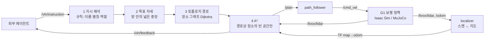
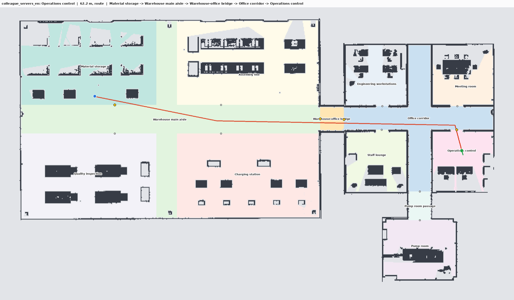
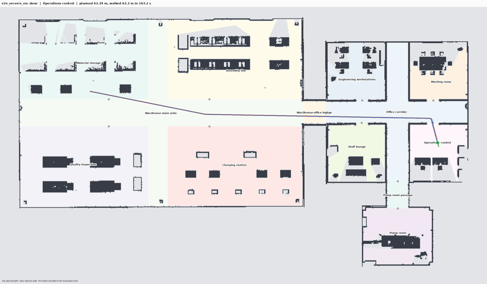
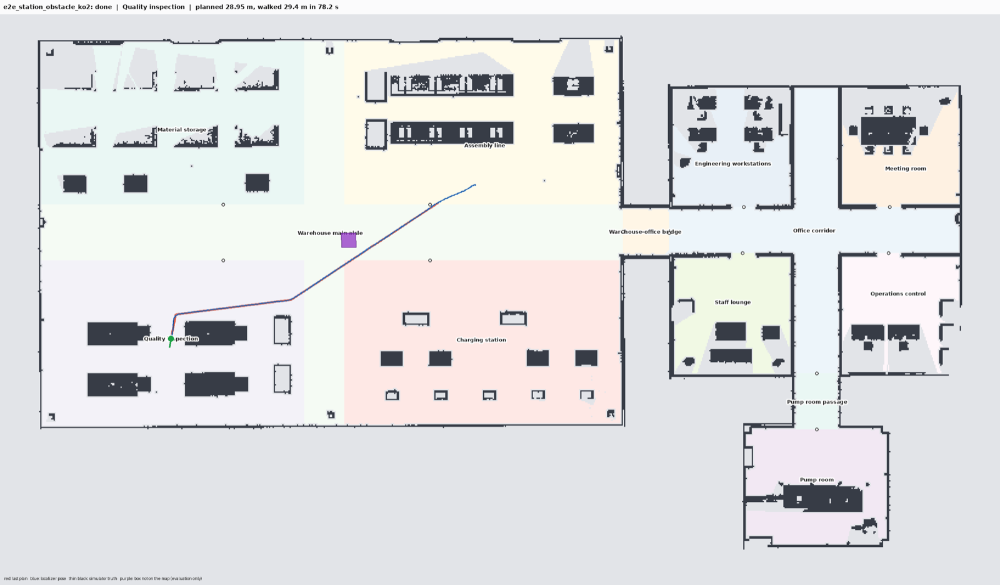
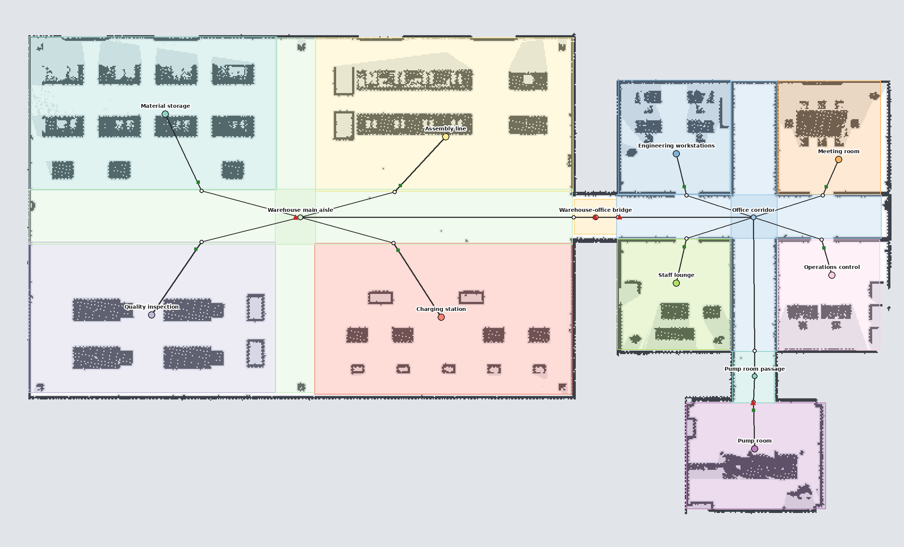

# naive-pp: 지시문 → 로봇 지도 위 장소 → 경로 계획 → G1 이동

외부 에이전트가 "Go to the operations control room and check whether the status indicator lights on the server rack are on." 같은 지시를 보내면, 지시문에서 **로봇이 만든 지도 위의 장소**를 규칙으로 찾고, 장소 그래프(토폴로지)로 경로를 정한 뒤, 점유 지도 위 A*로 길을 만들어 G1을 그 장소까지 걷게 합니다. VLN·VLM은 쓰지 않고, 도착 후 확인 동작도 하지 않습니다. 길 찾기만 합니다.

| 항목 | 내용 |
|---|---|
| 아는 것 | 지도 묶음 하나: 로봇이 SLAM으로 만든 점유 지도(`map.pgm`), 사람이 그 위에 그린 방·통로·기준점(`annotations.json`), 둘에서 자동으로 만든 장소 그래프(`semantic_map.json`) |
| 쓰지 않는 것 | 시뮬레이터 정답(물체 위치, 정답 지도, 시뮬레이터 좌표의 로봇 자세), VLN, VLM |
| 로봇 위치 | `localizer`가 LiDAR 스캔을 지도 묶음의 점유 지도에 맞춰 `map → odom` TF를 냄 (상위 저장소 노드 재사용) |
| 이동 | `path_follower`(순수 추종)가 `/plan`을 `/cmd_vel`로, G1 보행 정책이 걸음으로 (상위 저장소 노드 재사용) |
| 지시 해석 | 규칙 기반 (영어·한국어, 자연어 또는 JSON). 모델 없음 |
| 경로 | 장소 그래프 위 최단 경로 → 그 장소들의 빈 공간 안에서 0.1 m 격자 A* → 시야 단축 → 0.1 m 간격 경로 |

## 동작



### 1. 지시 해석 (`naive_pp/grounding.py`)

지도 묶음의 장소(방 9개, 통로 4개)와 기준점 4개가 각자 이름 목록을 가집니다. 라벨, id, 사람이 단 별칭(`관제실`, `통제실`, `서버실`…), 그리고 라벨의 머리 명사를 바꾼 변형("Charging station" → "charging area", "Operations control" → "operations control room")입니다. 지시문은 세 단계로 맞춥니다. 가장 강한 단계에서 찾은 것만 씁니다.

| 단계 | 조건 | 예 |
|---|---|---|
| 정확 | 이름이 단어로 나옴(영어), 띄어쓰기와 조사에 상관없이 나옴(한국어) | "operations control room" → 관제실, "조립라인으로" → 조립 라인 |
| 부분 | 이름의 내용어가 붙어서 나옴 | "the main aisle" → Warehouse main aisle, "the office" → Office corridor |
| 키워드 | 장소 이름이 하나도 없을 때만, 사람이 방마다 적어 둔 설비 종류 (`configs/place_keywords.yaml`) | "Check whether the vending machine is upright" → 휴게실 |

장소가 여럿 나오면 주변 단어로 역할을 정합니다. 출발("from X", "X에서 출발"), 경유("through X", "X를 거쳐"), 목적지("to X", "X로", "X에 가서"), 위치 수식("in X", "X의")입니다. 목적지는 목적지 표지가 붙은 마지막 장소, 없으면 표지 없는 마지막 장소, 그것도 없으면 첫 위치 수식 장소입니다. 경유 장소와 앞선 목적지는 경유점이 됩니다. 확인할 대상을 묘사하는 말("on the server rack")은 이름이 나온 장소를 바꾸지 못합니다. 다만 사람이 목표 방 안에 찍어 둔 기준점의 이름이 함께 나오면 그 기준점이 목표가 됩니다. 아무 장소도 못 찾으면 비슷한 이름을 제안하며 실패를 알립니다.

### 2. 목표 자세 (`naive_pp/planner.py`)

방이나 통로가 목표이면, 그 장소의 빈 칸 중 장애물에서 0.8 m 이상 떨어진 칸 가운데 장소 중앙에 가장 가까운 칸에 섭니다. 문간이나 설비 바로 앞이 아니라 방 안의 넓은 곳에 서고, 마지막 1 m를 걸어 들어온 방향(문 → 방 안쪽)을 바라봅니다. `goal_mode:=entrance`이면 주 출입구 바로 안쪽에 섭니다. 기준점은 그 점에서 가장 가까운 통행 가능 칸, 좌표 지시는 주어진 자세입니다.

### 3. 토폴로지 경로 (`naive_pp/topology.py`)

장소 그래프는 지도 묶음을 만들 때 자동으로 생깁니다. 두 장소의 빈 공간이 맞닿는 곳이 출입구입니다. 로봇이 있는 장소에서 목표 장소까지 출입구를 거치는 최단 경로를 Dijkstra로 구합니다. 비용은 로봇 → 출입구 → … → 목표의 직선 거리 합입니다.

```text
Material storage -> Warehouse main aisle -> Warehouse-office bridge -> Office corridor -> Operations control
```

### 4. A* 와 경로 다듬기

0.1 m 격자, 8방향, 장애물 모서리 가로지르기 금지, octile 휴리스틱입니다. 로봇 중심은 점유 칸과 미확인 칸에서 0.40 m 이상 떨어져야 합니다(G1 몸 반폭 0.23 m + 여유). 장애물에서 1.0 m 안쪽으로 들어가면 한 걸음 비용이 최대 4배로 커져서, 넓은 곳에서는 통로 가운데로 다니고 1.6 m 문도 지나갑니다. 탐색은 토폴로지 경로에 든 장소들의 빈 공간(+1 m)으로 제한합니다. 그 안에 길이 없으면(지도에 없는 물체가 문을 막음) 지도 전체를 탐색합니다. 결과를 시야 단축(직선 구간이 A* 경로의 여유 거리를 min(0.6 m, 원래 여유) 아래로 줄이지 않을 때만 꼭짓점 생략)으로 다듬고 0.1 m 간격 점으로 냅니다. 캠퍼스 82 x 48 m 지도에서 계획 한 번에 0.05-0.28 초가 걸립니다.

### 5. 걷는 동안

- 위치: `/odom`에 `localizer`의 `map → odom`을 합성한 지도 좌표 자세만 씁니다. 위치를 잃으면(`lost`) 제자리에 서서 다시 찾기를 기다립니다.
- 지도에 없는 장애물: LiDAR 점 중 바닥 위 0.15-1.7 m, 8 m 안, 지도 장애물에서 0.25 m 넘게 떨어진 점을 15초 동안 장애물로 둡니다. 앞으로 8 m 경로가 막히면 다시 계획합니다(2초 간격).
- 경로에서 1.5 m 넘게 벗어나거나 45초 동안 남은 거리가 줄지 않으면 다시 계획합니다.
- `path_follower`가 끝점 도착을 알리고 로봇이 목표에서 0.5 m 안이면 `done`입니다.

## 결과

### 지시 20개 계획 (오프라인, `configs/instructions.yaml`)

동료 지시문, 상위 저장소 VLN 과제 지시문 10개, 한국어·영어 변형, 출발·경유 표현, JSON 형식입니다. 20개 모두 의도한 장소로 해석했고, 모든 경로가 지도의 빈 칸 위에서 장애물과 0.40 m 이상 떨어져 있습니다. `tests/`가 이 표를 매번 검사합니다.

| 지시 | 찾은 장소 | 근거 | 경로 길이 | 토폴로지 경로 |
|---|---|---|---:|---|
| Go to the operations control room and check whether the status indicator lights on the server rack are on. | Operations control | 정확 "operations control room" | 62.2 m | 자재 창고 → 창고 통로 → 연결 통로 → 사무동 복도 → 관제실 |
| 사무동 관제실에 가서 서버 랙의 상태 표시등이 켜져 있는지 확인해. | Operations control | 정확 "관제실" | 38.3 m | 충전 구역 → 창고 통로 → 연결 통로 → 사무동 복도 → 관제실 |
| 조립 라인으로 가서 컨베이어 위에 상자가 놓여 있는지 확인해. | Assembly line | 정확 "조립 라인" | 25.2 m | 자재 창고 → 창고 통로 → 조립 라인 |
| Go to the charging area and check whether the free charging dock is empty. | Charging station | 정확 "charging area" | 25.7 m | 검사 구역 → 창고 통로 → 충전 구역 |
| 부품 품질을 확인하는 곳에 가서 두 번째 비전 검사 장비 위에 부품이 올려져 있는지 봐줘. | Quality inspection | 정확 "비전 검사" | 28.9 m | 조립 라인 → 창고 통로 → 검사 구역 |
| Find the blue electrical panel on the east wall of the assembly area and check ... | Assembly line | 정확 "assembly area" | 10.4 m | 충전 구역 → 창고 통로 → 조립 라인 |
| Go to the pump room and check whether the pressure tank TK-101 has a pressure gauge. | Pump room | 정확 "pump room" | 46.0 m | 충전 구역 → 창고 통로 → 연결 통로 → 사무동 복도 → 펌프실 통로 → 펌프실 |
| JSON `subgoals: [warehouse_office_bridge, vending_machine]` | Staff lounge, 경유 연결 통로 | 키워드 "vending machine" | 27.1 m | 충전 구역 → 창고 통로 → 연결 통로 → 사무동 복도 → 휴게실 |
| 연결 통로를 거쳐서 펌프실 통로로 가. | Pump room passage | 정확, 경유 "연결 통로" | 64.2 m | 자재 창고 → … → 펌프실 통로 |

전체 표와 그림은 `python3 naive-pp/scripts/plan_offline.py --tasks naive-pp/configs/instructions.yaml`로 다시 만듭니다(`outputs/offline/`).



### MuJoCo에서 끝까지 실행

G1 MuJoCo 시뮬레이터(사전학습 보행 정책, LiDAR 10 Hz) + `localizer` + `naive_pp` + `path_follower`, Mac Docker CPU입니다. 로봇은 지도 묶음 좌표만 압니다. 시뮬레이터 정답 자세는 평가에만 썼습니다(`scripts/report_run.py`).

초기 자세는 사람이 지도에서 대충 짚는 것처럼 일부러 틀리게 주었습니다. 4번 모두 목표 방 안, 목표 지점 0.15 m 안에서 멈췄습니다.

| # | 지시 | 지도 묶음 | 초기 자세 오차 | 토폴로지 경로 | 계획 / 걸은 거리 | 시간 (시뮬) | 재계획 | 목표까지 (localizer / 정답) | 위치 오차 평균 / 최대 |
|---:|---|---|---|---|---:|---:|---:|---:|---:|
| 1 | Go to the operations control room and check whether the status indicator lights on the server rack are on. | campus_dev | 0.06 m, 0.6° | 자재 창고 → 창고 통로 → 연결 통로 → 사무동 복도 → 관제실 | 62.2 / 62.2 m | 163 s | 0 | 0.14 / 0.24 m | 0.06 / 0.17 m |
| 2 | 사무동 남쪽 펌프실에 가서 펌프와 모터 사이에 커플링 가드가 설치되어 있는지 확인해. | campus_dev | 0.69 m, 12° | 충전 구역 → 창고 통로 → 연결 통로 → 사무동 복도 → 펌프실 통로 → 펌프실 | 45.8 / 45.8 m | 121 s | 0 | 0.15 / 0.28 m | 0.08 / 0.19 m |
| 3 | 부품 품질을 확인하는 곳에 가서 두 번째 비전 검사 장비 위에 부품이 올려져 있는지 봐줘. + 지도에 없는 1.2 m 상자가 처음 경로 위에 있음 | campus_dev | 0.59 m, 7.5° | 조립 라인 → 창고 통로 → 검사 구역 | 29.0 → 26.1 / 29.4 m | 78 s | 2 (LiDAR) | 0.15 / 0.13 m | 0.02 / 0.05 m |
| 4 | 1번과 같음 | campus_isaac | 0.08 m, 0.8° | 1번과 같음 | 62.1 / 62.1 m | 163 s | 0 | 0.15 / 0.28 m | 0.08 / 0.21 m |

- 시간은 시뮬레이션 시간입니다. 직선 구간은 path_follower 상한 0.4 m/s로 걷고, 방향 전환과 문 통과에서 느려집니다.
- 3번: 출발 8초 뒤(상자까지 약 9 m) LiDAR가 상자를 보고 앞 8 m 경로가 막힌 것을 알아 다시 계획했고, 2초 뒤 상자가 더 보이자 한 번 더 고쳐 상자 남쪽으로 돌아갔습니다. 같은 과제를 노드 수정 전에 한 번 더 돌린 결과도 같았습니다(재계획 2회, 0.14 m).
- 4번은 MuJoCo로 걷되 Isaac Sim에서 만든 지도로 위치를 찾고 계획했습니다. 두 시뮬레이터의 장면은 같은 모델에서 나왔습니다.





### Isaac Sim 지도에서도

Isaac Sim에서 G1이 만든 SLAM 지도(`maps/campus_isaac`, 2026-11-02 매핑 점군을 몸 필터를 넣어 다시 만든 점유 지도)에 MuJoCo 지도의 주석을 옮겼습니다(`scripts/transfer_annotations.py`). 두 점유 지도를 맞춘 변환은 (−0.23 m, 2.18 m, −0.27°), 점 99.9 %가 장애물 위에 놓였고, 두 지도가 시뮬레이터에서 놓인 위치로 계산한 값과 2 cm, 0.1° 안에서 같습니다. 방 9개, 출입구 12개가 그대로 나왔고, 지시 20개가 모두 같은 장소로 계획됩니다(`tests/test_isaac_package.py`).



## 실행

모든 명령은 저장소 루트(`G1-sim-test/`)에서, 상위 저장소의 Docker 이미지(`g1-sim-ros2:humble`)로 실행합니다.

### Isaac Sim (Ubuntu)

```bash
# 터미널 1: 시뮬레이터는 map -> odom을 내지 않음 (localizer가 냄)
bash scripts/run_isaac_sim.sh --gui --spawn -12 3.8 0 --no-map-tf
```

```bash
# 터미널 2: map_file + localizer + naive_pp + path_follower
bash scripts/g1_docker.sh ros2 launch naive-pp/launch/naive_pp.launch.py initial_pose:=0,0,0
```

```bash
# 터미널 3: 외부 에이전트 대신 지시 보내기 (동료 에이전트도 같은 토픽을 씀)
bash scripts/g1_docker.sh python3 scripts/send_instruction.py "Go to the operations control room and check whether the status indicator lights on the server rack are on."
```

- `initial_pose`는 지도 묶음 좌표의 대략적인 시작 자세(1.5 m, 20° 안)입니다. `0,0,0`은 지도를 만들 때 출발한 자리이고, `campus_dev` 지도는 스폰 (-12, 3.8, 0)에서 만들었습니다. 다른 곳에서 시작하면 지도에서 읽은 자세를 주거나, 비워 두고 RViz "2D Pose Estimate"(`/initialpose`)로 줍니다. 시뮬레이션에서만 `initial_pose:=spawn spawn:=x,y,yaw`이 스폰을 지도 좌표로 옮겨 줍니다(사람이 지도에서 짚어 주는 것을 대신함).
- Isaac Sim 지도로 바꾸려면 `package:=naive-pp/maps/campus_isaac`. 이 지도의 원점은 (-11.71, 1.66) 근처에서 시작한 매핑이라, 스폰 (-12, 3.8, 0)이면 `initial_pose:=-0.2,2.2,0`입니다.
- 지시를 하나 보내고 기록한 뒤 끝내려면 `instruction:="..." output_dir:=/ws/naive-pp/outputs/<이름>`을 붙입니다.
- VLN 스택(`launch/g1_hvln.launch.py`)과 동시에 띄우지 마세요. 둘 다 `/vln/instruction`을 받습니다.
- Isaac Sim 실행은 아직 해 보지 않았습니다(이 결과는 GPU 없는 Mac의 MuJoCo). 토픽, TF, QoS는 상위 저장소의 VLN 스택이 Isaac Sim에서 쓰는 것과 같습니다.

### MuJoCo (개발용, GPU 없이)

```bash
G1_DDS=cyclonedds bash scripts/g1_docker.sh ros2 launch naive-pp/launch/naive_pp.launch.py sim:=true \
  instruction:="Go to the operations control room and check whether the status indicator lights on the server rack are on." \
  output_dir:=/ws/naive-pp/outputs/e2e_servers_en
```

```bash
bash scripts/g1_docker.sh python3 naive-pp/scripts/report_run.py naive-pp/outputs/e2e_servers_en
```

`unmapped_obstacles:='[[x, y, sx, sy, sz]]'`(시뮬레이터 좌표)로 지도에 없는 상자를 놓아 재계획을 시험합니다.

### ROS 없이 계획만

```bash
bash scripts/g1_docker.sh python3 naive-pp/scripts/plan_offline.py --start 0,0,0 "펌프실로 가서 압력계를 확인해"
```

```bash
bash scripts/g1_docker.sh bash -c "cd naive-pp && python3 -m pytest -q"
```

### 새로 만든 지도 쓰기

지도를 다시 만들면(`launch/g1_slam_mapping.launch.py`) 좌표계가 바뀝니다. 주석을 손으로 다시 그리거나(`tools/map_annotator.html` → `scripts/build_map_package.py`), 이미 주석이 있는 지도에서 옮깁니다.

```bash
bash scripts/g1_docker.sh python3 naive-pp/scripts/transfer_annotations.py maps/campus --from naive-pp/maps/campus_dev
```

`annotations.json`, `semantic_map.json`, `topology.png`가 새 지도 폴더에 생깁니다. 맞춤이 나쁘면(장애물 위 점 60 % 미만) 아무것도 쓰지 않고 멈춥니다. `topology.png`를 눈으로 확인한 뒤 `package:=maps/campus`로 실행합니다.

## ROS 2 인터페이스

| 토픽 | 타입 | 방향 | 내용 |
|---|---|---|---|
| `/vln/instruction` | `std_msgs/String` | 외부 에이전트 → naive_pp | 자연어(영어·한국어) 또는 JSON |
| `/vln/feedback` | `std_msgs/String` JSON | naive_pp → 외부 에이전트 | 아래 이벤트 |
| `/plan` | `nav_msgs/Path` | naive_pp → path_follower | 지도 좌표, 0.1 m 간격, 마지막 자세 = 도착 방향, stamp = 계획 id |
| `/naive_pp/goal`, `/naive_pp/route` | `PoseStamped`, `Path` (latched) | naive_pp → RViz | 목표 자세, 로봇 → 출입구들 → 목표 |
| `/slam_map`, `/slam/semantic_map` | `OccupancyGrid`, `String` (latched) | map_file → 누구나 | 지도 묶음의 점유 지도, 방·출입구 |
| 구독: `/odom`, `/tf`, `/localization/status`, `/livox/lidar`, `/nav/status` | | | 자세, 위치 추정 상태, 지도에 없는 장애물, 도착/실패 |

지시 형식:

```text
Go to the operations control room and check whether ...          자연어
{"task_id": "t1", "instruction": "펌프실로 가"}                   JSON + 자연어
{"task_id": "t1", "place": "office_control"}                     장소 id·라벨·별칭
{"task_id": "t1", "goal": {"x": 58.6, "y": -8.7, "yaw": -1.57}}  지도 묶음 좌표
{"task_id": "t1", "subgoals": ["bridge", "office_lounge"]}       경유점들, 마지막이 목적지
{"cancel": true}   /   stop   /   취소                            멈추고 그 자리 유지
```

피드백 이벤트(`task_id`, `state`, `sim_time_s` + 아래 필드). 끝 상태는 `done`, `failed`, `canceled`입니다.

| state | 필드 |
|---|---|
| `accepted` | `target` {kind, id, label}, `match` (exact/partial/keyword/id/pose), `matched`, `waypoints`, `also_mentioned` |
| `waiting` | 아직 위치를 못 찾음 |
| `planned`, `replanned` | `goal` [x, y, yaw], `route`, `route_text`, `doors`, `length_m`, `search` (route/map), `planning_s` |
| `replanning`, `plan_failed` | `reason` |
| `progress` (5초마다) | `remaining_m`, `place`, `pose`, `travelled_m`, `lidar_obstacle_cells` |
| `done`, `failed`, `canceled` | `pose`, `place`, `in_target_place`, `goal_distance_m`, `elapsed_s`, `travelled_m`, `replans`, `reason` |

```json
{"task_id": "9e0e80e4", "state": "accepted", "sim_time_s": 3.6, "instruction": "Go to the operations control room and check whether ...", "target": {"kind": "place", "id": "office_control", "label": "Operations control"}, "match": "exact", "matched": "operations control room", "waypoints": [], "also_mentioned": []}
{"task_id": "9e0e80e4", "state": "done", "sim_time_s": 166.71, "pose": [58.606, -8.614, -1.28], "place": "Operations control", "in_target_place": true, "goal_distance_m": 0.142, "elapsed_s": 163.1, "travelled_m": 62.2, "replans": 0, "path_length_m": 62.24}
```

## 파일

| 파일 | 내용 |
|---|---|
| `naive_pp/package.py` | 지도 묶음 읽기, 칸마다 장소 라벨 |
| `naive_pp/grounding.py` | 지시 → 장소 (규칙) |
| `naive_pp/topology.py` | 장소 그래프 최단 경로 |
| `naive_pp/costmap.py` | 여유 거리 지도 + LiDAR 장애물 층 |
| `naive_pp/planner.py` | 목표 자세, 경로 제한 A*, 단축, `NaivePlanner` |
| `naive_pp/ros/pp_node.py` | ROS 2 노드 `naive_pp` |
| `naive_pp/ros/client_node.py` | 시험용 외부 에이전트: 지시 1회, 기록, 종료 |
| `launch/naive_pp.launch.py` | map_file + localizer + naive_pp + path_follower (+ MuJoCo, + client) |
| `configs/place_keywords.yaml` | 방마다 사람이 적은 설비 종류 (장소 이름이 없을 때만) |
| `configs/instructions.yaml` | 시험 지시 20개와 기대 장소 |
| `maps/campus_dev/` | MuJoCo에서 G1이 FAST-LIO2로 만든 지도 + 사람 주석 (상위 저장소 README의 지도) |
| `maps/campus_isaac/` | Isaac Sim에서 G1이 만든 지도 + 옮긴 주석 |
| `scripts/plan_offline.py`, `report_run.py`, `transfer_annotations.py` | 오프라인 계획·그림, 실행 보고, 주석 옮기기 |

`evaluation.json`(지도 좌표와 시뮬레이터 좌표의 관계)은 시뮬레이션 평가와 `initial_pose:=spawn`에만 쓰고, 계획 노드는 읽지 않습니다.

## 한계

- 도착 지점은 방 단위입니다. 지도에 물체가 없으므로 "서버 랙 앞"이 아니라 "관제실 안 넓은 곳"까지 갑니다. 사람이 기준점을 찍어 두면(예: "Server racks") 그 이름이 나올 때 그 점으로 갑니다.
- 규칙은 부정("not the lounge"), 순서 바꾸기("before going to X"), 방위("창고 서쪽 끝")를 해석하지 않습니다. 장소 이름이 없는 묘사는 키워드 표가 없으면 실패로 알립니다.
- 초기 위치는 사람이 대략 알려 줘야 합니다(1.5 m, 20° 안). 전역 위치 찾기는 없습니다.
- 지도에 없는 장애물은 LiDAR로 피하지만, 움직이는 사람을 따로 예측하지는 않습니다.
